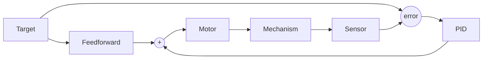

# 13. Feedforward

## Why it matters
PID only reacts **after** something goes wrong: it needs error before it does anything. That means a PID-only arm always sags a little below its target (the error has to exist to make the output that holds it up), and a PID-only flywheel always runs a little slow.

**Feedforward** predicts what the motor needs **before** there's any error, using a simple model of the mechanism. Most good FRC control is *mostly feedforward, with a little PID for cleanup*. Add feedforward and your PID gains get smaller, your mechanisms get faster and smoother, and tuning gets easier.


**Analogy: driving up a hill**

Feedforward is pressing the gas **because you see the hill coming**. PID is pressing harder **after you notice you're slowing down**. A good driver does both: most of the pedal from looking ahead, a little correction from feeling the speed.


## Read this
- [Introduction to DC Motor Feedforward](https://docs.wpilib.org/en/stable/docs/software/advanced-controls/introduction/introduction-to-feedforward.html)
- [Feedforward Control in WPILib](https://docs.wpilib.org/en/stable/docs/software/advanced-controls/controllers/feedforward.html)
- [Introduction to System Identification](https://docs.wpilib.org/en/stable/docs/software/advanced-controls/system-identification/introduction.html)

## Walkthrough

### Feedforward vs. feedback

| | Feedforward | Feedback (PID) |
|---|---|---|
| Uses | A model of the mechanism + the target | The error from a sensor |
| Acts | **Before** error appears | **After** error appears |
| Good at | The predictable part: gravity, friction, the voltage to hold a speed | The unpredictable part: bumps, game pieces, model mistakes |
| Needs a sensor? | No | Yes |
| On its own | Close, but drifts | Works, but lags and sags |

Used together, the output is simply added:

```
volts = feedforward(target) + PID(measurement, target)
```



### Where the voltage goes: the motor model
A DC motor's voltage goes to three jobs, plus a fourth for mechanisms that lift something:

| Term | Name | What the voltage is for | Unit |
|---|---|---|---|
| **kS** | Static | Overcoming friction, just to start moving | volts |
| **kV** | Velocity | Holding a speed (faster needs more voltage) | volts per (unit/second) |
| **kA** | Acceleration | Speeding up (accelerating takes extra) | volts per (unit/second²) |
| **kG** | Gravity | Holding the mechanism up against gravity | volts |

**Flywheel or drivetrain:**
```
volts = kS·sign(v) + kV·v + kA·a
```

`sign(v)` is +1 when moving forward and −1 when moving backward, because friction always opposes motion.

**Elevator** (gravity is the same at every height):
```
volts = kS·sign(v) + kG + kV·v + kA·a
```

**Arm** (gravity's pull depends on the angle):
```
volts = kS·sign(v) + kG·cos(θ) + kV·v + kA·a
```

### Why cos(θ) for an arm
Gravity pulls straight down. How much of that pull tries to **rotate** the arm depends on its angle:

| Arm angle (θ) | cos(θ) | Gravity's effect |
|---|---|---|
| 0° (horizontal) | 1.0 | Strongest. The full weight acts as torque. |
| 45° | 0.71 | About 71% |
| 90° (straight up) | 0.0 | None. The weight is directly over the pivot. |
| −90° (straight down) | 0.0 | None. The weight hangs from the pivot. |

So kG is the voltage needed to hold the arm **level**, and `kG·cos(θ)` gives the right amount at every other angle.

### A worked example
A flywheel has kS = 0.2 V and kV = 0.12 V per (rotation/second). To hold 50 rotations/second (3000 RPM):

```
volts = 0.2 + 0.12 × 50 = 6.2 V
```

Without any feedback at all, sending 6.2 V gets the flywheel close to 50 rot/s. PID then only has to correct small differences, like when a game piece passes through and slows the wheel.

### Why volts instead of percent?
Battery voltage sags during a match. 50% output at 12.5 V is 6.25 V to the motor; 50% at 10.5 V is only 5.25 V. Same command, different result.

Commanding **volts** with `setVoltage()` compensates for this: the motor controller adjusts the percent to deliver the voltage you asked for. Feedforward gains are measured in volts, so always use `setVoltage()` with feedforward.

```java
motor.setVoltage(6.2);   // ✅ 6.2 V, whatever the battery reads
motor.set(0.5);          // ❌ changes as the battery sags
```

### The WPILib classes

| Mechanism | Class | Constructor | `calculate(...)` takes |
|---|---|---|---|
| Flywheel, roller, drivetrain side | `SimpleMotorFeedforward` | `(kS, kV, kA)` | velocity |
| Elevator | `ElevatorFeedforward` | `(kS, kG, kV, kA)` | velocity |
| Arm | `ArmFeedforward` | `(kS, kG, kV, kA)` | angle (radians), velocity |

### Code it: a flywheel with feedforward + PID
```java
private final SimpleMotorFeedforward ff = new SimpleMotorFeedforward(kS, kV);
private final PIDController pid = new PIDController(kP, 0, 0);

public Command spinAt(double targetRotPerSec) {
    return run(() -> {
        double ffVolts  = ff.calculate(targetRotPerSec);
        double pidVolts = pid.calculate(getVelocityRotPerSec(), targetRotPerSec);
        motor.setVoltage(ffVolts + pidVolts);
    }).withName("Shooter " + targetRotPerSec);
}
```

Because feedforward does most of the work, kP here is small and only cleans up.

### Code it: an arm with feedforward + PID
```java
import edu.wpi.first.math.controller.ArmFeedforward;

private final ArmFeedforward ff = new ArmFeedforward(kS, kG, kV);
private final PIDController pid = new PIDController(kP, 0, kD);

public Command holdAt(double targetRadians) {
    return run(() -> {
        double ffVolts  = ff.calculate(targetRadians, 0.0);   // position, velocity
        double pidVolts = pid.calculate(getAngleRadians(), targetRadians);
        motor.setVoltage(ffVolts + pidVolts);
    }).withName("Arm hold");
}
```


**Angle convention**

`ArmFeedforward` expects **radians** with **0 = horizontal** and positive angles going up. If your encoder reads 0 when the arm hangs straight down, subtract π/2 before passing the angle in. Get this wrong and the gravity term pushes hardest at the wrong angle.


Here the velocity passed to feedforward is 0, because `holdAt` jumps straight to the target. In [Lesson 14](14-profiles.md), a motion profile supplies a real velocity for every step of the move, and kV and kA start pulling their weight.

### Getting the numbers
**Quick and dirty, by hand:**

1. **kG** (arm or elevator): slowly raise the voltage until the mechanism holds still without drifting. For an arm, do this with it horizontal. That voltage is roughly kG.
2. **kS**: on a flywheel or roller with no gravity, raise the voltage slowly from 0 until it just starts to turn. That's roughly kS.
3. **kV**: run at a few steady voltages, measure the speed each time, and calculate (volts − kS) ÷ speed.

**The right way:** use **SysId**. It runs the mechanism through test motions and calculates kS, kV, kA, and kG from real data. [Lesson 13.1](13b-sysid.md) walks through it step by step.

**For motors you haven't built yet:** WPILib's `DCMotor` models (like `DCMotor.getKrakenX60(1)`) and online calculators like ReCalc can estimate kV and kA from the motor, gear ratio, and load.

### Tuning with feedforward
1. Set kP, kI, and kD to 0.
2. Set the feedforward gains (from SysId, or by hand).
3. Run the mechanism. It should get **close** to the target with no PID at all.
4. Add a small kP to remove what's left. It'll be much smaller than your PID-only kP.
5. Add kD only if it overshoots.

## Try it
This is WPILib's vertical arm simulator, with **feedforward and feedback** together. Click a point around the arm's circle to set a new angle, or click and drag for smooth motion.


**Interactive simulator**

The simulator for this section runs in a web page, not in GitBook. Use it in either place:

- [This page on the course website](https://YOUR-USERNAME.github.io/frc-course/controls/13-feedforward.html)
- [Tuning a Vertical Arm Position Controller](https://docs.wpilib.org/en/stable/docs/software/advanced-controls/introduction/tuning-vertical-arm.html) in the WPILib docs (CC BY 4.0)



- [ ] Set every PID gain to 0. Set **kG** until the arm holds still at horizontal.
- [ ] Move the setpoint to other angles. Does the arm stay close with feedforward alone?
- [ ] Add a small kP to remove the remaining error
- [ ] Compare with your PID-only gains from Lesson 12. How much smaller is kP now? How much better does it hold?

In code:

- [ ] Calculate by hand the feedforward voltage for kS = 0.25, kV = 0.1, at 40 rot/s
- [ ] Add `ArmFeedforward` to your arm from Lesson 12, using `setVoltage()`
- [ ] In the **ArmSimulation** example, find kG by raising the voltage until the arm holds level

## Check yourself
<details>
<summary>What's the main difference between feedforward and feedback?</summary>

Feedforward predicts the output from a model **before** error appears. Feedback (PID) reacts to error **after** it appears.

</details>

<details>
<summary>Why does a PID-only arm sag a little below its target?</summary>

PID only produces output when there's error. Holding the arm up takes output, so some error has to exist to produce it.

</details>

<details>
<summary>Why does an arm use `cos(θ)` for gravity but an elevator doesn't?</summary>

Gravity's torque on an arm depends on its angle: maximum when horizontal, zero when vertical. An elevator lifts the same weight at every height.

</details>

<details>
<summary>kS = 0.3 V and kV = 0.15 V per (m/s). How many volts does feedforward give at 2 m/s?</summary>

0.3 + 0.15 × 2 = **0.6 V**

</details>

<details>
<summary>Why is `setVoltage()` better than `set()` with feedforward?</summary>

Feedforward gains are in volts. `setVoltage()` delivers that voltage no matter how much the battery has sagged, so the same command produces the same motion all match.

</details>
