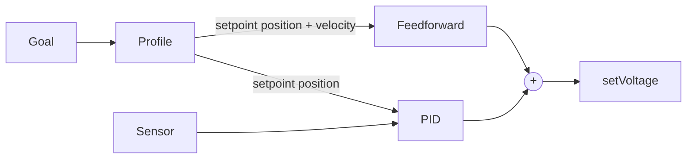

# 14. Motion Profiles

## Why it matters
When you tell an arm to go from 0° to 90° with plain PID, the error jumps from 0 to 90° instantly. The controller responds with a huge output, the arm launches toward the target as fast as it can, overshoots, and stresses the gearbox, the belts, and anything it's holding. You're effectively asking for **infinite acceleration**.

A **motion profile** plans a smooth path instead: speed up gently, cruise, slow down gently, and arrive. Every 20 ms the profile hands the controller a small, reachable step instead of the far-away final target. The result is faster, smoother, more repeatable motion, and much easier tuning.

## Read this
- [Trapezoidal Motion Profiles](https://docs.wpilib.org/en/stable/docs/software/advanced-controls/controllers/trapezoidal-profiles.html)
- [Combining Motion Profiling and PID (ProfiledPIDController)](https://docs.wpilib.org/en/stable/docs/software/advanced-controls/controllers/profiled-pidcontroller.html)
- [Tuning a Vertical Elevator with Motion Profiling](https://docs.wpilib.org/en/stable/docs/software/advanced-controls/introduction/tuning-elevator.html), with an interactive simulator

## Walkthrough

### Goal vs. setpoint
This distinction is the key to the whole lesson:

| | Goal | Setpoint |
|---|---|---|
| What it is | Where you ultimately want to end up | Where the profile says you should be **right now** |
| Changes | When you choose a new target | Every 20 ms |
| Example | 90° | 37.2°, moving at 85°/s |

Without a profile, the setpoint **is** the goal. With a profile, the setpoint moves smoothly toward the goal, and the controller only ever chases the setpoint.

### The trapezoid
A trapezoidal profile has three phases. Plotted as velocity over time, it makes a trapezoid:

```
velocity
   ▲        ________________
   │       /                \
   │      /     cruise       \
   │     /                    \
   │    / accelerate  decelerate\
   └───────────────────────────────► time
```

1. **Accelerate** at the maximum acceleration until reaching the maximum velocity.
2. **Cruise** at the maximum velocity.
3. **Decelerate** at the maximum acceleration so you stop exactly at the goal.

You choose two numbers, the **constraints**:

| Constraint | What it limits | Too high | Too low |
|---|---|---|---|
| **Max velocity** | Top speed | The motor can't keep up, so the mechanism falls behind the profile | Slow moves |
| **Max acceleration** | How fast speed changes | Jerky starts and stops, the motor can't keep up | Sluggish starts |

For short moves, the mechanism never reaches max velocity. It accelerates, then immediately decelerates, and the trapezoid becomes a **triangle**.

### A worked example
An arm moves 90° with max velocity 180°/s and max acceleration 360°/s².

- **Accelerating** from 0 to 180°/s at 360°/s² takes 180 ÷ 360 = **0.5 s** and covers ½ × 360 × 0.5² = **45°**.
- **Decelerating** takes the same: **0.5 s** and **45°**.
- That's already 90°, so there's **no cruise**: the profile is a triangle.

Total move time: **1.0 s**. Halfway through (0.5 s) the arm should be at 45°, moving at 180°/s. Every 20 ms in between, the profile gives an exact position and velocity.

### Why this works so well with feedforward
The profile gives you not just a position at every moment, but also a **velocity** (and acceleration). That's exactly what feedforward from [Lesson 13](13-feedforward.md) needs:

- `kV × velocity` supplies the voltage to keep up with the planned speed.
- `kA × acceleration` supplies the extra voltage to speed up and slow down on schedule.
- `kG·cos(θ)` holds the arm up along the way.

So feedforward does almost all the work of following the profile, and PID only corrects small differences. This is the same structure top teams use:



**Profile → feedforward (prediction) → PID (correction).**

### Option 1: ProfiledPIDController
`ProfiledPIDController` combines a trapezoidal profile and a PID controller in one object:

```java
import edu.wpi.first.math.controller.ArmFeedforward;
import edu.wpi.first.math.controller.ProfiledPIDController;
import edu.wpi.first.math.trajectory.TrapezoidProfile;

private final ProfiledPIDController controller = new ProfiledPIDController(
    kP, 0, kD,
    new TrapezoidProfile.Constraints(MAX_VEL_RAD_PER_S, MAX_ACCEL_RAD_PER_S2)
);
private final ArmFeedforward ff = new ArmFeedforward(kS, kG, kV, kA);

public Command goTo(double targetRadians) {
    return run(() -> {
        // PID on the profile's current setpoint, which moves toward the goal
        double pidVolts = controller.calculate(getAngleRadians(), targetRadians);
        TrapezoidProfile.State setpoint = controller.getSetpoint();
        double ffVolts = ff.calculate(setpoint.position, setpoint.velocity);
        motor.setVoltage(pidVolts + ffVolts);
    })
    .beforeStarting(() -> controller.reset(getAngleRadians(), getVelocityRadPerSec()))
    .withName("Arm to " + targetRadians);
}
```

| Line | What it does |
|---|---|
| `controller.calculate(measurement, goal)` | Advances the profile 20 ms toward the goal, then runs PID against the new setpoint |
| `controller.getSetpoint()` | Where the profile says to be **right now**: `.position` and `.velocity` |
| `ff.calculate(setpoint.position, setpoint.velocity)` | Feedforward for that exact point on the path |
| `controller.reset(position, velocity)` | Starts the profile from where the arm **actually** is |


**Always reset before a new move**

If you don't call `reset()` with the current position, the profile starts from wherever it last ended, possibly far from where the arm is now. The first loop then sees a huge error and the arm lurches. `.beforeStarting(...)` makes sure it happens every time the command starts.



**This command doesn't end**

`goTo` keeps running after it arrives, so the arm keeps holding the goal against gravity. To make it end, add `.until(controller::atGoal)`, but then something else must hold the arm.


### Option 2: TrapezoidProfile on its own
Sometimes you want the profile without WPILib's PID, for example to feed setpoints to a motor controller's onboard PID. Use `TrapezoidProfile` directly:

```java
private final TrapezoidProfile profile = new TrapezoidProfile(
    new TrapezoidProfile.Constraints(MAX_VEL, MAX_ACCEL));
private TrapezoidProfile.State setpoint = new TrapezoidProfile.State();

public Command goTo(double goalPosition) {
    TrapezoidProfile.State goal = new TrapezoidProfile.State(goalPosition, 0);
    return runOnce(() -> setpoint = new TrapezoidProfile.State(getPosition(), getVelocity()))
        .andThen(run(() -> {
            setpoint = profile.calculate(0.020, setpoint, goal);   // advance 20 ms
            // send setpoint.position and setpoint.velocity to your controller
        }));
}
```

### Choosing constraints
1. **Find what the mechanism can actually do.** A rough maximum velocity is about 80% of free speed at the mechanism (motor free speed ÷ gear ratio). Leave headroom so the motor can catch up when it falls behind.
2. **Start slow.** Use about half that velocity and a modest acceleration, so the first tests are gentle.
3. **Raise them** until moves are as fast as you need, or until the mechanism starts lagging behind the profile.
4. **Watch for lag.** Graph the setpoint and the measured position together. If the measurement falls further and further behind during a move, your constraints are more than the motor can deliver.


**Graph three things while tuning**

The **goal**, the **setpoint**, and the **measured position**. The setpoint should glide toward the goal, and the measurement should follow the setpoint closely. Big gaps between the setpoint and measurement mean feedforward or PID needs work; a setpoint that jumps means the profile isn't being reset.


### Elevators work the same way
Swap `ArmFeedforward` for `ElevatorFeedforward`, and use meters and meters per second instead of radians. Everything else is identical.

### On-controller profiles
Modern motor controllers can run profiles **on the controller itself** at much faster rates:

- CTRE TalonFX: **Motion Magic**
- REV SPARK MAX / Flex: **MAXMotion**

You give them the constraints and feedforward gains once, then just send a goal. They're excellent and widely used. Learn the WPILib version first so you understand what they're doing and can tune them.

## Try it
- [ ] By hand: an elevator moves 1.2 m with max velocity 1.5 m/s and max acceleration 3 m/s². Is the profile a trapezoid or a triangle? How long does the move take?
- [ ] Open the **ArmSimulation** example project
- [ ] Replace its controller with a `ProfiledPIDController` plus `ArmFeedforward`
- [ ] Bind two buttons to two angles and tune it to move smoothly between them
- [ ] Graph the goal, setpoint, and measured angle together in Glass or AdvantageScope
- [ ] Remove the `.beforeStarting(...)` reset and see what happens on the first move. Then put it back.

## Check yourself
<details>
<summary>What's the difference between the goal and the setpoint?</summary>

The goal is where you finally want to be. The setpoint is where the profile says to be right now, and it moves toward the goal every loop.

</details>

<details>
<summary>Why does a motion profile reduce overshoot?</summary>

The setpoint moves gradually and slows down near the goal, so the controller never sees a huge sudden error.

</details>

<details>
<summary>When does a trapezoidal profile become a triangle?</summary>

When the move is too short to reach max velocity before it has to start slowing down.

</details>

<details>
<summary>Why feed the profile's setpoint velocity into feedforward instead of the final goal?</summary>

Feedforward needs to know how fast the mechanism *should* be moving right now, and that's the profile's current setpoint. At the goal, the velocity is 0.

</details>

<details>
<summary>Why must you call `reset()` before each move?</summary>

So the profile starts from the mechanism's actual position. Otherwise the first setpoint can be far from reality and the mechanism lurches.

</details>

<details>
<summary>The measured position falls further behind the setpoint during every move. What should you change?</summary>

Lower the max velocity or acceleration, because the motor can't keep up, or improve the feedforward gains (kV and kA).

</details>
