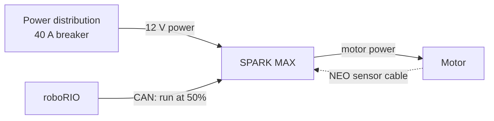

# 4.2 The SPARK MAX Motor Controller

## Why it matters
Every motor in the labs runs through a **SPARK MAX**: 7 of them across the test bed and West Coast Drive. When a motor doesn't move, or moves the wrong way, or two motors fight each other, the answer is almost always in how its SPARK MAX is wired or set up.

This lesson covers what a SPARK MAX does, how it connects to the roboRIO, and how to check and set it up with the **REV Hardware Client** before you ever write code.

## Read this
- [SPARK MAX Basic Configuration (REV)](https://docs.revrobotics.com/brushless/spark-max/gs/basic-config)
- [Using Encoders with the SPARK MAX (REV)](https://docs.revrobotics.com/brushless/spark-max/encoders)
- [REVLib documentation](https://docs.revrobotics.com/revlib)

## Walkthrough

### What a motor controller does
The roboRIO can't power a motor directly. Its outputs are tiny signals. A **motor controller** sits between the battery power and the motor, and turns a small signal ("run at 50% forward") into the big, fast-switching current the motor actually needs.



A SPARK MAX can drive **brushed** motors (CIM, 775pro) and **brushless** NEOs ([Lesson 4.1](04b-motors.md)).

### The connections on a SPARK MAX

| Connection | What plugs in |
|---|---|
| **Power input** (red and black) | 12 V from the power distribution, through a breaker |
| **Motor output** | The motor's power wires: 2 for brushed, 3 for a NEO |
| **Encoder port** | A NEO's sensor cable, or an encoder for a brushed motor |
| **CAN** (yellow and green) | The CAN bus to the roboRIO and other devices |
| **PWM** | An alternative to CAN for simple speed control (we use CAN) |
| **USB-C** | Your laptop, for setup with the REV Hardware Client |
| **Data port** (on top) | Limit switches and extra encoders (advanced) |

### CAN IDs
All 7 SPARK MAXes share the same CAN bus ([Lesson 4](04-electronics.md)), so each one needs a **unique CAN ID**. That number is how your code picks which controller to talk to:

```java
new SparkMax(8, MotorType.kBrushless);   // "the SPARK MAX with CAN ID 8"
```

| Robot | Controller | CAN ID |
|---|---|---|
| Test bed | NEO | 8 |
| Test bed | 775pro wheel | (check yours) |
| WCD | Left leader, left follower, right leader, right follower | 1, 2, 3, 4 (check yours) |
| WCD | Elevator NEO | (check yours) |


**Duplicate IDs**

If two SPARK MAXes on the same robot share an ID, motors twitch, don't respond, or the wrong one moves. Fill in the real IDs above for your robots and keep the list posted.


### Setting up with the REV Hardware Client
Before writing code, connect each SPARK MAX to your laptop with **USB-C** and open the **REV Hardware Client** (installed in [Lab 0](../testbed/lab0-first-project.md)). With it you can:

| Task | Why |
|---|---|
| **See the CAN ID**, and change it | Make sure it matches your code |
| **Update firmware** | Firmware should match your REVLib version. Ask a mentor before updating. |
| **Check the motor type** (brushed or brushless) | Must match the motor actually attached |
| **Spin the motor** right from the laptop | Proves the controller and motor work, with no robot code involved |
| **See faults and live values** | Current, temperature, and any errors |


**Debug in layers**

If a motor won't move from your code, try spinning it from the REV Hardware Client. If it spins there, the hardware is fine and the problem is in your code (CAN ID, motor type, or command). If it doesn't spin there either, it's wiring or hardware.


### The status light
The SPARK MAX's LED changes color and blink pattern to show its state: whether it's getting a signal, whether it's in brake or coast mode, which direction it's driving, and any faults. The full color table is in REV's SPARK MAX documentation. Learn the few you see most on your robots, especially the ones for "no signal" and "fault."

### Settings your code sends
Every lab configures its SPARK MAXes the same way, with a `SparkMaxConfig`:

| Setting | Code | What it does |
|---|---|---|
| Motor type | `new SparkMax(id, MotorType.kBrushed)` or `kBrushless` | Brushed or brushless driving. Must match the motor. |
| Current limit | `config.smartCurrentLimit(40)` | Caps current to protect the motor, breaker, and battery |
| Idle mode | `config.idleMode(IdleMode.kBrake)` | **Brake:** resists turning when stopped. **Coast:** spins freely. |
| Inversion | `config.inverted(true)` | Flips which way is "forward" |
| Follower | `config.follow(leaderCanId)` | Copies another SPARK MAX's output ([Lab 2](../testbed/lab2-west-coast-drive.md)) |

The settings are sent once, when the robot code starts:

```java
m_motor.configure(config, ResetMode.kResetSafeParameters, PersistMode.kPersistParameters);
```

| Option | Meaning |
|---|---|
| `kResetSafeParameters` | Start from known defaults, then apply your settings, so leftovers from someone else's code can't sneak in |
| `kPersistParameters` | Save the settings in the SPARK MAX, so they survive if it loses power for a moment, like during a brownout |

### Brake vs. coast
| | Brake | Coast |
|---|---|---|
| When output is 0 | Shorts the motor's coils, so it **resists** turning | Lets the motor spin freely |
| Feels like | Stops quickly | Rolls to a stop |
| Good for | Elevators (slows falling), precise stops, drivetrains for most drivers | Shooter flywheels (no sudden stop), pushing a robot by hand |

### Leaders and followers
When two motors drive the same gearbox, like the WCD's CIMs, one SPARK MAX is the **leader** and the other is its **follower**. Your code commands only the leader, and the follower copies it automatically over CAN. The two motors in one gearbox must always push the same way, or they fight each other, overheat, and trip breakers ([Lab 2](../testbed/lab2-west-coast-drive.md)).

## Try it
- [ ] Connect each test bed SPARK MAX to the REV Hardware Client. Write down its CAN ID and motor type.
- [ ] Do the same for all 5 SPARK MAXes on the WCD, and fill in the CAN ID table above
- [ ] Spin the test bed NEO from the REV Hardware Client, with no robot code
- [ ] Trace one SPARK MAX's power wires back to its breaker, and its CAN wires to the next device on the bus
- [ ] Look up the status light table in REV's docs. What does the light show when a SPARK MAX has no signal?
- [ ] Spin the NEO in Lab 1 with brake mode, then coast mode. Describe the difference when it stops.

## Check yourself
<details>
<summary>Why can't the roboRIO power a motor directly?</summary>

Its outputs are small signals. A motor controller turns that signal into the large current the motor needs.

</details>

<details>
<summary>What does a CAN ID do?</summary>

It identifies one device on the shared CAN bus, so your code can talk to the right SPARK MAX.

</details>

<details>
<summary>A motor won't move from your code, but spins fine from the REV Hardware Client. Where's the problem?</summary>

In the code: most likely a wrong CAN ID, wrong motor type, or a command that isn't running.

</details>

<details>
<summary>Why use `kPersistParameters`?</summary>

So the SPARK MAX keeps its settings, like the current limit, if it loses power for a moment and restarts during a match.

</details>

<details>
<summary>Why does the elevator use brake mode?</summary>

In brake mode the motor resists turning when it isn't powered, which slows the carriage if it starts to fall.

</details>

<details>
<summary>What happens if a follower in the same gearbox pushes the opposite way from its leader?</summary>

The two motors fight each other. They heat up, draw a lot of current, and can trip breakers or damage the gearbox.

</details>
