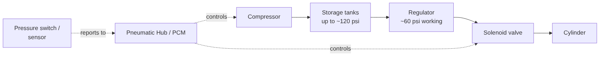

# 5. Pneumatics

## Why it matters
Pneumatics use **compressed air** to push and pull pistons. They're great for mechanisms that only need two positions, moved fast and with force:

- a claw: open or closed
- an intake: deployed or stowed
- a gearbox: high gear or low gear
- a climber hook: extended or retracted

Pneumatics are simple to control in code (usually just "extend" or "retract"), but they come with their own hardware, safety rules, and failure modes. Many teams have moved away from pneumatics in recent years, but they still show up often, so you should know how they work.

## Read this
- [Wiring Pneumatics - REV Pneumatic Hub](https://docs.wpilib.org/en/stable/docs/hardware/hardware-basics/wiring-pneumatics-ph.html)
- [Pneumatics APIs](https://docs.wpilib.org/en/stable/docs/software/hardware-apis/pneumatics/index.html)

## Walkthrough

### The air path



| Part | Job |
|---|---|
| **Compressor** | An electric pump that fills the tanks with air |
| **Storage tanks** | Hold a supply of air so mechanisms can move many times between refills |
| **Pressure switch or analog pressure sensor** | Tells the control module when the tanks are full so the compressor stops |
| **Relief valve** | Vents air automatically if the pressure gets dangerously high. A required safety part. |
| **Regulator** | Lowers tank pressure to a steady, lower working pressure for the mechanisms |
| **Gauges** | Show the stored and working pressure so you can see them at a glance |
| **Solenoid valve** | An electrically controlled valve. **This is what your code switches.** |
| **Cylinder (piston)** | Moves in or out when air is sent to one side or the other |
| **Pneumatic Hub (REV) or PCM (CTRE)** | The control module: runs the compressor and powers the solenoids, connected to the roboRIO over CAN |
| **Dump (vent) valve** | A manual valve that releases all the stored air |

### Why two pressures?
The tanks store air at high pressure (up to about 120 psi) so they hold a lot of it. The mechanisms run at a lower working pressure (about 60 psi) from the regulator, which keeps the force steady and stays within the rules. As the tanks drain during a match, the working pressure stays the same until the tanks drop below it.


**Safety first**

Stored air is stored energy, and a cylinder can move with real force without warning.

- Always **open the dump valve** and check that the gauges read zero before touching fittings, tubing, or cylinders.
- Wear safety glasses around pressurized systems.
- Keep hands out of a pneumatic mechanism's path, even when the robot is disabled. A valve can still be holding air in the cylinder.


### How a cylinder moves
A double-acting cylinder has two ports. Air into one side pushes the piston **out**; air into the other side pulls it **in**. The solenoid valve decides which side gets air.

**Single vs. double solenoids:**

| | Single solenoid | Double solenoid |
|---|---|---|
| Control wires | One channel | Two channels (forward and reverse) |
| Powered | Moves to one position | Forward channel: one way. Reverse channel: the other way. |
| Unpowered | A spring returns the valve to its rest position | Usually stays wherever it was last set |
| When the robot disables | Returns to rest position | Usually holds its last position |
| Good for | Mechanisms with a clear safe position | Mechanisms that should hold position when disabled |


**What happens when the robot disables matters**

When the robot is disabled at the end of a match, all solenoid outputs turn off. A single-solenoid intake springs back to its rest position, which might drop a game piece. A double-solenoid claw usually stays where it was. Your mechanism team should choose the valve with this in mind.


### Code it
WPILib needs to know which control module you have. Use `PneumaticsModuleType.REVPH` for a REV Pneumatic Hub or `PneumaticsModuleType.CTREPCM` for a CTRE PCM.

**A double solenoid:**
```java
import edu.wpi.first.wpilibj.DoubleSolenoid;
import edu.wpi.first.wpilibj.PneumaticsModuleType;
import edu.wpi.first.wpilibj2.command.Command;
import edu.wpi.first.wpilibj2.command.SubsystemBase;

public class Claw extends SubsystemBase {
    // Forward channel 0, reverse channel 1 on the Pneumatic Hub
    private final DoubleSolenoid piston =
        new DoubleSolenoid(PneumaticsModuleType.REVPH, 0, 1);

    public Command open() {
        return runOnce(() -> piston.set(DoubleSolenoid.Value.kForward));
    }

    public Command close() {
        return runOnce(() -> piston.set(DoubleSolenoid.Value.kReverse));
    }

    public Command toggle() {
        return runOnce(piston::toggle);
    }
}
```

| `DoubleSolenoid.Value` | Meaning |
|---|---|
| `kForward` | Power the forward channel |
| `kReverse` | Power the reverse channel |
| `kOff` | Power neither. The valve usually stays where it was. |

**A single solenoid:**
```java
private final Solenoid intakeDeploy = new Solenoid(PneumaticsModuleType.REVPH, 2);

public Command deploy() { return runOnce(() -> intakeDeploy.set(true)); }
public Command stow()   { return runOnce(() -> intakeDeploy.set(false)); }
```

**Bind them to buttons** in `RobotContainer`:
```java
driver.leftBumper().onTrue(claw.open());
driver.rightBumper().onTrue(claw.close());
```

Each command is `runOnce` because setting a solenoid is instant: it sends the signal and is done. The air does the rest.

### The compressor
The compressor runs automatically by default whenever the robot is enabled and the tanks aren't full. You can create a `Compressor` object to check it or change its behavior:

```java
private final Compressor compressor = new Compressor(PneumaticsModuleType.REVPH);

@Override
public void periodic() {
    SmartDashboard.putBoolean("Pneumatics/Compressor Running", compressor.isEnabled());
    SmartDashboard.putNumber("Pneumatics/Pressure (psi)", compressor.getPressure());
}
```

`getPressure()` only works if the robot has an **analog pressure sensor** wired to the Pneumatic Hub.


**Turn the compressor off when you need power**

The compressor pulls a lot of current. Some teams disable it during climbing or other high-power moments to avoid brownouts: `compressor.disable()`, then `compressor.enableDigital()` (or `enableAnalog(min, max)` with a pressure sensor) afterward.


### Troubleshooting

| Symptom | Likely cause |
|---|---|
| Nothing moves, compressor never runs | Pneumatic Hub not powered, wrong module type in code, or its CAN ID doesn't match |
| Compressor runs but pressure never builds | A leak. Listen for hissing, check fittings, or a tank or the dump valve is open. |
| Mechanism moves the wrong direction | Tubes swapped on the cylinder, or forward and reverse channels swapped in code |
| Mechanism moves slowly or weakly | Working pressure too low, or the tanks are nearly empty |
| Solenoid clicks but the cylinder doesn't move | No air reaching the valve, or a kinked or disconnected tube |

## Try it
With a mentor, on a robot with pneumatics:

- [ ] Find each part in the table: compressor, tanks, relief valve, regulator, gauges, solenoids, cylinders, dump valve
- [ ] Trace the air from the compressor to one cylinder
- [ ] Find which solenoid channels your team's mechanism uses
- [ ] Write `open()` and `close()` commands and bind them to two buttons
- [ ] Put the compressor status on the dashboard and watch it turn off when the tanks are full
- [ ] Vent the system with the dump valve and confirm both gauges read zero

## Check yourself
<details>
<summary>Why is there a regulator between the tanks and the solenoids?</summary>

The tanks store air at high pressure for capacity, while mechanisms run at a lower, steady working pressure. The regulator steps it down.

</details>

<details>
<summary>Why do solenoid commands use `runOnce` instead of `run`?</summary>

Setting a solenoid is a single, instant action. Once the valve is switched, there's nothing more for the command to do every loop.

</details>

<details>
<summary>A single-solenoid intake is deployed when the match ends. What happens when the robot disables?</summary>

The solenoid loses power and its spring returns it to the rest position, so the intake moves to wherever that is, probably stowed.

</details>

<details>
<summary>The compressor runs constantly and pressure never reaches the target. What's the most likely problem?</summary>

A leak somewhere in the system, or the dump valve left open.

</details>

<details>
<summary>What must you do before touching a cylinder or fitting?</summary>

Open the dump valve and confirm both gauges read zero.

</details>
