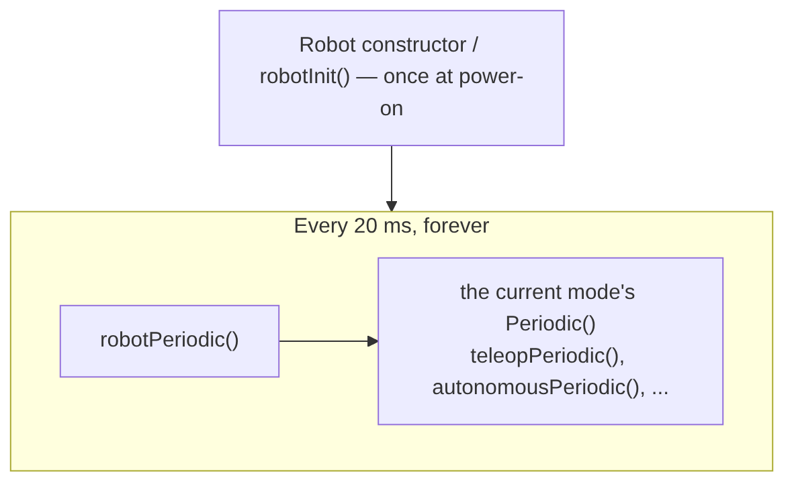

# 6. How a Robot Program Runs

## Why it matters
Robot code is not like a normal program that starts, runs top to bottom, and exits. A robot program starts once and then **repeats the same code about 50 times a second** until the robot is turned off. Every sensor read, motor command, and button check happens inside that repeating loop.

Once you understand **the loop**, everything else in this course makes sense: why you never wait inside your code, why commands are built the way they are, and why "loop overrun" warnings matter.

## Read this
- [What is WPILib?](https://docs.wpilib.org/en/stable/docs/software/what-is-wpilib.html)
- [Creating a Robot Program](https://docs.wpilib.org/en/stable/docs/software/vscode-overview/creating-robot-program.html), especially the TimedRobot section

## Walkthrough

### What happens when the robot turns on
1. The roboRIO boots and starts your program by calling `Main.main()`.
2. `main()` creates your `Robot` object. Its constructor (or `robotInit()`) runs **once**, and this is where `RobotContainer` creates all your subsystems and binds your buttons.
3. The program enters the loop and stays there until power is cut.

### Robot modes
The Driver Station tells the robot which **mode** it's in. Each mode has its own pair of methods in `Robot.java`:

| Mode | When | Methods |
|---|---|---|
| **Disabled** | Before and after a match, and any time the robot isn't enabled | `disabledInit()`, `disabledPeriodic()` |
| **Autonomous** | The first 15 seconds of a match, no driver input | `autonomousInit()`, `autonomousPeriodic()` |
| **Teleop** | The rest of the match, drivers in control | `teleopInit()`, `teleopPeriodic()` |
| **Test** | Practice and tuning only, never in a match | `testInit()`, `testPeriodic()` |
| *(every mode)* | Always | `robotPeriodic()` |

- An **`Init()`** method runs **once**, when the robot enters that mode.
- A **`Periodic()`** method runs **every loop** while the robot is in that mode.
- `robotPeriodic()` runs **every loop in every mode**, including disabled.

### The 20 ms loop
`TimedRobot` calls your periodic methods every **20 milliseconds**, which is **50 times per second**:



One loop, start to finish, typically looks like this:

1. Read the joysticks and sensors.
2. Decide what each mechanism should do.
3. Set motor outputs.
4. Return, and wait for the next 20 ms tick.

Each loop is a **snapshot**: "Given what I see right now, what should every motor do right now?" Then 20 ms later, you answer the question again with fresh data.

### A full match, step by step
| Time | What the Driver Station does | What runs |
|---|---|---|
| Before the match | Robot is disabled | `disabledInit()` once, then `disabledPeriodic()` every 20 ms |
| 0:00 | Field starts autonomous | `autonomousInit()` once, then `autonomousPeriodic()` every 20 ms |
| 0:15 | Autonomous ends, brief disable | `disabledInit()`, `disabledPeriodic()` |
| 0:18 | Teleop starts | `teleopInit()` once, then `teleopPeriodic()` every 20 ms |
| 2:33 | Match ends | `disabledInit()`, `disabledPeriodic()` |

`robotPeriodic()` runs in every row.

### The golden rule


**Never block the loop**

Your code has 20 ms to finish each loop. Do a little work, then **return**. Next loop, do a little more.

No `Thread.sleep()`. No `while` loops that wait for something. No slow work like reading a big file.


Here's why. Suppose you want to run a motor for 2 seconds:

```java
// ❌ BAD: freezes the robot for 2 seconds
motor.set(0.5);
Thread.sleep(2000);
motor.set(0);
```

During those 2 seconds, the loop is stuck. Nothing else runs: the drivetrain ignores the joysticks, other mechanisms freeze, and the robot can't even respond to being disabled. The roboRIO's **motor safety** feature may also shut off motors because they stopped getting updates.

The right way spreads the work across many loops. Each loop checks how much time has passed:

```java
// ✅ GOOD: checked once per loop, finishes in microseconds
private final Timer timer = new Timer();

@Override
public void autonomousInit() {
    timer.restart();        // start timing when auto begins
}

@Override
public void autonomousPeriodic() {
    if (timer.get() < 2.0) {
        motor.set(0.5);
    } else {
        motor.set(0);
    }
}
```

Over 2 seconds, `autonomousPeriodic()` runs 100 times. Each time it asks "has it been 2 seconds yet?" and sets the motor accordingly. Every other part of the robot keeps running the whole time.

The same goes for waiting on a sensor:

```java
// ❌ BAD: waits forever if the switch never closes
while (!limitSwitch.get()) {
    motor.set(0.3);
}

// ✅ GOOD: one check per loop
if (!limitSwitch.get()) {
    motor.set(0.3);
} else {
    motor.set(0);
}
```


**This is why command-based programming exists**

Writing every mechanism as timers and if statements inside `teleopPeriodic()` gets messy fast. Commands ([Lesson 7](07-command-based.md)) are a cleaner way to write "do this a little each loop until it's done." Under the hood, they follow exactly this rule.


### Loop overruns
If your code takes longer than 20 ms, the console prints a warning:

```
Warning: Loop time of 0.02s overrun
    teleopPeriodic(): 0.045s
    robotPeriodic(): 0.001s
```

That means the next loop started late. An occasional overrun isn't a disaster, but frequent ones make the robot sluggish and unpredictable. The warning shows which method took the time, so you know where to look.

Common causes: `Thread.sleep()`, waiting loops, printing too much with `System.out.println` every loop, or slow work like file reads.

### Where your code goes in the Command Robot template
In the template you created in Lesson 0, `Robot.java` is short, and you'll rarely edit it:

```java
public class Robot extends TimedRobot {
    private Command autonomousCommand;
    private final RobotContainer robotContainer;

    public Robot() {
        robotContainer = new RobotContainer();   // builds subsystems, binds buttons
    }

    @Override
    public void robotPeriodic() {
        CommandScheduler.getInstance().run();    // runs all commands, every loop
    }

    @Override
    public void autonomousInit() {
        autonomousCommand = robotContainer.getAutonomousCommand();
        if (autonomousCommand != null) {
            autonomousCommand.schedule();
        }
    }

    @Override
    public void teleopInit() {
        if (autonomousCommand != null) {
            autonomousCommand.cancel();          // stop auto when teleop starts
        }
    }
}
```

The important line is `CommandScheduler.getInstance().run()` in `robotPeriodic()`. Every loop, the **command scheduler** runs your commands, checks your buttons, and calls your subsystems' `periodic()` methods. You'll write subsystems and commands; the scheduler decides when they run. [Lesson 7.1](07b-scheduler.md) covers it in detail.

## Try it
- [ ] Open your project's `Robot.java` and find each mode's `Init()` and `Periodic()` methods
- [ ] Add a counter field. Increase it in `robotPeriodic()` and print it every 50th loop (`if (count % 50 == 0)`). Run in simulation. Does it print about once per second?
- [ ] Add a print to `teleopInit()` and `disabledInit()`. Switch modes in the Sim GUI and watch when each prints.
- [ ] Put `Thread.sleep(100);` in `teleopPeriodic()` (you'll need to wrap it in `try { } catch (InterruptedException e) { }`). Enable teleop and read the loop overrun warnings. Then remove it.
- [ ] Use a `Timer` to print "Two seconds!" exactly once, two seconds after teleop starts

## Check yourself
<details>
<summary>How many times per second does `teleopPeriodic()` run?</summary>

About 50, once every 20 ms.

</details>

<details>
<summary>What's the difference between `teleopInit()` and `teleopPeriodic()`?</summary>

`teleopInit()` runs once when teleop starts. `teleopPeriodic()` runs every loop for the rest of teleop.

</details>

<details>
<summary>Which method runs in every mode, including disabled?</summary>

`robotPeriodic()`

</details>

<details>
<summary>Why does `Thread.sleep()` cause a *loop overrun* warning?</summary>

The loop has 20 ms to finish. Sleeping blocks it, so the next loop starts late and the whole robot stops responding until it's done.

</details>

<details>
<summary>How do you run a motor for 2 seconds without blocking?</summary>

Start a `Timer` when the action begins, then check `timer.get()` every loop and stop the motor once it passes 2 seconds.

</details>
