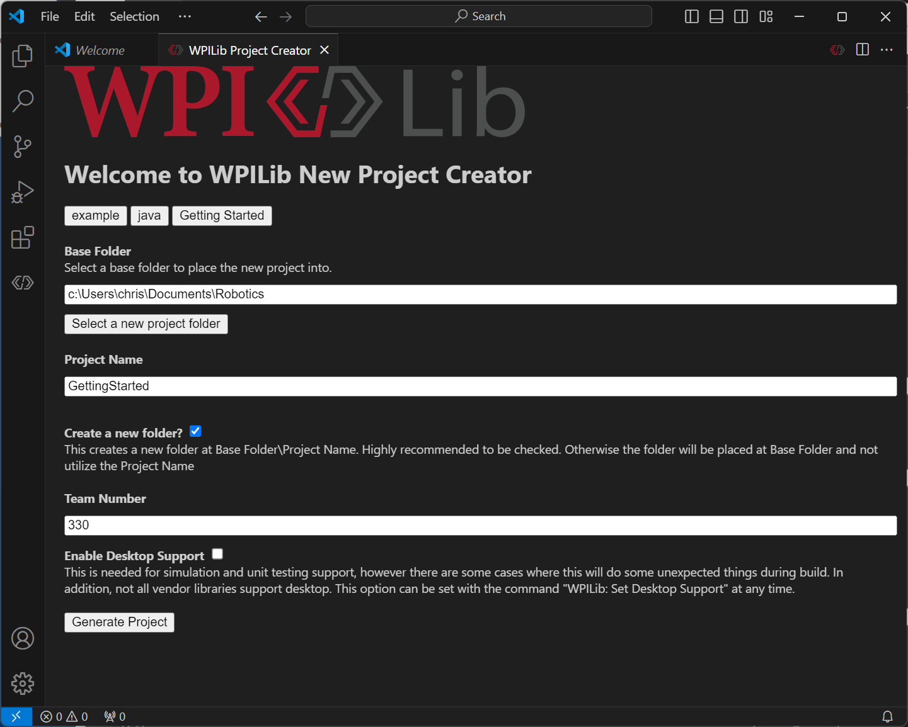
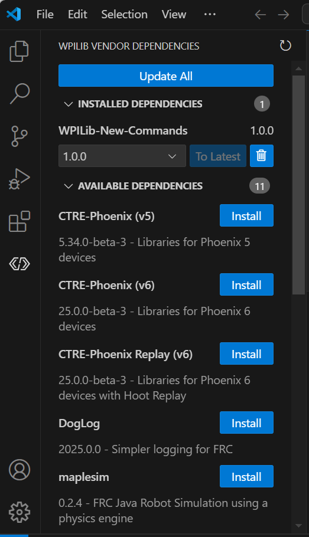
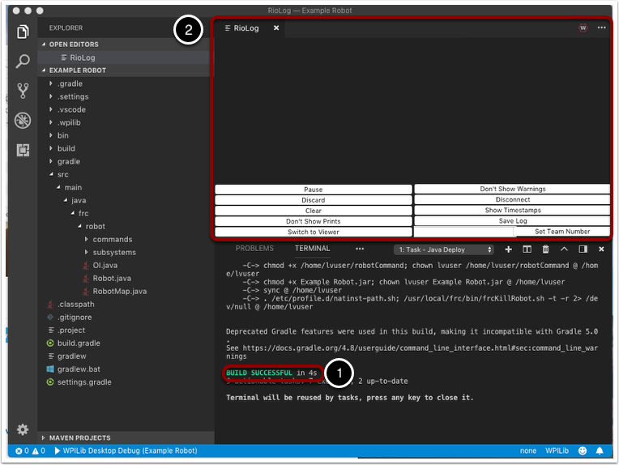
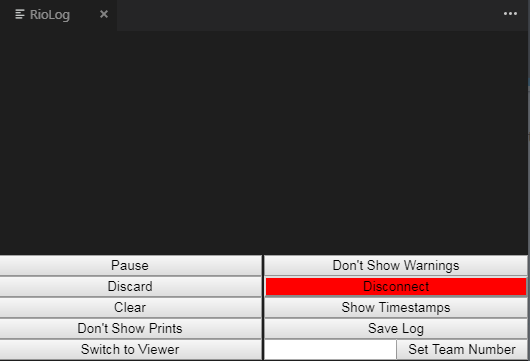

# Lab 0: Set Up and Create the TestBed Project

## Why it matters
Before you can make anything move, you need the right tools on your laptop and a project that can reach the test bed. That's this lab. Nothing will spin yet. By the end you'll have:

- every program an FRC programmer needs, installed
- a robot project named **TestBed**, with REV's library added
- that project **deployed** to the test bed's roboRIO
- a message you wrote, printed by the real robot

You'll keep using this **same TestBed project** in every lab after this one, so take your time and get it right.

## Read this
- [WPILib Installation Guide](https://docs.wpilib.org/en/stable/docs/zero-to-robot/step-2/wpilib-setup.html)
- [FRC Game Tools](https://docs.wpilib.org/en/stable/docs/zero-to-robot/step-2/frc-game-tools.html)
- [3rd Party Libraries (vendor dependencies)](https://docs.wpilib.org/en/stable/docs/software/vscode-overview/3rd-party-libraries.html)
- [Building and Deploying Robot Code](https://docs.wpilib.org/en/stable/docs/software/vscode-overview/deploying-robot-code.html)

## Walkthrough

### Part 1: Install the tools
Install all four. Each one is free. Use **this season's** version of each, the same as the rest of the team.

| Program | What it's for | Where to get it |
|---|---|---|
| **WPILib** | VS Code, Java, and the tools to build and deploy robot code | [WPILib Installation Guide](https://docs.wpilib.org/en/stable/docs/zero-to-robot/step-2/wpilib-setup.html). Step-by-step in [Lesson 0](../foundations/00-setup.md). |
| **FRC Game Tools** (Windows only) | Installs the **Driver Station**, the program that enables and disables the robot | [FRC Game Tools](https://docs.wpilib.org/en/stable/docs/zero-to-robot/step-2/frc-game-tools.html) |
| **REV Hardware Client** (Windows only) | Checks and sets up the SPARK MAX controllers: CAN IDs, firmware, and motor type | [REV Hardware Client](https://docs.revrobotics.com/rev-hardware-client) |
| **Git** | Saves your work and shares it with the team ([Lesson 1](../foundations/01-git.md)) | [git-scm.com](https://git-scm.com/downloads) |


**Mac or Chromebook?**

WPILib runs on Mac and Linux, so you can write and build code. The Driver Station and REV Hardware Client only run on Windows, so you'll need a team laptop to enable the test bed.


**Check your installs:**

- [ ] WPILib VS Code opens (look for the WPILib logo)
- [ ] The **FRC Driver Station** opens
- [ ] **REV Hardware Client** opens
- [ ] In a terminal, `git --version` prints a version number

### Part 2: Create the TestBed project
1. Open **WPILib VS Code**.
2. Press **Ctrl+Shift+P** and run **WPILib: Create a new project**.
3. Fill in the form:

    | Field | Value |
    |---|---|
    | Project type | Template |
    | Language | Java |
    | Project base | **Command Robot** |
    | Base folder | Your `robotics` folder |
    | Project name | **TestBed** |
    | Team number | **4674** |

4. Click **Generate Project** and open it.



_The New Project Creator, filled in. Your folder, name, and team number will differ. From the WPILib docs, [Creating a Robot Program](https://docs.wpilib.org/en/stable/docs/software/vscode-overview/creating-robot-program.html) (CC BY 4.0)._


**No spaces in project names**

`TestBed`, not `Test Bed`. Spaces in folder names cause problems in the terminal ([Lesson 2](../foundations/02-terminal.md)).


The **team number** matters more than it looks. When you deploy, WPILib uses it to find the robot on the network (as `roboRIO-4674-FRC.local`). The wrong number means "roboRIO not found."

### Part 3: Look around
Open these files. You don't need to change them yet, but you should know what each is for:

| File | What it does |
|---|---|
| `Robot.java` | Runs the robot loop and switches between modes ([Lesson 6](../robot-code/06-robot-program.md)) |
| `RobotContainer.java` | Creates subsystems and binds controller buttons ([Lesson 7](../robot-code/07-command-based.md)) |
| `Constants.java` | Holds numbers like CAN IDs, speeds, and ports |
| `Main.java` | Starts the program. Never edit it. |
| `subsystems/ExampleSubsystem.java` | An empty example from the template |
| `commands/ExampleCommand.java`, `Autos.java` | An example command and auto from the template |
| `deploy/` | Files copied to the roboRIO along with your code (you won't need it yet) |
| `vendordeps/` | Vendor libraries. Only WPILib's own are here so far. |

### Part 4: Install REVLib
The test bed's motor controllers are REV **SPARK MAX**es. WPILib doesn't include code for them, so you add REV's library, **REVLib**, as a **vendor dependency** ("vendordep").

1. Click the **WPILib** icon in VS Code's left sidebar and open **Vendor Dependencies**.
2. Find **REVLib** in the list and click **Install**.
3. If VS Code asks to build or refresh the project, say yes.
4. Check that a file like `REVLib.json` now appears in the `vendordeps/` folder.



_The Vendor Dependencies sidebar: installed libraries at the top, available ones below, each with an Install button. From the WPILib docs, [3rd Party Libraries](https://docs.wpilib.org/en/stable/docs/software/vscode-overview/3rd-party-libraries.html) (CC BY 4.0)._

If you don't see the sidebar, use **Ctrl+Shift+P** → **WPILib: Manage Vendor Libraries** instead.


**Same season, same library**

The REVLib version must match your WPILib season. Installing from the WPILib vendor list picks a compatible one for you. You need internet for this step.


### Part 5: Say hello
Open `Robot.java` and find the constructor, `public Robot()`. Add one line at the top, with your real name:

```java
public Robot() {
    System.out.println("Hello from the TestBed! Written by YOUR NAME.");
    // Instantiate our RobotContainer. This will perform all our button bindings, and put our
    // autonomous chooser on the dashboard.
    m_robotContainer = new RobotContainer();
}
```

This line runs **once**, when the robot program starts.

### Part 6: Build
Make sure the code compiles before touching the robot:

**Ctrl+Shift+P** → **WPILib: Build Robot Code**

You should see `BUILD SUCCESSFUL` in the terminal at the bottom. If it fails, read the **first** `error:` line, fix it, and build again ([Lesson 2](../foundations/02-terminal.md)).



_Where to look: BUILD SUCCESSFUL appears in the terminal panel (1). From the WPILib docs, [Building and Deploying Robot Code](https://docs.wpilib.org/en/stable/docs/software/vscode-overview/deploying-robot-code.html) (CC BY 4.0)._

### Part 7: Power up and connect

**Safety check**

The template has no motor code, so nothing should move in this lab. Still, build the habit now: before powering the test bed, check that hands are clear of the wheel and that the battery is secured.


1. Plug a **charged** battery into the test bed and turn on the **main breaker**.
2. Wait about 30 seconds for the roboRIO to boot.
3. Connect your laptop to the roboRIO with an Ethernet or USB cable. The test bed has no radio, so there's no Wi-Fi.
4. Open the **Driver Station** and set the team number to **4674** (the gear tab, on the left).
5. The **Communications** light on the Driver Station should turn green.

The **Robot Code** light is probably red. That's fine: there's no code on the robot yet, or it's someone else's old code.


**The roboRIO must be set up for this season**

Each season, the roboRIO gets a new system image that matches that year's WPILib. A mentor or lead programmer does this once. If deploy complains about the image version, ask them.


### Part 8: Deploy
**Ctrl+Shift+P** → **WPILib: Deploy Robot Code**

This builds your code, copies it to the roboRIO, and restarts the robot program. It takes about 15 to 30 seconds. Near the end, the terminal shows lines like this:

```
-C-> . /etc/profile.d/natinst-path.sh; /usr/local/frc/bin/frcKillRobot.sh -t -r ...
BUILD SUCCESSFUL in 12s
```

`frcKillRobot` stops the old robot program and starts yours. When it finishes, the **Robot Code** light on the Driver Station turns **green**. That's your code running on real hardware.

### Part 9: See your message
Your `println` went to the robot's console. Open it either way:

- In VS Code: **Ctrl+Shift+P** → **WPILib: Start RioLog**
- In the Driver Station: click the **gear icon** above the message box and choose **View Console**



_The RioLog window. Your messages appear in the big area; the buttons below pause, clear, and filter it. From the WPILib docs, [Viewing Console Output](https://docs.wpilib.org/en/stable/docs/software/vscode-overview/viewing-console-output.html) (CC BY 4.0)._

Look for:

```
Hello from the TestBed! Written by YOUR NAME.
```

If you missed it, restart the robot code from the Driver Station (**Restart Robot Code** on the Diagnostics tab) and watch it print again.

### Part 10: Enable (nothing should move)
1. Say **"Enabling!"** out loud.
2. In the Driver Station, choose **TeleOperated** and click **Enable**.
3. Watch the orange **Robot Signal Light** on the test bed: it **blinks** while enabled.
4. Click **Disable**, or press **Enter**. The light goes back to **solid**.


**Know your emergency keys**

In the Driver Station, **Enter** **disables** the robot, and **Space** is the **emergency stop**. An emergency stop requires restarting the roboRIO before you can enable again. Use it if anything goes wrong.


### Part 11: Save it with Git
```bash
git init
git add .
git commit -m "Lab 0: TestBed project with REVLib"
```

From now on, commit after each lab, so you can always get back to working code.

### When it doesn't work

| Problem | Fix |
|---|---|
| Deploy says it can't find the roboRIO | Check the cable, wait for the roboRIO to finish booting, and check that the team number is 4674 (`.wpilib/wpilib_preferences.json`) |
| Driver Station Communications light stays red | Same as above, plus check the team number in the Driver Station |
| Deploy says the roboRIO image is the wrong version | The roboRIO needs this season's image. Ask a mentor. |
| Build fails after installing REVLib | You may have been offline, so it couldn't download the library. Connect to the internet and build again. |
| Robot Code light red after deploy | Your code crashed on startup. Open RioLog and read the first error. |
| No message in the console | Make sure you deployed after adding the line |

## Try it
- [ ] Install WPILib, FRC Game Tools, REV Hardware Client, and Git
- [ ] Create **TestBed** from the Command Robot template with team number 4674
- [ ] Install REVLib and find its file in `vendordeps/`
- [ ] Add your hello message and build successfully
- [ ] Deploy to the test bed and get a green **Robot Code** light
- [ ] Find your message in RioLog or the Driver Station console
- [ ] Enable and disable, and watch the Robot Signal Light change
- [ ] Commit TestBed to Git

## Check yourself
<details>
<summary>What does each of the four programs do?</summary>

**WPILib** writes, builds, and deploys code. The **Driver Station** enables and disables the robot. The **REV Hardware Client** sets up SPARK MAX controllers. **Git** saves and shares your code.

</details>

<details>
<summary>Why does the project need the team number?</summary>

Deploy uses it to find the robot on the network, at `roboRIO-4674-FRC.local`.

</details>

<details>
<summary>What's a vendor dependency, and why does TestBed need REVLib?</summary>

A library from a hardware maker that adds code for their devices. The test bed's SPARK MAX controllers are made by REV, and WPILib doesn't include code for them.

</details>

<details>
<summary>What's the difference between Build and Deploy?</summary>

**Build** only compiles the code on your laptop. **Deploy** builds it, copies it to the roboRIO, and restarts the robot program.

</details>

<details>
<summary>How can you tell your code is running on the robot?</summary>

The Driver Station's **Robot Code** light is green, and your message shows up in the console.

</details>

<details>
<summary>Which key disables the robot from the Driver Station?</summary>

**Enter**. **Space** is the emergency stop.

</details>
