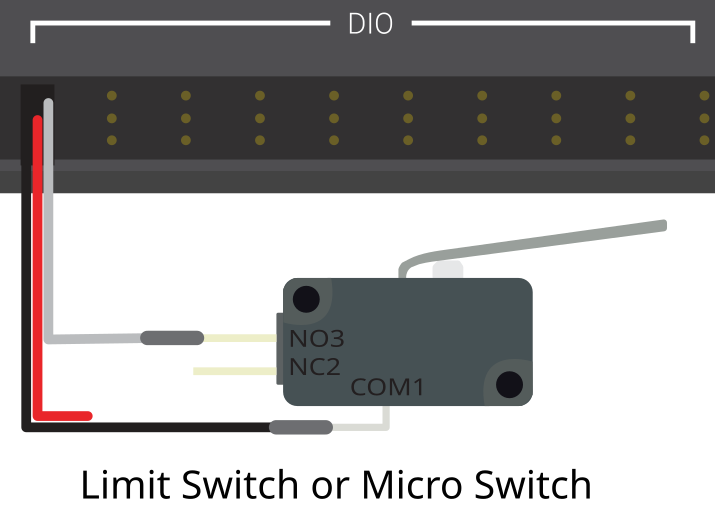

# Lab 4: Stop at a Limit Switch

## Why it matters
So far the robot has only done what the driver told it. Now it starts **sensing** the world.

A **limit switch** is the simplest sensor there is: pressed or not pressed. Robots use them everywhere to know when a mechanism has reached the end of its travel: an elevator at the bottom, an arm against its hard stop, a climber fully retracted. Running a motor into a hard stop without stopping can strip gears, snap belts, or burn out the motor.

In this lab you'll read a limit switch, show it on the dashboard, and make the motor stop by itself the moment the switch is pressed.

**Before you start:** finish [Lab 3](lab3-buttons-triggers.md). You'll add to the same **TestBed** project. [Lesson 8](../robot-code/08-sensors.md) covers sensors in more depth. Lesson [4.3](../hardware/04d-sensors.md) explains how limit switches are wired, including NO vs. NC.

## Read this
- [Digital Inputs – Software](https://docs.wpilib.org/en/stable/docs/software/hardware-apis/sensors/digital-inputs-software.html)
- [Limit Switches](https://docs.wpilib.org/en/stable/docs/software/hardware-apis/sensors/limit-switch.html)

## Walkthrough

### How a limit switch talks to the roboRIO
A limit switch connects to one of the roboRIO's **DIO** (digital input/output) ports. Each DIO port has three pins: **signal**, **5 V**, and **ground**. A basic limit switch uses two of them: **signal** and **ground**.

Inside the roboRIO, the signal pin is gently pulled up to "high" (`true`). When the switch closes, it connects signal to ground, which pulls it "low" (`false`).

| Switch | Wired as "normally open" (NO) | What `get()` returns |
|---|---|---|
| Not pressed | Circuit open | `true` |
| Pressed | Circuit closed to ground | `false` |


**Pressed reads `false`**

This surprises everyone the first time. With the usual wiring, `get()` returns **`false`** when the switch is pressed. That's why the code below uses `!` (not). Always check on the dashboard instead of guessing.




_A limit switch on a DIO port. Only signal and ground are used. From the WPILib docs, [Digital Inputs - Hardware](https://docs.wpilib.org/en/stable/docs/hardware/sensors/digital-inputs-hardware.html) (CC BY 4.0)._

The test bed's switches have both **NO** (normally open) and **NC** (normally closed) contacts. If yours is wired to NC, the logic flips: pressed reads `true`. The dashboard test in Step 3 tells you which you have.

On the test bed, the switch isn't attached to a mechanism, so **you** will be the mechanism: pressing the switch by hand is like an arm reaching its hard stop.

### Step 1: Constants
Find which DIO port the switch is wired to (follow the wire to the roboRIO). Add a new class to `Constants.java`:

```java
  public static class kSensorConstants {
    public static final int LimitSwitchDio = 2;   // the DIO port your switch uses
  }
```

### Step 2: Add the switch to the subsystem
Open `SpinBrushlessMotorSubsystem.java`. Add the switch next to the motor:

```java
  private final DigitalInput m_limitSwitch =
      new DigitalInput(Constants.kSensorConstants.LimitSwitchDio);
```

Import `edu.wpi.first.wpilibj.DigitalInput`. Then add a method that says what the switch **means**:

```java
  /** True when the limit switch is pressed. */
  public boolean isLimitPressed() {
    return !m_limitSwitch.get();   // pressed pulls the signal low, so flip it
  }
```


**Name it for what it means**

`isLimitPressed()` is much clearer than `getSwitch()`. Everywhere else in your code, `if (isLimitPressed())` reads like English and hides the "pressed is false" wiring detail in one place.


Add it to `periodic()` so you can see it:

```java
    SmartDashboard.putBoolean("Brushless/Limit Pressed", isLimitPressed());
```

### Step 3: Check it on the dashboard
Deploy (the robot can stay **disabled**). Open the dashboard and find **Brushless/Limit Pressed**.

- [ ] Not touching the switch: shows **false**
- [ ] Holding the switch down: shows **true**

If it's backward, your switch is wired NC. Remove the `!` in `isLimitPressed()` and deploy again. Getting this right now saves confusion later.

### Step 4: Spin until the switch is pressed
Add a command that runs the motor and **stops by itself** when the switch is hit:

```java
  /** Spins until the limit switch is pressed, then stops. */
  public Command spinUntilLimitCommand(double speed) {
    return spinMotorCommand(speed)
        .until(this::isLimitPressed)
        .withName("Spin Until Limit");
  }
```

`.until(condition)` checks the condition every 20 ms. The moment it's `true`, the command ends, and `spinMotorCommand`'s end action stops the motor.

Bind it in `RobotContainer`:

```java
    // D-pad up: spin until the limit switch is pressed
    m_controller.povUp().onTrue(
        m_spinBrushlessMotorSubsystem.spinUntilLimitCommand(
            Constants.kBrushlessConstants.BrushlessMotorSpeed));
```

It's `onTrue` because the command ends by itself. Tap once and let it go.

**Test it:**

1. Enable. Tap **D-pad up**. The motor spins.
2. Press the limit switch by hand. The motor **stops immediately**.
3. Tap D-pad up **while holding the switch down**. What happens? Why?

### Step 5: Don't even start if you're already at the limit
In step 3 of the test, the command started, saw the switch already pressed, and ended in the same loop. That works, but it's cleaner to say "don't start at all":

```java
  public Command spinUntilLimitCommand(double speed) {
    return spinMotorCommand(speed)
        .until(this::isLimitPressed)
        .unless(this::isLimitPressed)          // don't start if already pressed
        .withName("Spin Until Limit");
  }
```

### Step 6: A trigger made from a sensor
Buttons aren't the only triggers. **Any true/false check** can start a command. Add this in `configureBindings()`:

```java
    // Whenever the limit switch becomes pressed, print a message
    new Trigger(m_spinBrushlessMotorSubsystem::isLimitPressed)
        .onTrue(Commands.print("Limit switch hit!"));
```

Import `Trigger` and `Commands` if needed. Deploy, open RioLog, and press the switch. The message prints once **each time** the switch goes from not-pressed to pressed, not 50 times a second while you hold it. That's what `onTrue` means: it fires on the **change**.

### Step 7: Commit
```bash
git add .
git commit -m "Lab 4: limit switch"
```

### When it doesn't work

| Problem | Likely cause |
|---|---|
| Dashboard always shows the same value | Wrong DIO port in `Constants`, or the wire isn't on the signal pin |
| Value is backward | The switch is wired NC. Remove the `!`. |
| Motor doesn't stop when the switch is pressed | `.until` is missing, or `isLimitPressed()` returns the wrong value |
| "Limit switch hit!" prints over and over | You used `whileTrue` instead of `onTrue`, or the switch is bouncing (see the last exercise) |

## Try it
- [ ] Get **Limit Pressed** reading correctly on the dashboard
- [ ] Spin until the switch is pressed with D-pad up
- [ ] Hold the switch, then tap D-pad up. Explain what happens with and without `.unless`.
- [ ] Use the **second** limit switch on the test bed. Make D-pad down spin **backward** until it's pressed, like an elevator going down to its bottom switch.
- [ ] Make A (from Lab 1) also refuse to spin while the switch is pressed
- [ ] Switches can "bounce," flickering on and off for a few milliseconds when pressed. Add `.debounce(0.05)` to the `Trigger` from Step 6. What does it change?

## Check yourself
<details>
<summary>Why does a pressed limit switch usually read `false`?</summary>

The roboRIO pulls the signal pin high when nothing is connected. Pressing a normally-open switch connects the signal to ground, which pulls it low.

</details>

<details>
<summary>Why put the `!` inside `isLimitPressed()` instead of everywhere you check the switch?</summary>

So the wiring detail lives in one place. The rest of the code reads clearly, and if the wiring changes, you fix one line.

</details>

<details>
<summary>What does `.until(this::isLimitPressed)` do?</summary>

It checks the switch every loop and ends the command the moment the switch is pressed. Ending the command runs its end action, which stops the motor.

</details>

<details>
<summary>What's the difference between `.until(...)` and `.unless(...)`?</summary>

`.until` ends a running command when the condition becomes true. `.unless` stops the command from starting at all if the condition is already true.

</details>

<details>
<summary>Why does the print in Step 6 happen once instead of 50 times a second?</summary>

`onTrue` fires when the trigger **changes** from false to true, not while it stays true.

</details>
