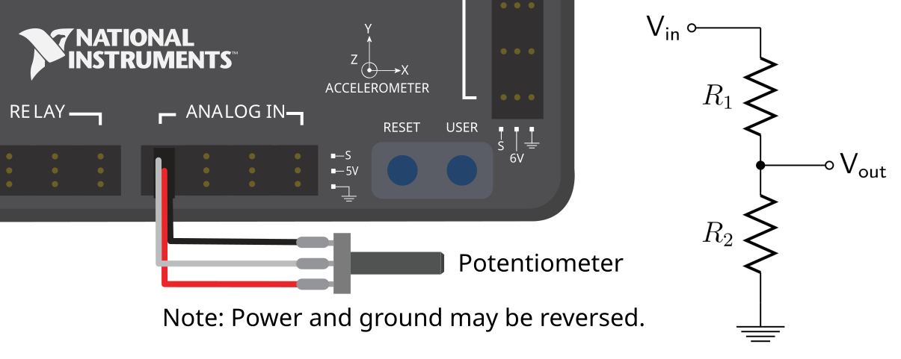

# Lab 5: Control Speed with a Knob

## Why it matters
A limit switch only knows two things: pressed or not. Most sensors report a **range** of values instead: how far, how fast, what angle. These are **analog** sensors.

The test bed's **10-turn potentiometer** ("pot") is a knob that reports how far it's been turned. In this lab you'll read it, turn its raw reading into something useful, and use it to set the motor's speed: turn the knob one way to spin forward, the other way to spin backward, and leave it in the middle to stop.

Turning one range of numbers into another is something you'll do with almost every sensor, so this lab is about more than knobs.

**Before you start:** finish [Lab 4](lab4-limit-switch.md). You'll add to the same **TestBed** project. Lesson [4.3](../hardware/04d-sensors.md) explains how a potentiometer works.

## Read this
- [Analog Potentiometers – Software](https://docs.wpilib.org/en/stable/docs/software/hardware-apis/sensors/analog-potentiometers-software.html)
- [Analog Inputs – Software](https://docs.wpilib.org/en/stable/docs/software/hardware-apis/sensors/analog-inputs-software.html)

## Walkthrough

### How a potentiometer works
A potentiometer has three wires. Two connect across a strip of resistive material (5 V at one end, ground at the other), and the third, the **wiper**, slides along the strip as you turn the knob.

| Knob position | Wiper voltage |
|---|---|
| Turned fully one way | About 0 V |
| Halfway | About 2.5 V |
| Turned fully the other way | About 5 V |

It plugs into one of the roboRIO's **Analog In** ports (0 to 3), which measure that voltage. Ours is a **10-turn** pot: it takes ten full turns of the knob to go from one end to the other, which gives very fine control.


**It has hard stops**

A multi-turn pot stops at each end. Don't force it past the end, and never connect one to a motor that could drive it past the stops.




_A potentiometer on an Analog In port. Swap the two outer wires to reverse which end reads 0 V. From the WPILib docs, [Analog Potentiometers - Hardware](https://docs.wpilib.org/en/stable/docs/hardware/sensors/analog-potentiometers-hardware.html) (CC BY 4.0)._

### Step 1: Constants
Find which Analog In port the pot is wired to, and add it to `kSensorConstants`:

```java
  public static class kSensorConstants {
    public static final int LimitSwitchDio = 2;
    public static final int KnobAnalogPort = 0;    // the Analog In port your pot uses
    public static final double KnobTurns = 10.0;   // it's a 10-turn pot
  }
```

### Step 2: Read the knob
WPILib's `AnalogPotentiometer` turns the voltage into a number for you. Give it the port and the **full range** you want it to report. With a range of 10, it reports **turns**: about 0 at one end and about 10 at the other.

Open `RobotContainer.java` and add the knob as a field, next to the controller:

```java
  private final AnalogPotentiometer m_knob = new AnalogPotentiometer(
      Constants.kSensorConstants.KnobAnalogPort,
      Constants.kSensorConstants.KnobTurns,
      0.0);   // offset: added to every reading
```

Import `edu.wpi.first.wpilibj.AnalogPotentiometer`.


**Why put the knob in RobotContainer?**

The knob is a **control**, like the Xbox controller, not part of the motor's mechanism. Controls live in `RobotContainer`; mechanisms live in subsystems.


Put the reading on the dashboard. `RobotContainer` doesn't have a `periodic()`, so add this line to the end of `robotPeriodic()` in `Robot.java`, after the scheduler runs:

```java
    m_robotContainer.updateDashboard();
```

And add the method to `RobotContainer`:

```java
  /** Called every loop from Robot.robotPeriodic(). */
  public void updateDashboard() {
    SmartDashboard.putNumber("Knob/Turns", m_knob.get());
  }
```

### Step 3: Calibrate
Real pots almost never read exactly 0 and exactly 10 at the ends. Deploy (disabled is fine) and watch **Knob/Turns**.

1. Turn the knob all the way one direction. Write down the reading: **min** = ______
2. Turn it all the way the other direction. **max** = ______
3. Find the middle: **center** = (min + max) ÷ 2 = ______

Add your numbers to `kSensorConstants`:

```java
    public static final double KnobMin = 0.1;     // your measured values
    public static final double KnobMax = 9.9;
```

If the reading goes **down** when you turn the knob clockwise, that's fine. You'll decide which way is "forward" in the next step.

### Step 4: Map the knob to a speed
We want the knob's range to become a motor speed:

| Knob | Speed |
|---|---|
| min | -1.0 (full backward) |
| center | 0 (stopped) |
| max | +1.0 (full forward) |

That's a **linear map**: a straight line from one range onto another. Here's the math, step by step:

```
center    = (min + max) / 2
halfRange = (max - min) / 2
speed     = (turns - center) / halfRange
```

**Worked example** with min = 0.1 and max = 9.9:

- center = 5.0, halfRange = 4.9
- Knob at 7.45 turns: speed = (7.45 − 5.0) ÷ 4.9 = **0.5**
- Knob at 2.55 turns: speed = (2.55 − 5.0) ÷ 4.9 = **−0.5**

Add this method to `RobotContainer`:

```java
  /** Turns the knob position into a motor speed from -1 to 1. */
  private double knobToSpeed() {
    double min = Constants.kSensorConstants.KnobMin;
    double max = Constants.kSensorConstants.KnobMax;
    double center = (min + max) / 2.0;
    double halfRange = (max - min) / 2.0;

    double speed = (m_knob.get() - center) / halfRange;

    speed = MathUtil.clamp(speed, -1.0, 1.0);      // never go past full speed
    speed = MathUtil.applyDeadband(speed, 0.05);   // a small dead zone in the middle
    return speed * 0.5;                            // cap at 50% while learning
  }
```

| Line | Why |
|---|---|
| `clamp` | If the knob reads a bit past your measured min or max, the speed still stays between -1 and 1 |
| `applyDeadband` | It's hard to leave a knob exactly at center. The dead zone makes "close to center" mean stopped. |
| `* 0.5` | A safety cap while you test |

Add the speed to `updateDashboard()` so you can watch it:

```java
    SmartDashboard.putNumber("Knob/Speed", knobToSpeed());
```

### Step 5: Let the knob drive the motor
You already wrote `spinWithSupplierCommand` in Lab 3. It reads a speed every loop, which is exactly what the knob needs. Bind it in `configureBindings()`:

```java
    // D-pad right: tap to let the knob control the motor, tap again to stop
    m_controller.povRight().toggleOnTrue(
        m_spinBrushlessMotorSubsystem.spinWithSupplierCommand(this::knobToSpeed));
```

`this::knobToSpeed` is a **method reference**: "call `knobToSpeed()` every time you need a value." ([Lesson 3](../foundations/03-java.md))

**Test it:**

1. Set the knob to the middle. Enable.
2. Tap **D-pad right**. The motor shouldn't move.
3. Slowly turn the knob one way. The motor speeds up. Watch **Knob/Speed** on the dashboard.
4. Turn it back through the middle and the other way. The motor slows, stops, and reverses.
5. Tap **D-pad right** again to hand control back.

If the motor spins the "wrong" way for your taste, flip the sign: `return -speed * 0.5;`

### Step 6: Commit
```bash
git add .
git commit -m "Lab 5: knob controls speed"
```

## Try it
- [ ] Calibrate the knob and record min, max, and center
- [ ] Control the motor speed with the knob
- [ ] Graph **Knob/Turns** with the knob sitting still. Is the reading perfectly steady, or does it wiggle a tiny bit? That wiggle is **noise**, and every analog sensor has some.
- [ ] Change the dead zone from 0.05 to 0.15. How does the middle feel different?
- [ ] Make a second mapping where the knob only goes forward: min = stopped, max = full speed. Bind it to D-pad left.
- [ ] Combine labs: make the knob-controlled motor stop when the limit switch from Lab 4 is pressed

## Check yourself
<details>
<summary>What's the difference between a digital and an analog sensor?</summary>

A digital sensor reports only true or false. An analog sensor reports a range of values, like a voltage from 0 to 5 V.

</details>

<details>
<summary>With min = 0.2 and max = 9.8, what speed does a knob reading of 7.4 give (before the 50% cap)?</summary>

Center = 5.0, halfRange = 4.8. Speed = (7.4 − 5.0) ÷ 4.8 = **0.5**

</details>

<details>
<summary>Why calibrate instead of assuming 0 and 10?</summary>

Real pots rarely reach their exact ends. Using the real min and max makes center truly mean stopped, and makes the full range of the knob reach full speed.

</details>

<details>
<summary>Why do we clamp after mapping?</summary>

If the knob reads slightly past the measured min or max, the math would give a speed beyond ±1. Clamping keeps it in range.

</details>

<details>
<summary>Why does the knob command use `this::knobToSpeed` instead of `knobToSpeed()`?</summary>

`knobToSpeed()` would run once, when the robot starts, and hand over a single number. `this::knobToSpeed` hands over the method itself, so the command can call it every loop and follow the knob.

</details>
