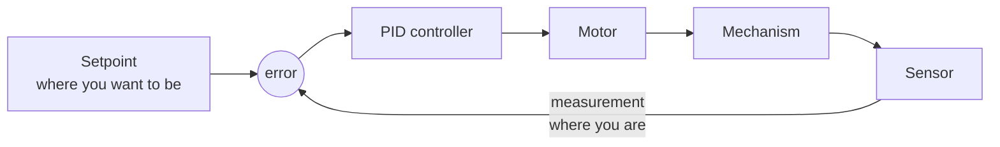

# 12. PID Feedback

## Why it matters
"Set the motor to 0.3 and hope" doesn't work. Battery voltage changes during a match, mechanisms wear, game pieces add weight, and carpet adds friction. A fixed motor output gets a different result every time.

**Feedback control** measures where the mechanism actually is, compares it to where you want it, and corrects automatically, 50 times a second. **PID** is the most common feedback controller in FRC, and in robotics generally. Once you understand it, you can make arms hold their angle, flywheels hold their speed, and drivetrains stop exactly where you tell them.

## Read this, then come back
- [Introduction to Control Theory](https://docs.wpilib.org/en/stable/docs/software/advanced-controls/introduction/control-system-basics.html)
- [Introduction to PID](https://docs.wpilib.org/en/stable/docs/software/advanced-controls/introduction/introduction-to-pid.html)
- [PID Control in WPILib](https://docs.wpilib.org/en/stable/docs/software/advanced-controls/controllers/pidcontroller.html)
- [Tuning a Flywheel Velocity Controller](https://docs.wpilib.org/en/stable/docs/software/advanced-controls/introduction/tuning-flywheel.html) and [Tuning a Vertical Arm Position Controller](https://docs.wpilib.org/en/stable/docs/software/advanced-controls/introduction/tuning-vertical-arm.html)

!!! tip "Use the interactive simulators"
    The WPILib tuning pages above include simulators right in the browser, for a flywheel, turret, and arm. Move the sliders and watch what happens. They're the fastest way to build intuition, and you'll use them in the exercises.

## Walkthrough

### Open loop vs. closed loop
- **Open loop:** "Run the motor at 30%." The code never checks the result.
- **Closed loop:** "Get the arm to 90°." Measure, compare, correct, repeat every 20 ms.



The loop is **closed** because the sensor's measurement feeds back into the next decision.

The WPILib docs draw it like this, using the standard control-theory names:


<p class="credit">A closed loop. The **plant** is the mechanism being controlled. From the WPILib docs, <a href="https://docs.wpilib.org/en/stable/docs/software/advanced-controls/introduction/control-system-basics.html">Control System Basics</a> (CC BY 4.0).</p>

| Symbol | Name in the docs | In this course |
|---|---|---|
| r(t) | reference, setpoint | setpoint (where you want to be) |
| e(t) | error | error |
| u(t) | control input, control effort | output (what you send the motor) |
| y(t) | output, process variable | measurement (where you are) |

!!! note "Two names for the same thing"
    The docs call the motor command the **control input** and the measured value the **output**. This course says **output** for the motor command and **measurement** for the sensor value. Same ideas, different words.

### The vocabulary

| Term | Meaning | Arm example |
|---|---|---|
| **Setpoint** (reference) | Where you want to be | 90° |
| **Measurement** (process variable) | Where you are, from a sensor | 60° |
| **Error** | Setpoint − measurement | 30° |
| **Output** (control effort) | What you send to the motor | 0.4, or 4.8 V |
| **Gain** | A tuning number that scales one part of the output | kP = 0.02 |

### Error is everything
```
error = setpoint − measurement
```

- Positive error: you're short of the target, so push forward.
- Negative error: you're past it, so push back.
- Zero error: you're there.

The controller's whole job is to drive the error to zero and keep it there.

### Build PID one letter at a time

#### P: Proportional. *"Push harder the farther away you are."*
```
output = kP × error
```

With kP = 0.02 and the arm 30° short, the output is 0.02 × 30 = **0.6**. At 5° short, it's 0.1. As the arm approaches the target, the push gets gentler.

| kP | What happens |
|---|---|
| Too small | Slow and sluggish. May stop short, because the push gets too weak to overcome friction. |
| About right | Moves quickly and settles close to the target |
| Too big | Overshoots, swings back, overshoots again: **oscillation** |


<p class="credit">A P controller: the output is K<sub>p</sub> times the error. From the WPILib docs, <a href="https://docs.wpilib.org/en/stable/docs/software/advanced-controls/introduction/introduction-to-pid.html">Introduction to PID</a> (CC BY 4.0).</p>

!!! wpilib "From the WPILib docs: P is a software spring"
    Proportional gains act like **software-defined springs** that pull the system toward the setpoint. A spring pushes harder the more you stretch it. P pushes harder the farther the mechanism is from the setpoint, in exactly the same way.

    *Adapted from [Introduction to PID](https://docs.wpilib.org/en/stable/docs/software/advanced-controls/introduction/introduction-to-pid.html), CC BY 4.0.*

P alone has a classic flaw: **steady-state error**. Near the target, the error is small, so the output is small, and a small output may not beat friction or gravity. The mechanism stops a little short and stays there.

#### D: Derivative. *"Slow down as you approach."*
```
output += kD × (how fast the error is changing)
```

The derivative is the **rate of change** of the error. When the mechanism is rushing toward the target, the error is shrinking fast, and D pushes **against** that motion. It acts like a shock absorber.


<p class="credit">A PD controller adds a second term based on how fast the error is changing. From the WPILib docs, <a href="https://docs.wpilib.org/en/stable/docs/software/advanced-controls/introduction/introduction-to-pid.html">Introduction to PID</a> (CC BY 4.0).</p>

!!! wpilib "From the WPILib docs: D is a software damper"
    When the setpoint isn't moving, the D term slows the system down whenever it's moving. It acts like a **software-defined damper**, like the door closers that stop a door from slamming. Their pushback grows the faster the door moves.

    *Adapted from [Introduction to PID](https://docs.wpilib.org/en/stable/docs/software/advanced-controls/introduction/introduction-to-pid.html), CC BY 4.0.*

- With D, you can use a higher kP for a faster response without as much overshoot.
- Too much D makes the mechanism sluggish, and because it reacts to change, it **amplifies sensor noise** into jittery output.

#### I: Integral. *"Fix the leftover error."*
```
output += kI × (error added up over time)
```

The integral keeps a running total of the error. If the mechanism sits a little short of the target for a while, that total grows until the output is big enough to finish the job. That's how I removes steady-state error.


<p class="credit">Steady-state error: P control alone leaves a gap below the setpoint. From the WPILib docs, <a href="https://docs.wpilib.org/en/stable/docs/software/advanced-controls/introduction/introduction-to-pid.html">Introduction to PID</a> (CC BY 4.0).</p>


<p class="credit">Left: adding I removes the gap. Right: too much I causes overshoot. From the WPILib docs, <a href="https://docs.wpilib.org/en/stable/docs/software/advanced-controls/introduction/introduction-to-pid.html">Introduction to PID</a> (CC BY 4.0).</p>

!!! wpilib "From the WPILib docs: What WPILib says about I"
    Integral gain is **generally not recommended** for FRC use. It's almost always better to use a **feedforward** controller to eliminate steady-state error. If you do use integral gain, it's crucial to protect against **integral windup**.

    *Adapted from [Introduction to PID](https://docs.wpilib.org/en/stable/docs/software/advanced-controls/introduction/introduction-to-pid.html), CC BY 4.0.*

!!! warning "Use I sparingly: integral windup"
    If the mechanism is stuck (against a hard stop, or held by a person, or still far from the target), the integral keeps growing the whole time. When the mechanism is finally free, that huge stored value sends it flying past the target. This is **integral windup**.

    Most FRC mechanisms don't need I at all once you add **feedforward** ([Lesson 13](13-feedforward.md)), which handles gravity and friction directly. If you do use I, limit it with `setIZone()` and `setIntegratorRange()`.

#### All three together
```
output = kP × error  +  kI × ∫error  +  kD × d(error)/dt
         (present)       (past)          (future trend)
```

### Watching the response
When you tune, plot the setpoint and measurement together on a graph.


<p class="credit">The three response types. From the WPILib docs, <a href="https://docs.wpilib.org/en/stable/docs/software/advanced-controls/introduction/introduction-to-pid.html">Introduction to PID</a> (CC BY 4.0).</p>

!!! wpilib "From the WPILib docs: Response types"
    - An **underdamped** response oscillates around the setpoint before settling.
    - An **overdamped** response is slow to rise and doesn't overshoot.
    - A **critically damped** response has the fastest rise time **without** overshooting.

    **Rise time** is how long the system takes to first reach the setpoint. **Settling time** is how long it takes to settle there.

    *Adapted from [Introduction to PID](https://docs.wpilib.org/en/stable/docs/software/advanced-controls/introduction/introduction-to-pid.html), CC BY 4.0.*

These shapes tell you what to change:

| What you see | Name | Usual fix |
|---|---|---|
| Rises slowly, stops short | Sluggish | Raise kP |
| Shoots past, swings back once, settles | Overshoot | Raise kD, or lower kP a little |
| Keeps swinging back and forth | Oscillation | Lower kP, raise kD |
| Settles a little off the target | Steady-state error | Add feedforward (Lesson 13), or a small kI |
| Output buzzes or jitters | Noise | Lower kD |

### The PIDController class
WPILib does the math for you:

```java
import edu.wpi.first.math.controller.PIDController;

PIDController pid = new PIDController(kP, kI, kD);

// Every loop:
double output = pid.calculate(measurement, setpoint);
```

Useful extras:

| Method | What it does |
|---|---|
| `setTolerance(position)` | How close counts as "there" |
| `setTolerance(position, velocity)` | …and how slow it must be moving |
| `atSetpoint()` | `true` when within tolerance |
| `enableContinuousInput(-180, 180)` | For things that wrap around, like a turret or swerve module, so it takes the short way around |
| `reset()` | Clears the stored integral and previous error. Call it when starting a new move. |
| `setIZone(range)` | Only build up the integral when the error is within this range |

!!! info "The controller assumes a 20 ms loop"
    `PIDController` assumes `calculate()` is called every 20 ms. Call it **exactly once per loop**, from a command's `execute()` or a `run()` factory. Calling it twice per loop, or only sometimes, breaks the D and I terms.

### Code it: an arm that goes to an angle
```java
import edu.wpi.first.math.MathUtil;
import edu.wpi.first.math.controller.PIDController;
import edu.wpi.first.wpilibj.Encoder;
import edu.wpi.first.wpilibj.motorcontrol.PWMSparkMax;
import edu.wpi.first.wpilibj2.command.Command;
import edu.wpi.first.wpilibj2.command.SubsystemBase;
import frc.robot.DashTable;

public class Arm extends SubsystemBase {
    private final PWMSparkMax motor = new PWMSparkMax(1);
    private final Encoder encoder = new Encoder(0, 1);
    private final PIDController pid = new PIDController(0.05, 0.0, 0.002);
    private final DashTable dash = new DashTable("Arm");   // Lesson 6.1

    public Arm() {
        encoder.setDistancePerPulse(ArmConstants.DEGREES_PER_PULSE);
        pid.setTolerance(2.0);   // within 2° counts as "there"
    }

    public double getAngleDegrees() {
        return encoder.getDistance();
    }

    /** Moves to the angle and ends once it's there. */
    public Command goTo(double degrees) {
        return runOnce(pid::reset)
            .andThen(run(() -> {
                double output = pid.calculate(getAngleDegrees(), degrees);
                motor.set(MathUtil.clamp(output, -0.5, 0.5));   // limit power while tuning
            }))
            .until(pid::atSetpoint)
            .withName("Arm to " + degrees);
    }

    /** Moves to the angle and keeps holding it until interrupted. */
    public Command hold(double degrees) {
        return runOnce(pid::reset)
            .andThen(run(() -> motor.set(pid.calculate(getAngleDegrees(), degrees))))
            .withName("Hold " + degrees);
    }

    @Override
    public void periodic() {
        dash.log("Angle", getAngleDegrees());
        dash.log("Setpoint", pid.getSetpoint());
        dash.log("Error", pid.getError());
        dash.log("Output", motor.get());
    }
}
```

!!! warning "`goTo` stops pushing when it ends"
    When `goTo` ends, nothing is holding the arm up, and gravity pulls it down. For arms and elevators, use a `hold`-style command (or a default command that holds the last position) instead of one that ends.

### Units of the gains
The gains depend on your units. With degrees in and motor percent out, kP = 0.02 means "2% output per degree of error." Measure in radians instead and the same behavior needs kP ≈ 1.15. **If you change units, you must retune.** That's one more reason to pick units once and keep them ([Lesson 8](../robot-code/08-sensors.md)).

### A tuning recipe
1. **Check the sensor first.** Move the mechanism by hand. Does the measurement go up when the motor would push it positive? If the sensor and motor disagree on direction, PID will push the wrong way and run away.
2. Set kI = 0 and kD = 0.
3. Start with a small kP. Raise it (doubling works well) until the mechanism **oscillates** around the target.
4. Back kP off by about half.
5. Raise **kD** in small steps until the overshoot is gone, or it starts to jitter.
6. If it still settles short, add **feedforward** (Lesson 13) before reaching for kI.
7. Write down the gains that work, and put them in `Constants.java`.

!!! danger "Safety"
    Tune with the robot on blocks or with a low output limit, like the `clamp(..., -0.5, 0.5)` above, and keep a hand near the disable key. A badly tuned arm can slam into its hard stops hard enough to break something.

### Tuning live from the dashboard
Rebuilding and redeploying for every gain change is slow. Make the gains **tunable** with `DashTable` ([Lesson 6.1](../robot-code/06b-dashboards.md)), and copy them into the controller every loop:

```java
private final DoubleSupplier kP = dash.tunable("kP", 0.05);
private final DoubleSupplier kI = dash.tunable("kI", 0.0);
private final DoubleSupplier kD = dash.tunable("kD", 0.002);

@Override
public void periodic() {
    pid.setPID(kP.getAsDouble(), kI.getAsDouble(), kD.getAsDouble());
    // ...the dash.log lines from above...
}
```

Change kP, kI, and kD in Elastic (as **Text Display** widgets) and watch the response immediately. When you're happy, **copy the numbers into `Constants.java`**. Dashboard edits are lost when the robot restarts.

### On-controller PID
Modern motor controllers (TalonFX, SPARK MAX, SPARK Flex) can run PID **on the controller itself**, at 1000 Hz instead of 50 Hz, using the motor's built-in encoder. Many teams use this for flywheels and arms. The ideas and tuning process are the same; only where the math runs is different. Learn it with WPILib's `PIDController` first, then read your vendor's docs.

## Try it
!!! tip "Have the test bed?"
    Do [Lab 9: PID on the Wheel](../testbed/lab9-pid-wheel.md), then [Lab 10: Elevator Position Control](../testbed/lab10-elevator.md). They're this whole lesson on real hardware.

### Tune a turret, right here
This is WPILib's turret simulator, running **PID only**. Click a spot around the turret to set a new angle, or click and drag the pointer to make the setpoint move smoothly.

<div class="viz-div" id="lesson_turret_container">
<div>
<div class="col" id="lesson_turret_plotVals"></div>
<div class="col" id="lesson_turret_plotVolts"></div>
</div>
<div class="flex-grid">
<div class="col" id="lesson_turret_viz"></div>
<div id="lesson_turret_ctrls"></div>
</div>
<script>new TurretPIDF("lesson_turret", "feedback");</script>
</div>

<p class="credit">Interactive simulator from the WPILib docs, <a href="https://docs.wpilib.org/en/stable/docs/software/advanced-controls/introduction/tuning-turret.html">Tuning a Turret Position Controller</a> (CC BY 4.0).</p>

- [ ] Set kP, kI, kD, and kV to zero. Raise **kP** until the turret moves sharply to each new angle. If it oscillates too much, lower kP until it stops.
- [ ] Raise **kD** to reduce the "lag" when you drag the setpoint smoothly. If it starts to oscillate, lower kD.
- [ ] Turn on **System Noise**. Does your tuning still work?
- [ ] Try the [arm tuning simulator](https://docs.wpilib.org/en/stable/docs/software/advanced-controls/introduction/tuning-vertical-arm.html) with **PID only**. Notice how hard it is to hold the arm level, and how it sags at some angles. Write down your best kP and kD. You'll compare in the next lesson.
- [ ] In the **ArmSimulation** example project, replace its controller with your `goTo` and `hold` commands, bind them to two buttons, and tune them with the dashboard
- [ ] Graph `Arm/Angle` and `Arm/Setpoint` together in one Elastic **Graph** widget while you tune

## Check yourself
??? question "In your own words, what do P, I, and D each do?"
    P pushes in proportion to how far off you are. D resists fast changes to reduce overshoot. I accumulates small leftover error over time and pushes harder the longer it lasts.

??? question "The arm is 20° short and kP = 0.03. What's the P term's output?"
    0.03 × 20 = **0.6** (60% output).

??? question "Why is a very high kP bad?"
    The mechanism overshoots, swings back, and overshoots again: it oscillates and may never settle.

??? question "Why does P alone often stop a little short of the target?"
    Near the target, the error is tiny, so the output is tiny, and it can't overcome friction or gravity. That leftover is steady-state error.

??? question "What is integral windup, and how do you avoid it?"
    The integral keeps growing while the mechanism is stuck or far away, then causes a big overshoot once it's free. Avoid it by using feedforward instead of I, or by limiting the integral with `setIZone()`.

??? question "PID makes your arm run away faster and faster instead of stopping. What's the most likely cause?"
    The sensor direction doesn't match the motor direction, so every correction pushes the arm further from the target. Fix the inversion.
