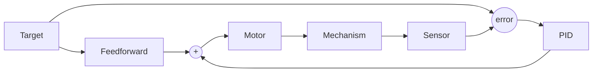

# 13. Feedforward

## Why it matters
PID only reacts **after** something goes wrong: it needs error before it does anything. That means a PID-only arm always sags a little below its target (the error has to exist to make the output that holds it up), and a PID-only flywheel always runs a little slow. You saw the flywheel version yourself in [Lab 9, Part 2](../testbed/lab9-pid-wheel.md#part-2-hold-a-speed-velocity-pid): P alone held the wheel below its target, and adding kV fixed it.

**Feedforward** predicts what the motor needs **before** there's any error, using a simple model of the mechanism. Most good FRC control is *mostly feedforward, with a little PID for cleanup*. Add feedforward and your PID gains get smaller, your mechanisms get faster and smoother, and tuning gets easier.

!!! example "Analogy: driving up a hill"
    Feedforward is pressing the gas **because you see the hill coming**. PID is pressing harder **after you notice you're slowing down**. A good driver does both: most of the pedal from looking ahead, a little correction from feeling the speed.

## Read this
- [Introduction to DC Motor Feedforward](https://docs.wpilib.org/en/stable/docs/software/advanced-controls/introduction/introduction-to-feedforward.html)
- [Feedforward Control in WPILib](https://docs.wpilib.org/en/stable/docs/software/advanced-controls/controllers/feedforward.html)
- [Introduction to System Identification](https://docs.wpilib.org/en/stable/docs/software/advanced-controls/system-identification/introduction.html)

## Walkthrough

### Feedforward vs. feedback

| | Feedforward | Feedback (PID) |
|---|---|---|
| Uses | A model of the mechanism + the target | The error from a sensor |
| Acts | **Before** error appears | **After** error appears |
| Good at | The predictable part: gravity, friction, the voltage to hold a speed | The unpredictable part: bumps, game pieces, model mistakes |
| Needs a sensor? | No | Yes |
| On its own | Close, but drifts | Works, but lags and sags |

Used together, the output is simply added:

```
volts = feedforward(target) + PID(measurement, target)
```



### Where the voltage goes: the motor model
A DC motor's voltage goes to three jobs, plus a fourth for mechanisms that lift something:

| Term | Name | What the voltage is for | Unit |
|---|---|---|---|
| **kS** | Static | Overcoming friction, just to start moving | volts |
| **kV** | Velocity | Holding a speed (faster needs more voltage) | volts per (unit/second) |
| **kA** | Acceleration | Speeding up (accelerating takes extra) | volts per (unit/second²) |
| **kG** | Gravity | Holding the mechanism up against gravity | volts |

**Flywheel or drivetrain:**
```
volts = kS·sign(v) + kV·v + kA·a
```

`sign(v)` is +1 when moving forward and −1 when moving backward, because friction always opposes motion.

**Elevator** (gravity is the same at every height):
```
volts = kS·sign(v) + kG + kV·v + kA·a
```

**Arm** (gravity's pull depends on the angle):
```
volts = kS·sign(v) + kG·cos(θ) + kV·v + kA·a
```

### Why cos(θ) for an arm
Gravity pulls straight down. How much of that pull tries to **rotate** the arm depends on its angle:

| Arm angle (θ) | cos(θ) | Gravity's effect |
|---|---|---|
| 0° (horizontal) | 1.0 | Strongest. The full weight acts as torque. |
| 45° | 0.71 | About 71% |
| 90° (straight up) | 0.0 | None. The weight is directly over the pivot. |
| −90° (straight down) | 0.0 | None. The weight hangs from the pivot. |

So kG is the voltage needed to hold the arm **level**, and `kG·cos(θ)` gives the right amount at every other angle.

### A worked example
A flywheel has kS = 0.2 V and kV = 0.12 V per (rotation/second). To hold 50 rotations/second (3000 RPM):

```
volts = 0.2 + 0.12 × 50 = 6.2 V
```

Without any feedback at all, sending 6.2 V gets the flywheel close to 50 rot/s. PID then only has to correct small differences, like when a game piece passes through and slows the wheel.

### Why volts instead of percent?
Battery voltage sags during a match. 50% output at 12.5 V is 6.25 V to the motor; 50% at 10.5 V is only 5.25 V. Same command, different result.

Commanding **volts** with `setVoltage()` compensates for this: the motor controller adjusts the percent to deliver the voltage you asked for. Feedforward gains are measured in volts, so always use `setVoltage()` with feedforward.

```java
motor.setVoltage(6.2);   // ✅ 6.2 V, whatever the battery reads
motor.set(0.5);          // ❌ changes as the battery sags
```

### The WPILib classes

| Mechanism | Class | Constructor | `calculate(...)` takes |
|---|---|---|---|
| Flywheel, roller, drivetrain side | `SimpleMotorFeedforward` | `(kS, kV, kA)` | velocity |
| Elevator | `ElevatorFeedforward` | `(kS, kG, kV, kA)` | velocity |
| Arm | `ArmFeedforward` | `(kS, kG, kV, kA)` | angle (radians), velocity |

### Code it: a flywheel with feedforward + PID
```java
private final SimpleMotorFeedforward ff = new SimpleMotorFeedforward(kS, kV);
private final PIDController pid = new PIDController(kP, 0, 0);

public Command spinAt(double targetRotPerSec) {
    return run(() -> {
        double ffVolts  = ff.calculate(targetRotPerSec);
        double pidVolts = pid.calculate(getVelocityRotPerSec(), targetRotPerSec);
        motor.setVoltage(ffVolts + pidVolts);
    }).withName("Shooter " + targetRotPerSec);
}
```

Because feedforward does most of the work, kP here is small and only cleans up.

### Code it: an arm with feedforward + PID
```java
import edu.wpi.first.math.controller.ArmFeedforward;

private final ArmFeedforward ff = new ArmFeedforward(kS, kG, kV);
private final PIDController pid = new PIDController(kP, 0, kD);

public Command holdAt(double targetRadians) {
    return run(() -> {
        double ffVolts  = ff.calculate(targetRadians, 0.0);   // position, velocity
        double pidVolts = pid.calculate(getAngleRadians(), targetRadians);
        motor.setVoltage(ffVolts + pidVolts);
    }).withName("Arm hold");
}
```

!!! warning "Angle convention"
    `ArmFeedforward` expects **radians** with **0 = horizontal** and positive angles going up. If your encoder reads 0 when the arm hangs straight down, subtract π/2 before passing the angle in. Get this wrong and the gravity term pushes hardest at the wrong angle.

Here the velocity passed to feedforward is 0, because `holdAt` jumps straight to the target. In [Lesson 14](14-profiles.md), a motion profile supplies a real velocity for every step of the move, and kV and kA start pulling their weight.

### Getting the numbers
There are three ways to get feedforward gains, from roughest to best. Use the first to get a starting point before the mechanism is even built, the second to check it on the real mechanism, and SysId for the real values.

#### 1. Estimate them from the motor's specs
You can work out a good starting point for kV and kG from numbers on the motor's spec sheet and your gear ratio. No robot needed.

**kV: 12 volts ÷ the mechanism's top speed.** At full voltage, a motor with no load spins at its **free speed**. So:

```
kV ≈ 12 V ÷ (free speed of the mechanism, in your units)
```

Example: a flywheel on a NEO (free speed **5676 RPM** = 94.6 rotations/second) with a 1.5:1 reduction. The flywheel's free speed is 94.6 ÷ 1.5 = 63.1 rotations/second:

```
kV ≈ 12 ÷ 63.1 = 0.19 V per (rotation/second)
```

For an elevator, convert the free speed to meters per second (motor rotations per second ÷ gear ratio × the drum's circumference). The real kV comes out a little **higher**, because friction and load mean the mechanism never quite reaches free speed.

**kG: 12 volts × the fraction of the motor's stall torque needed to hold the mechanism.** A motor makes its **stall torque** at 12 V with the shaft held still. To hold a load still, it needs just enough voltage to make the torque gravity is putting on it:

```
torque at the motor = (weight × lever arm) ÷ gear ratio
kG ≈ 12 V × (torque at the motor) ÷ (stall torque × number of motors)
```

The **lever arm** is the drum's radius for an elevator, or the distance from the pivot to the center of mass (with the arm level) for an arm.

Example: an elevator lifting a **5 kg** carriage with a **1.8 cm** radius sprocket, through a **10:1** gearbox, on one NEO (stall torque **2.6 N·m**):

```
weight × lever arm   = 5 kg × 9.81 m/s² × 0.018 m = 0.88 N·m
torque at the motor  = 0.88 ÷ 10                   = 0.088 N·m
kG                   ≈ 12 × 0.088 ÷ 2.6            = 0.41 V
```

WPILib's `DCMotor` class has every FRC motor's specs built in, and can do this math in code:

```java
DCMotor neo = DCMotor.getNEO(1);
double torqueAtMotor = 5.0 * 9.81 * 0.018 / 10.0;          // N·m
double kG = neo.getVoltage(torqueAtMotor, 0.0);             // volts to hold still: about 0.41
```

**kS and kA:** kS is friction, which no spec sheet knows. Start around **0.1 to 0.3 V** for a small mechanism and measure it (below). kA only matters for fast acceleration; start at **0**.

!!! tip "ReCalc does all of this for you"
    [ReCalc](https://www.reca.lc/) is a free online calculator made for FRC. Choose arm, elevator, flywheel, or drivetrain, enter the motor, gear ratio, and load, and it estimates kG, kV, and kA. It's the fastest way to get starting gains, and a great check on your own math.

#### 2. Measure them by hand
On the real mechanism, with PID turned off:

1. **kG** (arm or elevator): slowly raise the voltage until the mechanism holds still without drifting. For an arm, do this with it horizontal. That voltage is roughly kG.
2. **kS**: on a flywheel or roller with no gravity, raise the voltage slowly from 0 until it just starts to turn. That's roughly kS.
3. **kV**: run at a few steady voltages, measure the speed each time, and calculate (volts − kS) ÷ speed.

Compare your measurements with the estimates from step 1. If they're close (within about 30%), the mechanism is working as designed. If kG is much bigger than you calculated, look for friction or binding. If kV is much bigger, check the gear ratio and the units.

!!! tip "kG and kS together"
    Friction makes "the voltage that holds it still" a range, not one number. Raise the voltage until it **stops drifting down** (that's kG − kS), then until it **starts creeping up** (kG + kS). kG is halfway between, and kS is half the difference.

#### 3. SysId
**The right way:** use **SysId**. It runs the mechanism through test motions and calculates kS, kV, kA, and kG from real data. [Lesson 13.1](13b-sysid.md) walks through it step by step. Its numbers should land near your estimates; if they're wildly different, double-check the units before trusting either.

### Tuning with feedforward
1. Set kP, kI, and kD to 0.
2. Set the feedforward gains (from SysId, or by hand).
3. Run the mechanism. It should get **close** to the target with no PID at all.
4. Add a small kP to remove what's left. It'll be much smaller than your PID-only kP. Use the "most output ÷ slowing-down distance" rule from [Lesson 12](12-pid.md#picking-starting-gains), but with a much smaller "most output," like 1–2 V, because feedforward is already doing the heavy lifting.
5. Add kD only if it overshoots.

## Try it
This is WPILib's vertical arm simulator, with **feedforward and feedback** together. Click a point around the arm's circle to set a new angle, or click and drag for smooth motion.

<div class="viz-div" id="lesson_arm_container">
<div>
<div class="col" id="lesson_arm_plotVals"></div>
<div class="col" id="lesson_arm_plotVolts"></div>
</div>
<div class="flex-grid">
<div class="col" id="lesson_arm_viz"></div>
<div id="lesson_arm_ctrls"></div>
</div>
<script>new VerticalArmPIDF("lesson_arm", "both");</script>
</div>

<p class="credit">Interactive simulator from the WPILib docs, <a href="https://docs.wpilib.org/en/stable/docs/software/advanced-controls/introduction/tuning-vertical-arm.html">Tuning a Vertical Arm Position Controller</a> (CC BY 4.0).</p>


- [ ] Set every PID gain to 0. Set **kG** until the arm holds still at horizontal.
- [ ] Move the setpoint to other angles. Does the arm stay close with feedforward alone?
- [ ] Add a small kP to remove the remaining error
- [ ] Compare with your PID-only gains from Lesson 12. How much smaller is kP now? How much better does it hold?

In code:

- [ ] Calculate by hand the feedforward voltage for kS = 0.25, kV = 0.1, at 40 rot/s
- [ ] Add `ArmFeedforward` to your arm from Lesson 12, using `setVoltage()`
- [ ] In the **ArmSimulation** example, find kG by raising the voltage until the arm holds level

## Check yourself
??? question "What's the main difference between feedforward and feedback?"
    Feedforward predicts the output from a model **before** error appears. Feedback (PID) reacts to error **after** it appears.

??? question "Why does a PID-only arm sag a little below its target?"
    PID only produces output when there's error. Holding the arm up takes output, so some error has to exist to produce it.

??? question "Why does an arm use `cos(θ)` for gravity but an elevator doesn't?"
    Gravity's torque on an arm depends on its angle: maximum when horizontal, zero when vertical. An elevator lifts the same weight at every height.

??? question "kS = 0.3 V and kV = 0.15 V per (m/s). How many volts does feedforward give at 2 m/s?"
    0.3 + 0.15 × 2 = **0.6 V**

??? question "Why is `setVoltage()` better than `set()` with feedforward?"
    Feedforward gains are in volts. `setVoltage()` delivers that voltage no matter how much the battery has sagged, so the same command produces the same motion all match.
