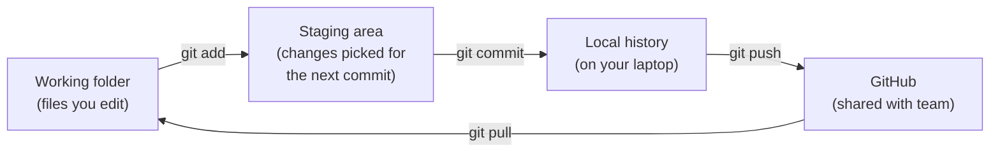

# 1. Git & Version Control

## Why it matters
Picture build season: five programmers, one robot project, a competition in two weeks. Without a system, someone copies an old version over a new one, a working autonomous gets lost, and nobody knows what changed when the robot suddenly stops driving straight.

**Git** fixes all of that. It:

- saves a snapshot every time you **commit**, so you can always go back
- shows exactly **what changed** between any two versions, and who changed it
- lets several people **work at the same time** without overwriting each other

Every FRC team that's serious about software uses Git, usually with **GitHub** to share the code. This course website is stored in Git too.

## Read this
- [Git Version Control Introduction (WPILib)](https://docs.wpilib.org/en/stable/docs/software/basic-programming/git-getting-started.html)
- [GitHub Skills](https://skills.github.com/): short, free, interactive courses. Do "Introduction to GitHub."

## Walkthrough

### Git vs. GitHub
These get mixed up constantly:

| | Git | GitHub |
|---|---|---|
| What it is | A program on your computer | A website |
| What it does | Tracks changes to files in a folder | Stores a shared copy of the project online |
| Works offline? | Yes | No |
| Analogy | Your notebook, with every draft saved | The team's shared binder |

You can use Git without GitHub, but teams use both: Git on each laptop, GitHub as the copy everyone syncs with.

### The words you need

| Term | Meaning |
|---|---|
| **Repository (repo)** | A project folder that Git tracks. It has a hidden `.git` folder holding all the history. |
| **Commit** | A saved snapshot of the project, with a message saying what changed |
| **Staging** | Choosing which changes go into the next commit (`git add`) |
| **Branch** | A separate line of work, so experiments don't break the working code |
| **Remote** | A copy of the repo somewhere else, usually GitHub. The default one is named `origin`. |
| **Push** | Upload your new commits to the remote |
| **Pull** | Download other people's new commits and merge them into yours |
| **Clone** | Download a full copy of a repo from GitHub for the first time |

### The three places your changes live
This is the idea that makes Git click:



Editing a file changes only your working folder. Nothing is saved in Git until you **add** and **commit**, and nobody else sees it until you **push**.

### One-time setup
Tell Git who you are. Your name goes on every commit you make:

```bash
git config --global user.name "Your Name"
git config --global user.email "you@example.com"
```

Use the same email as your GitHub account so GitHub links commits to you.

### Your first commit
Open a terminal in your `my-first-robot` folder. In VS Code: **Terminal → New Terminal**.

```bash
git init                         # start tracking this folder
git status                       # see what Git notices
git add .                        # stage every changed file
git commit -m "Initial robot project"
git log --oneline                # see your history
```

!!! info "WPILib projects already have a `.gitignore`"
    The `build/` folder and other generated files are listed in `.gitignore`, so Git skips them. Never commit build output. It's huge and it changes on every build.

### Reading `git status`
You'll run this more than any other Git command. It tells you exactly where your changes are:

```
On branch main
Changes to be committed:            ← staged; will go in the next commit
        modified:   src/main/java/frc/robot/RobotContainer.java

Changes not staged for commit:      ← edited but not staged yet
        modified:   src/main/java/frc/robot/Constants.java

Untracked files:                    ← new files Git isn't tracking yet
        src/main/java/frc/robot/subsystems/Intake.java
```

### Writing good commit messages
Future you, at 11 PM before a competition, will read these. Make them useful:

| ❌ Bad | ✅ Good |
|---|---|
| `stuff` | `Add intake subsystem with run and stop commands` |
| `fixed it` | `Fix right drive motors spinning backward` |
| `changes` | `Lower arm kP to stop oscillation at 90 degrees` |

A good message says **what** changed and, if it isn't obvious, **why**. Keep each commit to one idea. Small commits are easy to understand and easy to undo.

### Push to GitHub
1. Make a free account at [github.com](https://github.com) if you don't have one.
2. Click **New repository**, name it `my-first-robot`, and leave every box unchecked (no README, no `.gitignore`). You already have files.
3. GitHub shows commands under *"…or push an existing repository from the command line."* They look like this:
    ```bash
    git remote add origin https://github.com/YOUR-NAME/my-first-robot.git
    git branch -M main
    git push -u origin main
    ```
4. Refresh the GitHub page. Your code is there.

The first push may open a browser window to sign in. That's normal.

### Getting the team's code: clone
To work on a repo that already exists, like the team's robot code, you **clone** it instead of using `git init`:

```bash
git clone https://github.com/Robojacks/REPO-NAME.git
```

That creates a folder with the full project and all its history, already connected to GitHub.

### The daily loop
```bash
git pull                         # 1. get everyone's latest work
# ...edit code, build, test...
git status                       # 2. see what you changed
git diff                         # 3. read your own changes before saving them
git add .                        # 4. stage
git commit -m "Describe the change"
git push                         # 5. share
```

!!! tip "Pull before you start, every time"
    If you start working on old code, your changes and a teammate's may collide. Pulling first avoids most conflicts.

### Undoing things
| Situation | Command |
|---|---|
| Undo edits to a file you haven't staged | `git restore FILE` |
| Unstage a file (keep the edits) | `git restore --staged FILE` |
| Fix the message of the commit you just made (before pushing) | `git commit --amend -m "Better message"` |
| Undo a commit that's already pushed | `git revert COMMIT_ID` (makes a new commit that reverses it) |
| See an old version of a file | `git log --oneline FILE`, then `git show COMMIT_ID:path/to/FILE` |

!!! danger "Don't rewrite shared history"
    Commands like `git reset --hard` and `git push --force` can permanently delete teammates' work. Don't use them on the team repo unless a lead programmer is helping you.

### Merge conflicts
When two people change the **same lines** of the same file, Git can't pick a winner, so it asks you. After a `git pull`, the file will contain markers like this:

```java
<<<<<<< HEAD
private final double kP = 0.05;     // your version
=======
private final double kP = 0.08;     // the version you pulled
>>>>>>> origin/main
```

To fix it:

1. Decide what the line should be. Sometimes it's one version, sometimes a mix. Ask whoever wrote the other one.
2. Delete the marker lines (`<<<<<<<`, `=======`, `>>>>>>>`).
3. Build to make sure it compiles.
4. `git add` the file and `git commit`.

VS Code highlights conflicts and gives you **Accept Current / Accept Incoming / Accept Both** buttons above each one.

### Using Git inside VS Code
You don't have to type everything. The **Source Control** panel (the branch icon on the left side) lets you stage files with **+**, type a message, commit, and sync. It's the same Git underneath. Learn the commands first so you know what the buttons do.

## Try it
- [ ] Set your `user.name` and `user.email`
- [ ] Make three commits to your project, each with a clear message
- [ ] Push them to GitHub and find them on the website
- [ ] Change a line, run `git diff`, then `git restore` the file to throw the change away
- [ ] With a partner: both clone the same repo, both change the **same line**, both push. Whoever pushes second resolves the conflict.

## Check yourself
??? question "What's the difference between a commit and a push?"
    A commit saves a snapshot **on your computer**. A push uploads your commits **to GitHub** so others can see them.

??? question "You edited a file but `git commit` says nothing changed. Why?"
    You didn't stage it. Run `git add` first. Commit only saves staged changes.

??? question "Why should you `git pull` before starting work?"
    So you build on top of everyone else's latest changes instead of an old version. That avoids merge conflicts.

??? question "What causes a merge conflict, and how do you fix one?"
    Two people changed the same lines. Edit the file to the correct final version, delete the conflict markers, build, then add and commit.

??? question "Why isn't the `build/` folder in Git?"
    It's generated every build, it's large, and it's different on every computer. `.gitignore` tells Git to skip it.

We'll cover branches and pull requests in [Lesson 15](../workflow/15-team-process.md).
