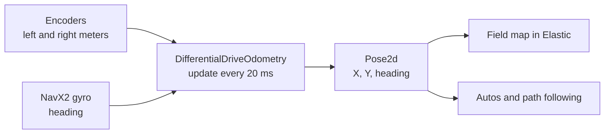

# 17. Where Is the Robot? Poses and Odometry

## Why it matters
So far the robot has only known things about itself: how fast a wheel spins, how far it has rolled, which way it's facing. To score in autonomous, line up on a goal, or follow a path, it needs to know where it is **on the field**.

That's called the robot's **pose**, and keeping track of it is called **pose estimation**. This lesson covers how WPILib describes a pose and how **odometry** tracks it from the encoders and gyro you already have. [Lesson 18](18-vision.md) adds cameras to correct it.

## Read this
- [Coordinate System (WPILib)](https://docs.wpilib.org/en/stable/docs/software/basic-programming/coordinate-system.html)
- [Kinematics and Odometry (WPILib)](https://docs.wpilib.org/en/stable/docs/software/kinematics-and-odometry/index.html)
- [Differential Drive Odometry (WPILib)](https://docs.wpilib.org/en/stable/docs/software/kinematics-and-odometry/differential-drive-odometry.html)

## Walkthrough

### What a pose is
A pose is three numbers:

| Part | Meaning | Units |
|---|---|---|
| **X** | How far along the field's long side | meters |
| **Y** | How far along the field's short side | meters |
| **Heading** (θ) | Which way the robot's front points | degrees or radians |

WPILib stores them in a `Pose2d`, which is a `Translation2d` (X and Y) plus a `Rotation2d` (heading):

```java
Pose2d pose = new Pose2d(2.0, 3.0, Rotation2d.fromDegrees(45));

pose.getX();                         // 2.0 meters
pose.getY();                         // 3.0 meters
pose.getRotation().getDegrees();     // 45.0
pose.getTranslation();               // just the (2.0, 3.0) part
```

A few things you can do with poses:

```java
// How far apart are two poses? (straight-line distance in meters)
double meters = pose.getTranslation().getDistance(target.getTranslation());

// How far do I still have to turn to face the target's heading?
Rotation2d turnLeft = target.getRotation().minus(pose.getRotation());

// Where would I be after driving 1 m forward from here? (forward = the robot's own front)
Pose2d ahead = pose.transformBy(new Transform2d(1.0, 0.0, Rotation2d.kZero));
```

### The field's coordinates
WPILib uses one coordinate system for the whole field, called the **field frame**, and it's the same for both alliances:

- **(0, 0)** is the corner on the **blue** alliance wall, on the right as the blue drivers look at the field.
- **+X** points away from the blue wall, toward the red wall.
- **+Y** points to the left, as seen from the blue driver station.
- **Heading 0°** faces +X (toward red). Turning **counterclockwise** (left, seen from above) makes it go **up**.

That last rule is the same one the gyro followed in [Lab 8](../testbed/lab8-navx-gyro.md). WPILib uses "counterclockwise is positive" everywhere.

!!! info "Red alliance"
    The origin always stays on the blue side. A red robot just starts at a big X, near the red wall. PathPlanner ([Lesson 19](19-pathplanner.md)) can flip blue paths to the red side for you, so you only draw them once.

There's also the **robot frame**: +X straight out the robot's front, +Y out its left side. Camera positions ("15 cm forward of center, 30 cm up") are written in the robot frame.

### Three ways to know the pose
| Method | How | Good | Bad |
|---|---|---|---|
| **Odometry** | Add up wheel distances and gyro heading every loop | Fast (every 20 ms), always available, smooth | **Drifts**: small errors add up and nothing removes them |
| **Vision** | A camera sees AprilTags on the field and works out where it must be | Absolute: no drift, can fix a wrong start | Only when tags are in view; noisy; slower |
| **Fusion** | Run odometry all the time and nudge it toward vision when vision is good | Smooth *and* doesn't drift | More code and tuning |

Competition robots use fusion. It starts with good odometry, so that's first.

### How odometry works
Every 20 ms, odometry asks the sensors two questions:

1. **How far did the robot roll since last loop?** The average of the left and right encoder changes.
2. **Which way was it facing?** The gyro heading.

A step of 1 cm while facing 0° adds 1 cm to X. The same step facing 90° adds 1 cm to Y. Add up 50 of those steps a second and you have a running position. This is **dead reckoning**, the same way sailors navigated before GPS.



WPILib does the math in `DifferentialDriveOdometry`:

```java
// Once, in the constructor: remember the starting readings
m_odometry = new DifferentialDriveOdometry(m_gyro.getRotation2d(), getLeftMeters(), getRightMeters());

// Every loop, in periodic(): add this loop's step
m_odometry.update(m_gyro.getRotation2d(), getLeftMeters(), getRightMeters());

// Any time: where are we?
Pose2d pose = m_odometry.getPoseMeters();
```

[Lab 11](../testbed/lab11-odometry.md) adds exactly this to the West Coast Drive.

!!! tip "Why the heading comes from the gyro"
    You saw in Lab 8 that a skid-steer's encoders overcount turns because the wheels slide sideways. `DifferentialDriveOdometry` only uses the encoders for **how far**, and takes **which way** from the gyro.

### Resetting the pose
Odometry starts wherever you tell it to, (0, 0, 0°) by default. To move it:

```java
m_odometry.resetPosition(m_gyro.getRotation2d(), getLeftMeters(), getRightMeters(), newPose);
```

You always pass the sensors' **current** readings, because odometry measures changes from them. You don't reset the encoders or gyro themselves. If a sensor reading suddenly jumps (because you reset it), odometry thinks the robot moved.

At the start of autonomous, teams reset the pose to where the robot really starts on the field, such as "touching the blue wall, 4.0 m from the right side, facing red." PathPlanner autos do this for you.

### Why odometry drifts
Every error gets added to the pose and stays there:

| Cause | What happens | Fix |
|---|---|---|
| Wheel diameter is a little off | Every meter is a little too long or short | Calibrate with a tape measure (Lab 11, Step 9) |
| Wheels slip (hard acceleration, pushing matches, carpet seams) | Encoders count rolling that didn't move the robot | Gentle acceleration; vision |
| Robot bumped while sitting still | Robot moved; encoders didn't turn | Vision |
| Gyro drifts | Heading slowly creeps | Keep the robot still while the NavX calibrates; vision |

A well-calibrated drivetrain is usually within a few centimeters after a short auto, and off by much more after a full match of pushing. That's why vision matters.

### Swerve odometry
Swerve robots use the same idea with `SwerveDriveOdometry`. Instead of two encoder distances, each of the four modules reports how far it rolled **and** which way it was pointing. [Lesson 21](21-swerve.md) covers swerve.

### Seeing the pose
Two ways to look at the pose:

- **Elastic**: a `Field2d` (sent with `SmartDashboard.putData`) shows the robot on a field picture. Good for drivers and quick checks.
- **AdvantageScope**: log the `Pose2d` and drag it onto the 2D or 3D field. You can replay a whole match afterward. See [Lesson 20](20-logging.md).

## Try it
- [ ] Do [Lab 11](../testbed/lab11-odometry.md)
- [ ] On paper: the robot is at (2, 1) facing 90°. It drives 1 m forward. What's its new pose?
- [ ] On paper: the robot faces 30° and the target faces 120°. How far, and which way, must it turn?

## Check yourself
??? question "The robot is at (2, 1) facing 90° and drives 1 m forward. Where is it?"
    (2, 2), still facing 90°. Facing 90° means facing +Y.

??? question "Which corner of the field is (0, 0)?"
    The corner on the blue alliance wall, on the blue drivers' right. +X points toward the red wall and +Y to the blue drivers' left.

??? question "Why does odometry drift?"
    It adds up small steps, and every small error (slip, a wrong wheel diameter, a bump) is added in and never removed.

??? question "Why pass the sensors' current readings to `resetPosition` instead of zeroing the sensors?"
    Odometry tracks changes in the readings. Zeroing a sensor makes its reading jump, which odometry sees as sudden movement.

??? question "Odometry vs. vision: which is fast and smooth, and which never drifts?"
    Odometry is fast and smooth. Vision doesn't drift. Fusion combines both.

<p class="credit">Parts of this lesson are adapted from the Introduction to Pose Estimation and Odometry lessons of <a href="https://github.com/itkan-robotics/mantik">Mantik</a> by Itkan Robotics (CC BY 4.0).</p>
