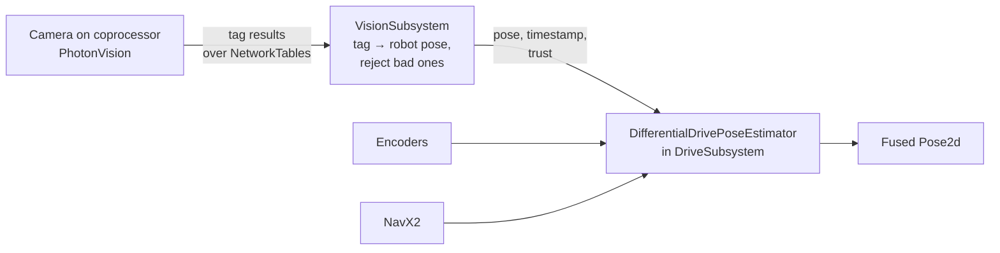

# 18. Vision: AprilTags and PhotonVision

## Why it matters
Odometry from [Lesson 17](17-odometry.md) is smooth and fast, but it drifts, and it only knows where the robot is if you told it where it started. A camera that can see the field fixes both problems.

Every FRC field has **AprilTags**: square black-and-white markers, each with a number, mounted at known spots. When a camera sees a tag, it can work out exactly where the camera must be to see the tag at that size and angle. WPILib knows where every tag is on the field, so that tells the robot where **it** is.

RoboJacks uses **PhotonVision**. This lesson covers how it works, how to read it from robot code, and how to **fuse** its measurements with odometry so the pose is both smooth and correct.

## Read this
- [AprilTag Introduction (WPILib)](https://docs.wpilib.org/en/stable/docs/software/vision-processing/apriltag/apriltag-intro.html)
- [PhotonVision documentation](https://docs.photonvision.org/), especially "Installation", "Camera Calibration", and "PhotonLib"
- [Pose Estimators (WPILib)](https://docs.wpilib.org/en/stable/docs/software/advanced-controls/state-space/state-space-pose-estimators.html)
- [Example: PhotonVisionSubsystem.java](https://github.com/ironmosquitos5653/nmrc-codecamp-level2-rev-2026/blob/main/src/main/java/frc/robot/subsystems/PhotonVisionSubsystem.java), from the NMRC code camp (level 2, 2026). This lesson follows its approach.

!!! info "Licenses"
    | What | License | What it means for you |
    |---|---|---|
    | **PhotonLib** (the vendor library in your robot code) | [MIT](https://github.com/PhotonVision/photonvision/blob/main/photon-lib/src/main/java/org/photonvision/PhotonCamera.java) | Use it in robot code freely. Keep its copyright notice if you copy its source files. |
    | **PhotonVision** (the program on the coprocessor) | [GNU GPL v3](https://github.com/PhotonVision/photonvision/blob/main/LICENSE) | Free to install and run. If you change PhotonVision itself and share it, you must share your changes under GPL v3 too. Your robot code isn't affected: it only talks to PhotonVision over NetworkTables. |
    | **PhotonVision documentation** | [CC BY 4.0](https://github.com/PhotonVision/photonvision/blob/main/docs/LICENSE) | You may copy and adapt it if you credit PhotonVision and link the license, the same way this course credits WPILib. |
    | **NMRC code camp example** | No license file in the repository | Read it and learn from it, but don't copy it into team code word for word without asking its authors. This lesson's code is written for the course. |

## Walkthrough

### The two halves
| Part | Runs on | What it does |
|---|---|---|
| **PhotonVision** | A **coprocessor** (a small computer like an Orange Pi 5) with one or more USB cameras | Finds AprilTags in every frame, works out where each tag is relative to the camera, and sends the results over NetworkTables |
| **PhotonLib** (vendor library) | The roboRIO | Reads those results in your robot code |

The coprocessor plugs into the robot's network switch or radio, like the roboRIO. The roboRIO does none of the image processing. It only reads the answers.

### Setting up PhotonVision
On a laptop connected to the robot's network, open the PhotonVision web page (`http://photonvision.local:5800`, or the coprocessor's IP address on port 5800). Then:

1. **Settings:** enter team number **4674**, so PhotonVision finds the roboRIO.
2. **Cameras:** give each camera a **nickname**, like `frontCamera`. Robot code finds the camera by this name, so it must match exactly.
3. **Calibrate** each camera at the resolution you'll use (Cameras tab → calibration with a printed chessboard). Without calibration, PhotonVision can't measure distance, and 3D results are wrong.
4. **Pipeline:** set the pipeline type to **AprilTag**, tag family **36h11**, and turn on **3D** mode.
5. Point the camera at a tag. The dashboard should outline it and show its ID.

Install PhotonLib in VS Code: **WPILib: Manage Vendor Libraries → Install new libraries (online)** and pick **PhotonLib**, or paste the JSON link from the PhotonVision docs. The PhotonLib version should match the version of PhotonVision on the coprocessor.

### What PhotonVision tells you
Each camera sends a **pipeline result** for every frame. A result can hold several **tracked targets**, one per tag it sees:

| Method | Meaning |
|---|---|
| `result.hasTargets()` | Did this frame see any tags? |
| `result.getBestTarget()` | The best tag in this frame |
| `result.getTimestampSeconds()` | When the picture was **taken** |
| `target.getFiducialId()` | The tag's number |
| `target.getYaw()` | How far left or right of center the tag is, in degrees |
| `target.getBestCameraToTarget()` | Where the tag is in 3D, relative to the camera |
| `target.getPoseAmbiguity()` | How sure PhotonVision is about that 3D answer: 0 is sure, above about 0.2 is a guess |

!!! warning "Check the sign of yaw on your camera"
    PhotonVision's own code comments disagree about whether a tag to the **right** gives a positive or negative yaw. In practice, PhotonVision's aiming examples treat **right as positive**, which is the opposite of WPILib's counterclockwise-positive rule. Hold a tag to the right of the camera and look at the yaw on the PhotonVision dashboard before you trust any aiming code.

### Where the camera is on the robot
To turn "where the tag is relative to the **camera**" into "where the **robot** is on the field," the code needs to know where the camera is mounted. That's a `Transform3d`, measured from the **center of the robot at floor level**, using the robot frame (+X forward, +Y left, +Z up):

```java
  // Where the front camera is mounted: 14 in forward, centered left-right, 8 in up,
  // tilted up 10 degrees, facing straight ahead. Measure your real robot!
  private final Transform3d m_robotToFrontCamera = new Transform3d(
      new Translation3d(Units.inchesToMeters(14), 0, Units.inchesToMeters(8)),
      new Rotation3d(0, Units.degreesToRadians(-10), 0));
```

The `Rotation3d` is roll, pitch, yaw, in radians. In WPILib's robot frame, **negative pitch tilts the camera up**. Yaw turns the camera left (positive) or right (negative), like the codecamp example's two cameras angled 15° outward.

If this transform is wrong, every pose the camera produces is wrong by the same amount. Measure it carefully, then check it: park the robot at a measured spot and compare the camera's pose with reality.

### From one tag to the robot's pose
PhotonLib's `PhotonUtils.estimateFieldToRobotAprilTag` does the geometry. It needs three things:

1. **Camera to tag**: what the camera measured (`target.getBestCameraToTarget()`)
2. **Tag on the field**: looked up by ID in WPILib's `AprilTagFieldLayout` for this season
3. **Camera to robot**: the mounting transform, flipped around (`m_robotToFrontCamera.inverse()`)

```java
Pose2d robotPose = PhotonUtils.estimateFieldToRobotAprilTag(
    target.getBestCameraToTarget(),         // where the tag is, seen from the camera
    tagPose.get(),                          // where the tag is on the field
    m_robotToFrontCamera.inverse())         // where the robot is, seen from the camera
    .toPose2d();
```

!!! info "Which field layout?"
    The 2026 game has two field layouts, because some events use welded field elements and some use AndyMark's: `AprilTagFields.k2026RebuiltWelded` (WPILib's default) and `AprilTagFields.k2026RebuiltAndymark`. The tags sit in slightly different places. Use the one your event uses; the codecamp example uses AndyMark.

### Fusing vision with odometry
You could just **replace** the odometry pose with the camera's whenever it sees a tag. Don't. Vision is noisy, so the robot would jitter, and one bad frame would teleport it.

Instead, WPILib's **pose estimator** blends them. It runs odometry every loop, like before, and when a vision measurement arrives it nudges the pose part of the way toward it. How far depends on how much you trust each one.



### Step 1: A pose estimator in the drive subsystem
In the WCD's `DriveSubsystem`, swap `DifferentialDriveOdometry` from [Lab 11](../testbed/lab11-odometry.md) for `DifferentialDrivePoseEstimator`. It needs one extra thing, the drivetrain's **kinematics** (its track width):

```java
  // Track width: how far apart the left and right wheels are
  private final DifferentialDriveKinematics m_kinematics =
      new DifferentialDriveKinematics(kDriveConstants.TrackWidthMeters);

  // Odometry plus vision (replaces DifferentialDriveOdometry from Lab 11)
  private final DifferentialDrivePoseEstimator m_poseEstimator;
```

In the constructor, where Lab 11 created the odometry:

```java
    m_poseEstimator = new DifferentialDrivePoseEstimator(
        m_kinematics,
        m_gyro.getRotation2d(),
        getLeftMeters(),
        getRightMeters(),
        Pose2d.kZero);
```

Then use it everywhere Lab 11 used `m_odometry`, and add one method the vision subsystem will call:

```java
  /** Where the robot is: odometry, corrected by vision. */
  public Pose2d getPose() {
    return m_poseEstimator.getEstimatedPosition();
  }

  /**
   * Hands the pose estimator a pose from a camera.
   * stdDevs says how much to trust it: (x meters, y meters, heading radians). Smaller = more trust.
   */
  public void addVisionMeasurement(Pose2d visionPose, double timestampSeconds, Matrix<N3, N1> stdDevs) {
    m_poseEstimator.addVisionMeasurement(visionPose, timestampSeconds, stdDevs);
  }
```

In `periodic()`, `m_odometry.update(...)` becomes `m_poseEstimator.update(...)` with the same arguments, and `resetPoseCommand()` calls `m_poseEstimator.resetPosition(...)` with the same arguments.

### Step 2: The vision subsystem
Vision gets its own subsystem. It reads every camera, turns good tag sightings into robot poses, and hands them to the drive subsystem.

```java
package frc.robot.subsystems;

import java.util.Optional;

import org.photonvision.PhotonCamera;
import org.photonvision.PhotonUtils;
import org.photonvision.targeting.PhotonPipelineResult;
import org.photonvision.targeting.PhotonTrackedTarget;

import edu.wpi.first.apriltag.AprilTagFieldLayout;
import edu.wpi.first.apriltag.AprilTagFields;
import edu.wpi.first.math.VecBuilder;
import edu.wpi.first.math.geometry.Pose2d;
import edu.wpi.first.math.geometry.Pose3d;
import edu.wpi.first.math.geometry.Rotation3d;
import edu.wpi.first.math.geometry.Transform3d;
import edu.wpi.first.math.geometry.Translation3d;
import edu.wpi.first.math.util.Units;
import edu.wpi.first.wpilibj2.command.SubsystemBase;

import frc.robot.telemetry.Telemetry;
import frc.robot.telemetry.TelemetryTable;

public class VisionSubsystem extends SubsystemBase {
  // Ignore a tag when PhotonVision is less sure than this about its 3D pose (0 = sure)
  private static final double kMaxAmbiguity = 0.15;

  private final DriveSubsystem m_drive;   // vision measurements go to its pose estimator
  private final TelemetryTable m_telemetry = Telemetry.getTable("Vision");

  // Where every AprilTag is on this season's field
  private final AprilTagFieldLayout m_fieldLayout =
      AprilTagFieldLayout.loadField(AprilTagFields.k2026RebuiltWelded);

  // The camera, by its nickname in the PhotonVision web page
  private final PhotonCamera m_frontCamera = new PhotonCamera("frontCamera");

  // Where the front camera is mounted. Measure your real robot!
  private final Transform3d m_robotToFrontCamera = new Transform3d(
      new Translation3d(Units.inchesToMeters(14), 0, Units.inchesToMeters(8)),
      new Rotation3d(0, Units.degreesToRadians(-10), 0));

  // The newest frame from the front camera, for aiming (it may have no targets)
  private PhotonPipelineResult m_latestFront = new PhotonPipelineResult();

  public VisionSubsystem(DriveSubsystem drive) {
    m_drive = drive;
  }

  @Override
  public void periodic() {
    PhotonPipelineResult newest = updateCamera("Front", m_frontCamera, m_robotToFrontCamera);
    if (newest != null) {
      m_latestFront = newest;   // keep the newest frame for aiming
    }
    // A second camera is one more line: updateCamera("Back", m_backCamera, m_robotToBackCamera);
  }

  /**
   * Reads every new frame from one camera and sends good robot poses to the drive subsystem.
   * Returns the newest frame, or null if there were no new frames.
   */
  private PhotonPipelineResult updateCamera(String name, PhotonCamera camera, Transform3d robotToCamera) {
    int used = 0;
    PhotonPipelineResult newest = null;
    for (PhotonPipelineResult result : camera.getAllUnreadResults()) {
      newest = result;
      if (!result.hasTargets()) {
        continue;   // no tags in this frame
      }
      PhotonTrackedTarget target = result.getBestTarget();

      // Where is this tag on the field? (Empty if it's not one of this year's tags.)
      Optional<Pose3d> tagPose = m_fieldLayout.getTagPose(target.getFiducialId());
      if (tagPose.isEmpty() || target.getPoseAmbiguity() > kMaxAmbiguity) {
        continue;   // unknown tag, or PhotonVision isn't sure: skip it
      }

      // Tag seen from the camera + tag on the field + camera on the robot = robot on the field
      Pose2d robotPose = PhotonUtils.estimateFieldToRobotAprilTag(
          target.getBestCameraToTarget(), tagPose.get(), robotToCamera.inverse())
          .toPose2d();

      // Trust it less the farther away the tag is: about 0.1 at 1.2 m, 0.6 at 3 m, 1.1 at 4 m
      double distance = PhotonUtils.getDistanceToPose(robotPose, tagPose.get().toPose2d());
      double stdDev = 0.07 * distance * distance;

      m_drive.addVisionMeasurement(robotPose, result.getTimestampSeconds(),
          VecBuilder.fill(stdDev, stdDev, stdDev));

      used++;
      m_telemetry.log(name + "/Pose", robotPose);           // for AdvantageScope's field view
      m_telemetry.log(name + "/Tag ID", target.getFiducialId());
      m_telemetry.log(name + "/Distance (m)", distance);
    }
    m_telemetry.log(name + "/Connected", camera.isConnected());
    m_telemetry.log(name + "/Measurements Used", used);
    return newest;
  }
}
```

In `RobotContainer`, create it **after** the drive subsystem, and hand it the drive:

```java
  private final VisionSubsystem m_vision = new VisionSubsystem(m_driveSubsystem);
```

!!! warning "Store the drive subsystem!"
    The constructor must save `drive` into `m_drive`. If it doesn't, `m_drive` stays `null`, and the robot code crashes with a `NullPointerException` the first time a camera sees a tag. That only happens when a tag is in view, so it's easy to miss in the shop. (The codecamp example's constructor has this exact bug: it takes `driveSubsystem` but never saves it.)

### Piece by piece
```java
for (PhotonPipelineResult result : camera.getAllUnreadResults()) {
```
The camera may have sent several frames since the last loop. `getAllUnreadResults()` returns every one we haven't read yet, so no measurement is wasted or used twice.

```java
if (tagPose.isEmpty() || target.getPoseAmbiguity() > kMaxAmbiguity) {
  continue;
}
```
Skips tags that aren't on this year's field and tags PhotonVision isn't sure about. A single flat tag can look almost the same from two different angles; **ambiguity** measures how close those two answers are. `continue` jumps to the next frame.

```java
double stdDev = 0.07 * distance * distance;
```
This is the **standard deviation**: roughly "how wrong is this measurement, usually?" Smaller means more trust. A tag 1 m away is measured precisely; a tag 5 m away is a few pixels across and much less precise. Squaring the distance makes trust drop fast as tags get farther away.

```java
m_drive.addVisionMeasurement(robotPose, result.getTimestampSeconds(), VecBuilder.fill(stdDev, stdDev, stdDev));
```
Hands the pose to the estimator with **when the picture was taken**, not when it arrived. The estimator remembers recent odometry, goes back to that moment, applies the correction there, and replays the movement since. The three numbers are the trust for X, Y, and heading.

### Tuning the trust
The `0.07 * distance²` rule is a starting point. Watch the fused pose in AdvantageScope ([Lesson 20](20-logging.md)) with the camera's pose (`Vision/Front/Pose`) drawn next to it:

| You see | Change |
|---|---|
| The pose jitters while the robot sits still in front of a tag | Trust vision less: raise 0.07 |
| The pose is slow to snap back after you push the robot | Trust vision more: lower 0.07 |
| Far-away tags drag the pose around | Skip tags beyond about 4 m |
| The heading jumps when a tag comes into view | Trust vision's heading less than the NavX's, for example `VecBuilder.fill(stdDev, stdDev, stdDev * 5)` |

### Aiming at a tag
For simple aiming (turn to face a tag) you don't need the pose at all. Turn by the target's **yaw** with a P controller from [Lesson 12](../controls/12-pid.md). This goes in `VisionSubsystem` or in a command that uses both subsystems:

```java
  /** Turns the robot in place to face the tag the front camera sees. Ends when lined up. */
  public Command aimAtTagCommand() {
    PIDController aim = new PIDController(0.02, 0, 0);   // output per degree of error
    aim.setTolerance(1.0);                                // within 1 degree counts as lined up
    return m_drive.run(() -> {
          PhotonPipelineResult result = m_latestFront;
          double turn = 0.0;
          if (result.hasTargets()) {
            // Yaw is positive when the tag is to the RIGHT (check yours!). Turning right = left side forward.
            turn = -aim.calculate(result.getBestTarget().getYaw(), 0.0);
          }
          m_drive.tankDriveVolts(turn * 12.0, -turn * 12.0);
        })
        .until(aim::atSetpoint)
        .finallyDo(() -> m_drive.tankDriveVolts(0, 0))
        .withName("Aim at Tag");
  }
```

`aim.calculate(yaw, 0.0)` is negative when the yaw is positive (tag to the right), so `turn` is positive and the left side drives forward: the robot turns right. If your yaw sign turns out the other way, remove the minus sign. Test with the wheels off the ground first.

This uses a new `DriveSubsystem` method, because `aimAtTagCommand` lives outside it:

```java
  /** Drives each side at a voltage. Keeps DifferentialDrive's safety timer fed. */
  public void tankDriveVolts(double leftVolts, double rightVolts) {
    m_leftLeader.setVoltage(leftVolts);
    m_rightLeader.setVoltage(rightVolts);
    m_drive.feed();
  }
```

Why `m_latestFront` instead of asking the camera? `getAllUnreadResults()` hands each frame out only **once**. If the aim command read frames itself, `periodic()` would miss them and the pose estimator would lose those measurements. So `periodic()` reads every frame and keeps the newest one for aiming. (PhotonLib's older `getLatestResult()` is deprecated and will be removed.)

### Is the camera's pose any good?
Before fusing, test the camera alone. Park the robot at a spot you've measured (in the shop, measure from a tag taped to the wall), then compare `Vision/Front/Pose` with reality:

| Real pose (measured) | Camera pose | Error |
|---|---|---|
| | | |

If the error is the same everywhere, the **camera mount transform** is off. If it gets worse with distance, **recalibrate** the camera and skip far-away tags.

### Going further
- **`PhotonPoseEstimator`** does the tag-to-robot math for you, and can combine **several tags in one frame** (multi-tag), which is much more accurate than one tag. Turn on multi-tag in the PhotonVision pipeline settings and see the PhotonLib docs.
- **Simulation:** PhotonLib's `VisionSystemSim` and `PhotonCameraSim` fake a camera in the WPILib simulator, so you can test vision code without a robot.

## Try it
- [ ] Set up the coprocessor: team number, camera nickname, calibration, AprilTag pipeline in 3D mode
- [ ] Hold a tag to the left and right of the camera and write down the sign of the yaw
- [ ] Measure the camera's mounting transform on the robot
- [ ] Add `VisionSubsystem` and swap Lab 11's odometry for `DifferentialDrivePoseEstimator`
- [ ] Park the robot at a measured spot and compare the camera's pose with reality
- [ ] Push the robot by hand so odometry is wrong, then point the camera at a tag. Watch the pose slide back.
- [ ] Challenge: add a second camera, angled out to the side like the codecamp robot

## Check yourself
??? question "Why not just use the camera's pose whenever it sees a tag?"
    Vision is noisy and sometimes wrong. Snapping to it makes the pose jitter, and one bad frame teleports the robot. The pose estimator blends it in gradually.

??? question "What does a smaller standard deviation mean?"
    More trust. The estimator moves the pose further toward a measurement with a small standard deviation.

??? question "Why does the standard deviation grow with distance squared?"
    Far-away tags are only a few pixels across, so a tiny pixel error becomes a big pose error. Trust should drop quickly with distance.

??? question "Why skip targets with high pose ambiguity?"
    A single tag can look almost the same from two different spots. High ambiguity means PhotonVision can't tell which spot is right, so the pose could be badly wrong.

??? question "Why does `addVisionMeasurement` need the picture's timestamp?"
    The picture was taken a little while ago. The estimator applies the correction at the moment the picture was taken, then replays the movement since.

??? question "The camera's pose is always 20 cm too far left, everywhere on the field. What's wrong?"
    The camera's mounting transform is wrong. A consistent offset points to the mount measurements.

??? question "The robot code crashes with a NullPointerException, but only when a camera sees a tag. What's the likely cause?"
    The vision subsystem's constructor didn't save the drive subsystem, so `m_drive` is `null` when it tries to add a measurement.

<p class="credit">The vision subsystem follows the approach of <a href="https://github.com/ironmosquitos5653/nmrc-codecamp-level2-rev-2026/blob/main/src/main/java/frc/robot/subsystems/PhotonVisionSubsystem.java">PhotonVisionSubsystem.java</a> from the NMRC code camp (level 2, 2026), adapted for a differential drive. Parts of the fusion and calibration explanations are adapted from <a href="https://github.com/itkan-robotics/mantik">Mantik</a> by Itkan Robotics (CC BY 4.0). API details follow PhotonLib 2026's source.</p>
