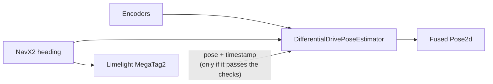

# 18. Vision: AprilTags and the Limelight

## Why it matters
Odometry from [Lesson 17](17-odometry.md) is smooth and fast, but it drifts, and it only knows where the robot is if you told it where it started. A camera that can see the field fixes both problems.

Every FRC field has **AprilTags**: square black-and-white markers, each with a number, mounted at known spots. When a camera sees a tag, it can work out exactly where the camera must be to see the tag at that size and angle. Since WPILib knows where every tag is on the field, that tells the robot where **it** is.

This lesson covers how that works, how to read a **Limelight** camera, and how to **fuse** its measurements with odometry so the pose is both smooth and correct.

## Read this
- [AprilTag Introduction (WPILib)](https://docs.wpilib.org/en/stable/docs/software/vision-processing/apriltag/apriltag-intro.html)
- [Pose Estimators (WPILib)](https://docs.wpilib.org/en/stable/docs/software/advanced-controls/state-space/state-space-pose-estimators.html)
- [Limelight documentation](https://docs.limelightvision.io/), especially "Robot Localization with MegaTag2"
- [PhotonVision documentation](https://docs.photonvision.org/), if your team uses PhotonVision instead

## Walkthrough

### Vision hardware
A vision camera for FRC is a camera plus a small computer that finds tags in every frame and sends the results to the roboRIO over NetworkTables.

| Option | What it is |
|---|---|
| **Limelight** | All-in-one camera and computer. Plug in power and Ethernet, configure it in a web page. Used in this lesson. |
| **PhotonVision** | Free software that runs on a coprocessor (Orange Pi and similar) with USB cameras. More setup, cheaper, more cameras. Same ideas, different library (`PhotonPoseEstimator`). |

### Two ways to use a tag
**1. Aim at it.** The simplest use: "how far left or right of the crosshair is the tag?" The Limelight sends these over NetworkTables:

| Key | Meaning |
|---|---|
| `tv` | 1 if the camera sees a valid target, 0 if not |
| `tx` | Horizontal angle from the crosshair to the target, in degrees. **Positive = target is to the right.** |
| `ty` | Vertical angle from the crosshair to the target, in degrees. Positive = target is above. |
| `ta` | How much of the image the target fills, 0–100%. Bigger = closer. |

!!! warning "tx is backwards from WPILib"
    WPILib counts **counterclockwise (left)** as positive. A positive `tx` means the robot must turn **right** (clockwise) to face the target. Hold a tag to the right of the camera and check the sign on your Limelight before trusting any code.

**2. Locate the robot.** The useful one. The camera sees one or more tags, looks up where they are on this year's field, and works out the **robot's** pose on the field. This is called **localization**. The Limelight calls its version **MegaTag**.

### What the camera needs to know
For localization to work, set these in the Limelight's web interface:

1. **Pipeline:** AprilTag, with **Full 3D** targeting.
2. **Field map:** this season's AprilTag layout (Limelight ships with it).
3. **Camera pose in robot space:** where the camera is on the robot, measured from the **center of the robot at floor level**: meters forward, meters left (or right), meters up, and its pitch, yaw, and roll. If this is wrong, every pose the camera reports is wrong by the same amount.

Measure carefully and double-check with the robot sitting at a known spot: the web interface draws the robot on a field map.

### MegaTag2
**MegaTag2** is Limelight's best localization mode. You send it the robot's heading from the gyro every loop, and it uses that to solve the rest of the pose. Because it doesn't have to guess the heading from the tag's shape, it's much more stable, especially with one tag far away.

`LimelightHelpers` is a single Java file from Limelight that reads and writes all the NetworkTables values for you. Download `LimelightHelpers.java` from the [Limelight docs](https://docs.limelightvision.io/) and put it in `src/main/java/frc/robot/`.

```java
// Tell the Limelight which way the robot is facing (degrees, WPILib convention)
LimelightHelpers.SetRobotOrientation("limelight", heading.getDegrees(), 0, 0, 0, 0, 0);

// Ask for the robot's pose, in WPILib's field coordinates (origin on the blue side)
LimelightHelpers.PoseEstimate estimate = LimelightHelpers.getBotPoseEstimate_wpiBlue_MegaTag2("limelight");
```

`"limelight"` is the camera's name, set in its web interface. With two cameras, give them different names.

A `PoseEstimate` has:

| Field | Meaning |
|---|---|
| `pose` | The robot's `Pose2d` on the field |
| `timestampSeconds` | When the picture was taken (not when it arrived) |
| `tagCount` | How many tags it used. 0 means no answer. |
| `avgTagDist` | Average distance to the tags, in meters |

### Fusing vision with odometry
You could just **replace** the odometry pose with the camera's whenever a tag is visible. Don't. Vision is noisy, so the robot would jitter, and a single bad frame would teleport it.

Instead, WPILib's **pose estimator** blends them. It runs odometry every loop, like before, and when a vision measurement arrives it nudges the pose part of the way toward it. How far it nudges depends on how much you trust each one.



For the West Coast Drive, swap `DifferentialDriveOdometry` from [Lab 11](../testbed/lab11-odometry.md) for `DifferentialDrivePoseEstimator`. It needs one extra thing, the drivetrain's **kinematics** (its track width):

```java
import edu.wpi.first.math.VecBuilder;
import edu.wpi.first.math.estimator.DifferentialDrivePoseEstimator;
import edu.wpi.first.math.kinematics.DifferentialDriveKinematics;

  // Track width: how far apart the left and right wheels are
  private final DifferentialDriveKinematics m_kinematics =
      new DifferentialDriveKinematics(kDriveConstants.TrackWidthMeters);

  // Odometry plus vision (replaces DifferentialDriveOdometry from Lab 11)
  private final DifferentialDrivePoseEstimator m_poseEstimator;
```

In the constructor:

```java
    m_poseEstimator = new DifferentialDrivePoseEstimator(
        m_kinematics,
        m_gyro.getRotation2d(),
        getLeftMeters(),
        getRightMeters(),
        Pose2d.kZero,
        VecBuilder.fill(0.05, 0.05, Units.degreesToRadians(5)),   // how much to trust odometry (x m, y m, heading rad)
        VecBuilder.fill(0.7, 0.7, 9999999));                      // how much to trust vision (x m, y m, heading rad)
```

### Standard deviations: how much to trust each source
Those two `VecBuilder.fill(...)` lines are **standard deviations**: roughly "how wrong is this source, usually?" Smaller numbers mean more trust.

- **Odometry:** about 5 cm and 5° of uncertainty per step.
- **Vision:** about 70 cm in X and Y. The heading is set to a huge number (9999999), meaning "never use vision's heading." With MegaTag2, the camera's heading came **from the gyro** in the first place, so feeding it back in would be circular.

You'll tune these later by watching the pose in AdvantageScope ([Lesson 20](20-logging.md)). A good start: trust vision more (smaller numbers) when it sees two or more tags close up, and less (bigger numbers) for one far-away tag.

### Updating every loop
`periodic()` now does three things: odometry, then send the heading to the camera, then vision.

```java
  @Override
  public void periodic() {
    // 1. Odometry, every loop, same as Lab 11
    m_poseEstimator.update(m_gyro.getRotation2d(), getLeftMeters(), getRightMeters());

    // 2. Send the heading to the Limelight for MegaTag2
    LimelightHelpers.SetRobotOrientation("limelight",
        m_poseEstimator.getEstimatedPosition().getRotation().getDegrees(), 0, 0, 0, 0, 0);

    // 3. Vision, only when it's trustworthy
    LimelightHelpers.PoseEstimate estimate =
        LimelightHelpers.getBotPoseEstimate_wpiBlue_MegaTag2("limelight");
    boolean useVision = estimate != null
        && estimate.tagCount > 0                  // it actually saw a tag
        && Math.abs(m_gyro.getRate()) < 360;      // not spinning fast (pictures blur)
    if (useVision) {
      m_poseEstimator.addVisionMeasurement(estimate.pose, estimate.timestampSeconds);
    }

    m_field.setRobotPose(getPose());
    m_telemetry.log("Vision/Used", useVision);
    m_telemetry.log("Vision/Tag Count", estimate == null ? 0 : estimate.tagCount);
    // ... the rest of your telemetry
  }

  public Pose2d getPose() {
    return m_poseEstimator.getEstimatedPosition();
  }
```

`resetPoseCommand()` from Lab 11 becomes `m_poseEstimator.resetPosition(...)` with the same arguments.

!!! info "Why pass the timestamp?"
    A picture takes time to process, so by the time the answer reaches the roboRIO the robot has moved. The pose estimator remembers recent odometry, goes back to the moment the picture was taken, applies the correction there, and replays the movement since. That's why `timestampSeconds` matters.

### Rejecting bad measurements
A few bad frames can drag the pose somewhere silly. Common checks before `addVisionMeasurement`:

| Reject when | Why |
|---|---|
| `tagCount == 0` | No tags, no answer |
| The robot is spinning fast | Motion blur, and the heading sent to the camera is out of date |
| One tag, far away (`avgTagDist` above about 4 m) | A small pixel error becomes a big pose error |
| The pose is off the field, or far from odometry right after a reset | Something is wrong (reflections, a wrong tag map) |

Log whether each measurement was used, like `Vision/Used` above. When the pose jumps during a match, the log will tell you which frame did it.

### Aiming with tx
For simple aiming (turn to face a tag) you don't need the pose at all. Turn by `tx` with a P controller from [Lesson 12](../controls/12-pid.md):

```java
  /** Turns in place to face the tag the Limelight sees. Ends when lined up. */
  public Command aimAtTagCommand() {
    PIDController aim = new PIDController(0.02, 0, 0);   // output per degree of error
    aim.setTolerance(1.0);                                // within 1 degree is lined up
    return run(() -> {
          double tx = LimelightHelpers.getTX("limelight");
          // tx is positive when the tag is to the right. Turning right means left forward, right backward.
          double turn = LimelightHelpers.getTV("limelight") ? -aim.calculate(tx, 0.0) : 0.0;
          m_drive.tankDrive(turn, -turn, false);
        })
        .until(() -> LimelightHelpers.getTV("limelight") && aim.atSetpoint())
        .finallyDo(() -> m_drive.stopMotor())
        .withName("Aim at Tag");
  }
```

`aim.calculate(tx, 0.0)` is negative when `tx` is positive (the tag is right), so `turn` is positive and the left side drives forward: the robot turns right. Check it on the robot with the wheels off the ground first.

### Is the camera's pose any good?
Before fusing, test the camera alone. Park the robot at a spot you've measured on the field (or in front of a tag in the shop), then compare:

| Real pose (measured) | Camera pose | Error |
|---|---|---|
| | | |

If the error is the same in every spot, the **camera mount measurements** are off. If it gets worse with distance, recalibrate the camera (the Limelight web interface has a calibration tool) and reject far-away single tags.

## Try it
- [ ] With the Limelight pointed at a tag, move the tag left and right and watch the sign of `tx`
- [ ] Measure the camera's position on the robot and enter it in the web interface
- [ ] Park the robot at a known spot and compare the camera's pose with reality
- [ ] Swap Lab 11's odometry for `DifferentialDrivePoseEstimator` and fuse MegaTag2 measurements
- [ ] Push the robot by hand so odometry is wrong, then point the camera at a tag. Watch the pose slide back.

## Check yourself
??? question "Why not just use the camera's pose whenever it sees a tag?"
    Vision is noisy and sometimes wrong. Snapping to it makes the pose jitter, and one bad frame teleports the robot. The pose estimator blends it in gradually.

??? question "What does a smaller standard deviation mean?"
    More trust. The estimator moves the pose further toward a source with a small standard deviation.

??? question "Why is the vision heading's standard deviation 9999999 with MegaTag2?"
    MegaTag2 gets its heading from the gyro you sent it. Using it again would just feed the gyro back to itself, so vision is only trusted for X and Y.

??? question "Why does `addVisionMeasurement` need a timestamp?"
    The picture was taken a little while ago. The estimator applies the correction at the moment the picture was taken, then replays the movement since.

??? question "The camera's pose is always 20 cm too far left, everywhere on the field. What's wrong?"
    The camera's mounting position on the robot is entered wrong. A consistent offset points to the mount measurements.

<p class="credit">Parts of this lesson are adapted from the Limelight, Fused Pose Estimation, and Pose Estimation Calibration lessons of <a href="https://github.com/itkan-robotics/mantik">Mantik</a> by Itkan Robotics (CC BY 4.0). MegaTag2 usage follows Limelight's documentation and <code>LimelightHelpers</code>.</p>
