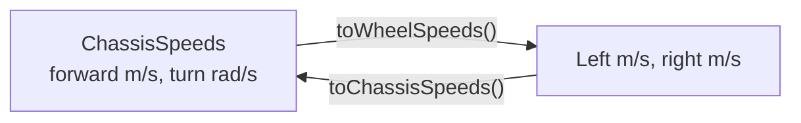

# 19. Autos with PathPlanner

## Why it matters
The autos from [Lesson 11](../project/11-autonomous.md) and [Lab 8](../testbed/lab8-navx-gyro.md) are lists of moves: drive 1 m, turn 90°, drive 1 m. Each move stops before the next one starts, and every stop wastes time.

**PathPlanner** lets you **draw** a smooth path on a picture of the field and have the robot follow it at full speed, curving through turns without stopping. You can drop actions onto the path ("start the intake here") and chain paths into whole autos, all without changing robot code.

PathPlanner needs to know where the robot is, so it builds on odometry from [Lesson 17](17-odometry.md) and [Lab 11](../testbed/lab11-odometry.md). It also needs to drive the wheels at exact **speeds**, which takes feedforward from [Lesson 13](../controls/13-feedforward.md) and [SysId](../controls/13b-sysid.md).

## Read this
- [PathPlanner documentation](https://pathplanner.dev/home.html)
- [PathPlannerLib: Build an Auto](https://pathplanner.dev/pplib-build-an-auto.html)
- [PathPlannerLib Java API](https://pathplanner.dev/api/java/)

## Walkthrough

### The two halves
| Part | Runs on | What it does |
|---|---|---|
| **PathPlanner** (the app) | Your laptop | Draw paths and autos; set the robot's size, weight, and speed limits. Saves files into your project's `src/main/deploy/pathplanner/` folder. |
| **PathPlannerLib** (vendor library) | The robot | Reads those files and turns them into commands that follow the paths. |

Download the app from the [PathPlanner releases](https://github.com/mjansen4857/pathplanner/releases) or the Microsoft Store. Install the library like REVLib: **WPILib: Manage Vendor Libraries → Install new libraries (online)**, and pick **PathplannerLib** from the list (or paste the JSON link from the PathPlanner docs).

### Words PathPlanner uses
| Word | Meaning |
|---|---|
| **Path** | One smooth drive from A to B, drawn with **waypoints** you drag around |
| **Auto** | A whole autonomous routine: paths in order, plus commands between them |
| **Named command** | A robot command you give a name, like `"Raise Elevator"`, so you can use it in the app |
| **Event marker** | A spot on a path where a named command starts, while the robot keeps driving |
| **Constraints** | Max speed, max acceleration, and max turning speed for a path |

### What PathPlanner needs from the drivetrain
PathPlannerLib's `AutoBuilder` needs four things from your drive subsystem:

| It needs | Method | You have it from |
|---|---|---|
| Where the robot is | `getPose()` | Lab 11 |
| A way to set where the robot is | `resetPose(Pose2d)` | Lab 11 (`resetPosition`) |
| How fast it's moving right now | `getChassisSpeeds()` | New: encoder rates |
| A way to drive at a speed | `driveRobotRelative(ChassisSpeeds)` | New: feedforward + PID |

**ChassisSpeeds** is WPILib's way to say how the whole robot moves: forward speed (m/s), sideways speed (always 0 for a tank drive), and turning speed (rad/s). The **kinematics** object converts between that and left/right wheel speeds:



### Step 1: Characterize the drivetrain
To drive at an exact speed, each side needs **feedforward**: kS (volts to overcome friction), kV (volts per m/s), and kA (volts per m/s²). Run **SysId** on the drivetrain ([Lesson 13.1](../controls/13b-sysid.md)) with the robot on the floor, and put the results in `Constants.java`:

```java
    // From SysId, drivetrain test (Lesson 19). These are examples: use your own numbers.
    public static final double kS = 0.15;   // volts
    public static final double kV = 2.60;   // volts per (m/s)
    public static final double kA = 0.40;   // volts per (m/s²)
    public static final double kVelocityP = 1.0;   // extra volts per (m/s) of speed error
```

!!! tip "No SysId yet?"
    You can estimate kV: drive straight at a known voltage (say 6 V) and read the speed from `getRate()`. kV ≈ (6 − kS) ÷ speed. It's rough, but enough to get a first path moving. Use SysId before competition.

### Step 2: Speeds in and out
In `DriveSubsystem.java`, add the kinematics, one feedforward, and a speed PID controller for each side:

```java
  // Converts between whole-robot speeds and left/right wheel speeds
  private final DifferentialDriveKinematics m_kinematics =
      new DifferentialDriveKinematics(kDriveConstants.TrackWidthMeters);

  // Voltage needed for a speed (from SysId), plus a little PID to fix what's left
  private final SimpleMotorFeedforward m_feedforward =
      new SimpleMotorFeedforward(kDriveConstants.kS, kDriveConstants.kV, kDriveConstants.kA);
  private final PIDController m_leftSpeedPID = new PIDController(kDriveConstants.kVelocityP, 0, 0);
  private final PIDController m_rightSpeedPID = new PIDController(kDriveConstants.kVelocityP, 0, 0);
```

Use the **effective** track width you measured in Lab 11, Step 9. PathPlanner turns better with it.

Then three methods:

```java
  /** How fast the robot is moving right now, from the encoder rates. */
  public ChassisSpeeds getChassisSpeeds() {
    return m_kinematics.toChassisSpeeds(
        new DifferentialDriveWheelSpeeds(m_leftEncoder.getRate(), m_rightEncoder.getRate()));
  }

  /** Drives at a whole-robot speed. PathPlanner calls this every loop while following a path. */
  public void driveRobotRelative(ChassisSpeeds speeds) {
    DifferentialDriveWheelSpeeds wheels = m_kinematics.toWheelSpeeds(speeds);
    double leftVolts = m_feedforward.calculate(wheels.leftMetersPerSecond)
        + m_leftSpeedPID.calculate(m_leftEncoder.getRate(), wheels.leftMetersPerSecond);
    double rightVolts = m_feedforward.calculate(wheels.rightMetersPerSecond)
        + m_rightSpeedPID.calculate(m_rightEncoder.getRate(), wheels.rightMetersPerSecond);
    m_leftLeader.setVoltage(leftVolts);
    m_rightLeader.setVoltage(rightVolts);
    m_drive.feed();   // tell DifferentialDrive's safety timer the motors are being driven
  }

  /** Tells odometry the robot is at this pose. PathPlanner calls it at the start of an auto. */
  public void resetPose(Pose2d pose) {
    m_odometry.resetPosition(m_gyro.getRotation2d(), getLeftMeters(), getRightMeters(), pose);
  }
```

`getRate()` is in meters per second because Lab 8 set the encoders' distance per pulse in meters. `setVoltage` respects the right side's inversion from Lab 2, so positive volts drive both sides forward.

!!! warning "Test before the first path"
    Put the robot on blocks and call `driveRobotRelative(new ChassisSpeeds(1.0, 0, 0))` from a button with `run(...)`. Both encoder rates should read about 1.0 m/s. If one side reads negative, or the speed is way off, fix that first: PathPlanner can't follow a path with a drivetrain that can't hold a speed.

### Step 3: Tell PathPlanner about the robot
Open the PathPlanner app, open your robot project folder, and go to **Settings**. Fill in **Robot Config**:

| Setting | WCD value |
|---|---|
| Drive mode | **Differential** (not holonomic) |
| Robot mass | Weigh it, with bumpers and battery |
| Trackwidth | Your effective track width from Lab 11 |
| Wheel radius | Half of `WheelDiameterMeters` |
| Drive gearing | Your gearbox ratio (motor turns per wheel turn) |
| True max drive speed | Measure: full voltage, straight line, read `getRate()` |
| Wheel COF | 1.2 is a common starting value for treaded wheels on carpet |
| Drive motor | **CIM**, **2** per side |
| Drive current limit | The `CurrentLimit` from Constants |

PathPlanner saves this to `src/main/deploy/pathplanner/settings.json`, and the robot reads it with `RobotConfig.fromGUISettings()`.

!!! warning "Keep the robot config honest"
    PathPlanner uses these numbers to predict how the robot will move. A mass from last year's robot, or a wrong max speed, makes every path track a little wrong, and it looks exactly like bad tuning. Update the config when the robot changes.

### Step 4: Configure AutoBuilder
At the end of the `DriveSubsystem` constructor:

```java
    // Let PathPlanner drive this subsystem (Lesson 19)
    try {
      RobotConfig config = RobotConfig.fromGUISettings();   // reads the app's Robot Config
      AutoBuilder.configure(
          this::getPose,              // where the robot is
          this::resetPose,            // set where the robot is
          this::getChassisSpeeds,     // how fast it's moving
          (speeds, feedforwards) -> driveRobotRelative(speeds),   // drive at a speed
          new PPLTVController(0.02),  // the path-following controller for tank drives (20 ms loop)
          config,
          // Flip paths to the red side when we're red. The field origin stays on the blue side.
          () -> DriverStation.getAlliance().orElse(Alliance.Blue) == Alliance.Red,
          this);                      // following a path requires this subsystem
    } catch (Exception e) {
      DriverStation.reportError("PathPlanner config didn't load: " + e.getMessage(), e.getStackTrace());
    }
```

`PPLTVController` is the controller for **differential** drives. It watches how far the robot is from the path (ahead, behind, to the side, wrong heading) and adjusts the speeds to get back on. Swerve robots use `PPHolonomicDriveController` instead.

### Step 5: Draw a path
In the app:

1. **Paths → +** to make a path. Drag the start and end points. Drag the round handles to bend the curve.
2. Set **Global Constraints** low for the first test: 1.0 m/s and 1.0 m/s².
3. **Autos → +** to make an auto. Set its starting pose to where the robot will start, then add your path.

Draw a simple first auto: 2 m straight ahead. Then an S-curve. Then something that ends back where it started.

!!! info "Starting pose"
    PathPlanner autos reset odometry to the auto's starting pose when they begin, so the robot must really be there. In the shop, put a tape mark on the floor and treat it as that spot.

### Step 6: Named commands
To run a mechanism during an auto, register it by name **before** building any autos. In `RobotContainer`'s constructor, first thing after the subsystems exist:

```java
    // Commands PathPlanner autos can use by name (register these before building any auto)
    NamedCommands.registerCommand("Elevator to L2", m_elevator.goToPresetCommand(Preset.L2));
    NamedCommands.registerCommand("Elevator to Start", m_elevator.goToPresetCommand(Preset.START));
```

In the app, add a **Named Command** block to an auto (between paths), or an **event marker** on a path (runs while driving), and type the same name.

### Step 7: Pick an auto in Elastic
Lesson 11's `Selectable` menu still works. Add every PathPlanner auto to it by name:

```java
    m_autoChooser.addDefault("Do nothing", Commands.none());
    m_autoChooser.add("Square", squareAuto());
    for (String name : AutoBuilder.getAllAutoNames()) {
      m_autoChooser.add("PP: " + name, new PathPlannerAuto(name));   // every auto drawn in the app
    }
    Tunables.publish("Auto", m_autoChooser);
```

`getAllAutoNames()` reads the auto files deployed with your code, so a new auto drawn in the app shows up in the menu after the next deploy. PathPlanner also has `AutoBuilder.buildAutoChooser()`, but it makes a `SendableChooser`, which this course doesn't use.

### Step 8: Warm up
The first time Java runs path-following code, it loads a lot of classes, and the first path can stutter. Pay that cost while the robot is disabled. At the end of the `Robot` constructor:

```java
    // Load PathPlanner's code now so the first auto path doesn't stutter
    CommandScheduler.getInstance().schedule(FollowPathCommand.warmupCommand());
```

### Step 9: Run it and watch
Deploy, select the auto in Elastic, and run autonomous. Watch the field map: the robot should follow the path's shape.

| If it... | Check |
|---|---|
| Doesn't move | The console for "PathPlanner config didn't load"; the auto is selected in Elastic |
| Drives the right shape but too short or long | Wheel diameter (Lab 11, Step 9) |
| Turns too much or too little | Track width: use the effective one |
| Lags behind the path, then catches up | kV too low; robot config max speed too high |
| Wobbles side to side | Speed PID too high, or acceleration constraint too high for the carpet |

Log the target pose and the real pose so you can see where they split apart. PathPlanner publishes its current path and target pose to NetworkTables under `/PathPlanner/` automatically; [AdvantageScope](20-logging.md) can draw them on the field next to the robot.

### Going further
- **On-the-fly paths:** `AutoBuilder.pathfindToPose(targetPose, constraints)` drives to a pose from wherever the robot is, avoiding field obstacles. Great with vision ([Lesson 18](18-vision.md)).
- **Choreo:** another path tool that computes the **fastest possible** path for your robot. PathPlannerLib can follow Choreo paths too.

## Try it
- [ ] Run SysId on the drivetrain and put kS, kV, kA in Constants
- [ ] With the robot on blocks, check `driveRobotRelative` holds 1.0 m/s on both sides
- [ ] Fill in PathPlanner's Robot Config with real measurements
- [ ] Follow a 2 m straight path, then an S-curve
- [ ] Add an event marker that raises the elevator while driving
- [ ] Make one auto in the app, deploy, and pick it from the Elastic menu
- [ ] Time Lab 8's sensor square, then draw a smooth "square" in PathPlanner and time it

## Check yourself
??? question "What does PathPlanner need from the drivetrain?"
    The pose, a way to reset the pose, the current speeds, and a way to drive at a requested speed.

??? question "Why does PathPlanner need feedforward?"
    It asks for exact wheel speeds. Feedforward turns a speed into the voltage that produces it; PID only fixes the small error left over.

??? question "Why register named commands before building autos?"
    Building an auto looks up each name. A name that isn't registered yet becomes a command that does nothing.

??? question "Which controller does a tank drive use, and which does swerve use?"
    `PPLTVController` for differential (tank) drives; `PPHolonomicDriveController` for swerve.

??? question "The robot drives the right shape, but every path ends 10% short. What's wrong?"
    The wheel diameter (distance per pulse) is off by about 10%, so odometry thinks the robot went farther than it did.

<p class="credit">Parts of this lesson are adapted from the PathPlanner lesson of <a href="https://github.com/itkan-robotics/mantik">Mantik</a> by Itkan Robotics (CC BY 4.0), rewritten for a differential drive. API details follow PathPlannerLib 2026's source and documentation.</p>
