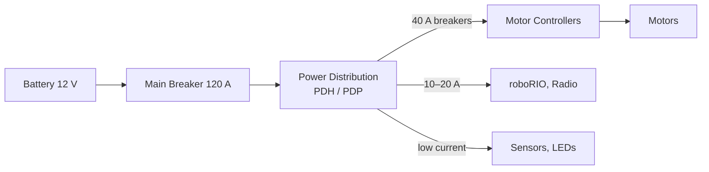
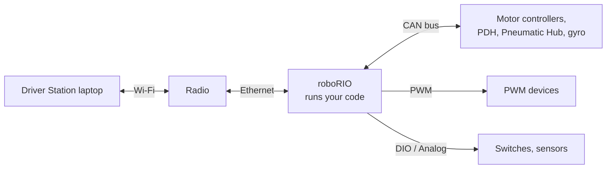

# 4. Electronics

## Why it matters
Half of all "code bugs" at competition are actually electrical problems: a loose wire, a tripped breaker, a dying battery, a duplicated CAN ID. A programmer who can tell the difference saves the team hours of chasing a bug that isn't in the code. Programmers who understand the wiring debug faster and get trusted more.

You won't be wiring the robot yourself in this lesson. The goal is to understand what each part does, how power and data flow, and what the electrical system means for your code.

## Read this
- [Intro to FRC Robot Wiring](https://docs.wpilib.org/en/stable/docs/zero-to-robot/step-1/intro-to-frc-robot-wiring.html)
- [Wiring Best Practices](https://docs.wpilib.org/en/stable/docs/hardware/hardware-basics/wiring-best-practices.html)
- [CAN Wiring Basics](https://docs.wpilib.org/en/stable/docs/hardware/hardware-basics/can-wiring-basics.html)
- [roboRIO Brownout and Understanding Current Draw](https://docs.wpilib.org/en/stable/docs/software/roborio-info/roborio-brownouts.html)

## Walkthrough

### The three ideas you need

| Concept | Symbol | Unit | Water-pipe analogy |
|---|---|---|---|
| Voltage | V | Volts (V) | Water **pressure**: how hard it pushes |
| Current | I | Amps (A) | How much water **flows** per second |
| Resistance | R | Ohms (Ω) | How **narrow** the pipe is |

**Ohm's Law** connects them:

```
V = I × R
```

With the same pressure (voltage), a narrower pipe (more resistance) lets less water (current) through.

**Power** is how fast energy is used:

```
P = V × I
```

A motor pulling 40 A at 12 V uses about 480 W, about the same as a small microwave.

!!! example "Why thin wires get hot"
    A wire has a little resistance. Push a lot of current through a thin wire and some power turns into heat (P = I² × R). That's why big motors use thick wire, and why the rules specify minimum wire sizes for each breaker.

### What's on an FRC robot

| Part | What it does | What programmers should know |
|---|---|---|
| **Battery** | 12 V lead-acid battery, the only power source | Its voltage drops under load and as it drains. Check it before every match. |
| **Main breaker** | 120 A switch and circuit breaker | Turns the whole robot on and off. Also the emergency off switch. |
| **Power Distribution** (PDH or PDP) | Splits power into many channels, each with its own breaker | Can report current per channel to your code |
| **Breakers / fuses** | Cut power to one channel if it draws too much | A tripped breaker looks like "the motor stopped working" |
| **roboRIO** | The robot's computer. Runs your code. | Has PWM, DIO, analog, and CAN ports |
| **Radio** | Wi-Fi link to the Driver Station | No radio = no robot control |
| **Motor controllers** | Turn small signals from the roboRIO into big motor power | TalonFX, SPARK MAX/Flex, and others. Each has a CAN ID. |
| **Motors** | Turn electrical power into motion | Kraken, Falcon, NEO, and others. Many have built-in encoders. |
| **Sensors** | Measure the world | Encoders, gyros, limit switches, cameras |
| **Robot Signal Light (RSL)** | Orange light. Solid = disabled, blinking = enabled | Check it before walking near the robot |

### Follow the power



Power always flows from the battery, through the main breaker, into the power distribution, and then out to each device through its own breaker.

### Follow the data
Power and data travel on different wires:



Your code runs on the roboRIO. Joystick data arrives from the Driver Station over Wi-Fi, and your code sends commands out to motor controllers, mostly over **CAN**.

### The roboRIO's ports

| Port | Signal | Used for |
|---|---|---|
| **CAN** | Digital messages on a shared bus | Most motor controllers, PDH, Pneumatic Hub, many sensors |
| **PWM** (0–9) | A pulse that sets a speed | Older or simpler motor controllers, servos |
| **DIO** (0–9) | On/off digital in or out | Limit switches, beam breaks, some encoders |
| **Analog In** (0–3) | A voltage from 0 to 5 V | Potentiometers, analog distance sensors |
| **I2C, SPI, USB** | Data buses | Some gyros, color sensors, cameras |

!!! info "Port numbers in code must match the wiring"
    `new PWMSparkMax(2)` means "the controller plugged into PWM port 2." `new DigitalInput(0)` means DIO port 0. If the wire is in port 3 and the code says 2, nothing happens and no error appears.

### Batteries and brownouts
A fresh battery reads about 12.5–13 V with nothing running. The voltage **sags** while motors pull current, and drops further as the battery drains through a match.

If the voltage drops too low, the roboRIO protects itself by **disabling outputs** to motors. That's a **brownout**. It happens in stages:

!!! wpilib "From the WPILib docs: roboRIO brownout stages"
    | Battery voltage | Stage | What happens |
    |---|---|---|
    | Below **6.8 V** | 1: 6 V output drop | The 6 V power on the PWM pins starts to drop |
    | Below **6.3 V** | 2: Output disable | **Motors are disabled**: PWM outputs turn off, CAN motor controllers get a disable command, pneumatics turn off, and the 5 V and 3.3 V sensor power rails turn off. The roboRIO's power light turns amber and the Driver Station shows "Voltage Brownout." This lasts until the voltage climbs back above **7.5 V**. |
    | Below about **4.5 V** | 3: Blackout | The roboRIO may shut off completely, then reboot when the voltage recovers |

    Stage 2 also cuts power to sensors plugged into the DIO and analog ports, so sensors can glitch during a brownout too.

    *Adapted from [roboRIO Brownout and Understanding Current Draw](https://docs.wpilib.org/en/stable/docs/software/roborio-info/roborio-brownouts.html), CC BY 4.0.*

A full reboot in stage 3 costs you a big chunk of the match while the roboRIO and radio start back up.

What causes brownouts:

- many motors starting at full power at the same time
- motors that are stalled (pushing against something but not moving), which pull huge current
- an old or partly charged battery
- loose battery connections

!!! tip "Programmer takeaway: current limits"
    Motor controllers let you set a **current limit** in code, a cap on how many amps the motor can pull. A current limit trades a little peak performance for a robot that doesn't brown out or trip breakers mid-match. Your team's code almost certainly sets these. Find them.

You can see brownouts after a match in the Driver Station log viewer, along with battery voltage over time.

### CAN bus
Most motor controllers talk to the roboRIO over **CAN**, a two-wire daisy chain (yellow and green). Every device is wired one after the other in a chain that starts at the roboRIO and ends at a **terminator**.


<p class="credit">CAN wiring runs from device to device in one chain. From the WPILib docs, <a href="https://docs.wpilib.org/en/stable/docs/hardware/hardware-basics/can-wiring-basics.html">CAN Wiring Basics</a> (CC BY 4.0).</p>

!!! wpilib "From the WPILib docs: CAN wiring and termination"
    CAN is generally wired with **yellow** and **green** wire, with yellow as CAN-High and green as CAN-Low. Many devices use the same colors to show how the wires plug in.

    A CAN network must be **terminated** with a 120 Ω resistor at each end. The roboRIO and the power distribution panel (PDP) have these built in, so the recommended layout starts the chain at the **roboRIO**, ends it at the **PDP**, and puts every other CAN device in between. The PDP ships with its termination jumper **on**; leave it that way. A REV **Power Distribution Hub** (PDH) has a termination switch instead, labeled **TERM**, next to its CAN terminals: make sure it's **ON** when the PDH is at the end of the chain.

    *Adapted from [CAN Wiring Basics](https://docs.wpilib.org/en/stable/docs/hardware/hardware-basics/can-wiring-basics.html), CC BY 4.0.*

- Every device needs a **unique CAN ID** for its device type.
- The ID you set in the vendor tool (Phoenix Tuner for CTRE, REV Hardware Client for REV) must match the ID in your code.
- If the chain breaks in the middle, every device **after** the break goes silent.

!!! warning "Common CAN mistakes"
    | Symptom | Likely cause |
    |---|---|
    | Motors twitch, or the wrong one moves | Two devices with the same CAN ID |
    | A whole group of devices stops responding | Broken connection in the chain before them |
    | One device missing in Phoenix Tuner or REV Hardware Client | Its CAN wires are loose or its ID was never set |
    | "CAN frame not received" errors in the console | The device the code expects isn't on the bus at that ID |
    | **Every** device times out (for REV: `timed out while waiting for Periodic Status 0: CAN Receive has Timed Out`) | The **yellow and green wires are swapped** somewhere, often right at the roboRIO. Yellow goes to CAN-H and green to CAN-L at **every** connection. |

!!! tip "Check the colors at the roboRIO first"
    The roboRIO's CAN port is labeled **H** and **L**. Yellow goes to **H**, green goes to **L**. One swapped connection anywhere in the chain can silence the whole bus, so when nothing on CAN responds, check the colors at each connector, starting at the roboRIO.

Keep a **CAN ID map**, a list of every device, its ID, and what it does, somewhere the whole team can see it.

### Safety basics
- The robot is **always** potentially live once the battery is plugged in. Turn off the main breaker before touching wiring.
- Never connect a battery backward. It can destroy electronics instantly.
- Say **"Enabling!"** out loud before enabling the robot, and wait until people are clear.
- Know where the main breaker is, so you can reach it in an emergency.

## Try it
!!! tip "Next: the parts on our robots"
    Lessons [4.1](04b-motors.md) (motors), [4.2](04c-spark-max.md) (the SPARK MAX), and [4.3](04d-sensors.md) (sensors) cover the exact hardware on the test bed and West Coast Drive.

With a mentor, on a real robot:

- [ ] Find each part in the table above: battery, main breaker, power distribution, roboRIO, radio, motor controllers, RSL
- [ ] Trace one motor from the battery to the motor, naming every part the power passes through
- [ ] Find that motor's breaker and CAN ID
- [ ] Open Phoenix Tuner or REV Hardware Client and list every device on the CAN bus
- [ ] Find where the team's code sets a current limit

## Check yourself
??? question "A motor pulls 60 A at 12 V. How much power is that?"
    `P = 12 × 60 = 720 W`

??? question "What is a brownout, and how can code help prevent one?"
    The battery voltage drops so low that the roboRIO disables motor outputs. Current limits in code reduce how much current motors can pull, which keeps the voltage up.

??? question "Why does every CAN device need a unique ID?"
    The roboRIO addresses devices by ID. Duplicates mean commands go to the wrong device or conflict.

??? question "Half the motors stop responding at once, all after a certain point in the CAN chain. What's the likely cause?"
    A broken or loose CAN connection just before the first device that stopped. Everything after a break loses communication.

??? question "Your code says `new PWMSparkMax(2)`, but the motor doesn't move. Name two non-code things to check."
    That the PWM cable is actually in port 2 (and plugged in the right way around), and that the motor controller has power: its breaker isn't tripped and its status light is on.
