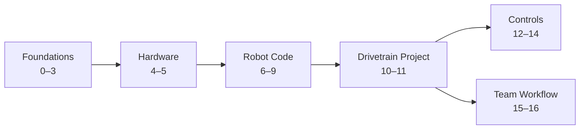

# RoboJacks FRC Programming

A hands-on tutorial course for high school FRC students. It starts with installing the tools and ends with PID, feedforward, SysId, and motion profiles: the same control techniques top teams use.

You don't need any programming experience to start. You don't need a robot for most of it, either. Nearly every exercise runs in simulation on your laptop.

<a class="cta" href="testbed/index.html">🔧 Go to the Test Bed Labs</a>

Two tabs at the top of every page switch between the **Lessons** and the **Labs**.

## Before you start: learn Java
This course doesn't teach Java from scratch. Before the labs, work through an interactive Java course:

- [Coddy: Learn Java](https://coddy.tech/landing/java) (free)
- [Codecademy: Learn Java](https://www.codecademy.com/learn/learn-java)

Finish at least through **classes and objects**. [Lesson 3: Java Reference](foundations/03-java.md) has the exact checklist, and it's the page to come back to whenever robot code uses Java you've forgotten.

## How this course works

The [WPILib documentation](https://docs.wpilib.org/en/stable/) is the official reference, and it's excellent. This course does **not** replace it. Think of WPILib as the textbook and this site as the lab manual: we explain things in order, at a beginner's pace, with exercises, and send you to WPILib for the full details.

Every lesson follows the same shape:

| Section | What it's for |
|---|---|
| **Why it matters** | The robot problem we're solving |
| **Read this** | WPILib pages to skim before or alongside the lesson |
| **Walkthrough** | Step-by-step explanation, with code you type yourself |
| **Try it** | Exercises in simulation or on the robot |
| **Check yourself** | Questions to answer before moving on. Click each one to check your answer. |

!!! tip "Type the code, don't paste it"
    You learn more from fixing your own typos than from running someone else's working code.

## The path

| Part | Lessons | You'll be able to... |
|---|---|---|
| **Foundations** | 0–3 | Set up WPILib, use Git and the terminal, and look up the Java robot code uses |
| **Hardware** | 4–5 | Trace power and data through the robot; know our motors (NEO, CIM, 775pro), the SPARK MAX, and our sensors; control pneumatics |
| **Robot Code** | 6–9 | Explain the 20 ms loop and the command scheduler, write subsystems and commands, read sensors in real units, debug in simulation |
| **Drivetrain Project** | 10–11 | Build a driveable robot with good controls and distance-based autonomous routines |
| **Controls** | 12–14 | Tune PID, add feedforward, characterize mechanisms with SysId, use motion profiles |
| **Team Workflow** | 15–16 | Work on a shared codebase with branches, reviews, unit tests, and CI |

## Test bed labs
Labs are hands-on exercises on the team's **test bed**, a board with a roboRIO, SPARK MAX controllers, motors, and sensors. They have their own **Labs** tab at the top of every page. Each one goes with a lesson:

| Labs | What you'll do |
|---|---|
| 0–2 | Set up, spin your first motor, and drive the West Coast Drive |
| 3–6 | Buttons, limit switches, a knob, and an encoder: one new sensor or idea per lab |
| 7–8 | Autonomous on the WCD, then turning with the NavX2 gyro |
| 9–10 | PID: turn a wheel exactly 10 times, then hold an elevator against gravity |

See the [Labs overview](testbed/index.md) for the full list and when to do each one.

## Where to start

| If you... | Start at |
|---|---|
| Have never programmed | An interactive Java course first ([Coddy](https://coddy.tech/landing/java) or [Codecademy](https://www.codecademy.com/learn/learn-java)), then [Lesson 0](foundations/00-setup.md) |
| Know Java from a class | Skim the [Java Reference](foundations/03-java.md), then [Lesson 6](robot-code/06-robot-program.md) |
| Already write robot code | [Lesson 7.1](robot-code/07b-scheduler.md), then [Controls](controls/12-pid.md) |

## Time
Plan on about one lesson per meeting for most people, after the Java course. The Controls lessons usually take two or three meetings each. Don't rush the exercises. They're where the learning happens.

## Getting help
- Ask a returning programmer or mentor. Everyone was a beginner once.
- Search [Chief Delphi](https://www.chiefdelphi.com/), the FRC forum, before posting. Most questions have been answered.
- Found a mistake in this course? See [How to Contribute](contributing/index.md).
