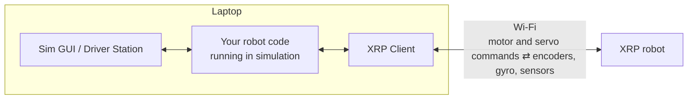

# 10. The XRP: Set Up, Simulate, and Run Code

## Why it matters
Everything so far ran in simulation, or on the team's one test bed and one West Coast Drive. For the drivetrain project, every student gets a robot: the **XRP**.

The XRP (Experiential Robotics Platform) is a small, cheap robot made for learning FIRST programming. It runs **the same WPILib code** as a competition robot: the same command-based structure, the same `DifferentialDrive`, the same `Encoder` class, the same dashboards. What you write for the XRP in Lessons 10.1 and 10.2 is what you'd write for a full-size tank drive.

This lesson gets an XRP ready: assemble it, put the WPILib firmware on it, connect to it, and run code two ways: **simulated** (no robot needed) and **on the real XRP**.

## Read this
- [Getting Started with XRP (WPILib)](https://docs.wpilib.org/en/stable/docs/xrp-robot/index.html)
- [XRP User Guide: building the robot](https://xrpusersguide.readthedocs.io/en/latest/course/building.html)
- [XRP-WPILib firmware releases](https://github.com/wpilibsuite/xrp-wpilib-firmware/releases)

## Walkthrough

### What's on an XRP
| Part | Details | In code |
|---|---|---|
| **Drive motors** | 2 geared motors, 48.75:1, about 90 RPM with no load | `XRPMotor` channels **0** (left) and **1** (right) |
| **Wheels** | 60 mm diameter, 155 mm track width | |
| **Encoders** | On each drive motor: **585 counts per wheel turn**. Count up going forward. | `Encoder` on **DIO 4/5** (left) and **6/7** (right) |
| **Gyro (IMU)** | 3-axis gyro and accelerometer. Calibrates for 3–5 s at power-on: keep the XRP still and flat. | `XRPGyro`, `BuiltInAccelerometer` |
| **Servo** | The arm, on the Servo 1 port | `XRPServo` channel **4** |
| **Line sensor** | 2 reflectance sensors (0 V white to 5 V black) | `XRPReflectanceSensor` (AnalogInput 0 and 1) |
| **Rangefinder** | Ultrasonic, about 2 cm to 4 m | `XRPRangefinder` (AnalogInput 2) |
| **USER button and green LED** | On the board | `XRPOnBoardIO` (DIO 0 and 1) |
| **Extra ports** | Motor 3 and 4 (with encoders), Servo 2 | `XRPMotor` 2 and 3, `XRPServo` 5 |
| **Power** | 4 AA batteries; rechargeable is best | |

!!! note "The right motor runs backward"
    Positive output spins the right motor backward, so robot code has to **invert** it. This is the same idea as the WCD's right side in [Lab 2](../testbed/lab2-west-coast-drive.md).

What the XRP **can't** do: CAN devices (no SPARK MAX, no Kraken), most other sensors, and the regular `PWMSparkMax` and `Servo` classes. It needs its own `XRPMotor` and `XRPServo` classes, which come with WPILib.

### How XRP code runs: it doesn't get deployed
This is the big difference from a real robot. On a competition robot, **Deploy** copies your code to the roboRIO and the roboRIO runs it. The XRP's little processor can't run Java, so:

- Your robot code **runs on your laptop**, exactly like simulation.
- WPILib's **XRP Client** sends motor and servo commands to the XRP over **Wi-Fi**, and gets sensor readings back, 50 times a second.



So "deploying to the XRP" means **running Simulate Robot Code with the XRP Client turned on**. Turn the XRP Client off, and the same code runs as a pure simulation with no robot at all.

| | Competition robot | XRP |
|---|---|---|
| Where the code runs | The roboRIO | Your laptop |
| How you start it | **Deploy Robot Code** | **Simulate Robot Code** (F5), with the XRP Client on |
| Connection | Robot radio | The XRP's own Wi-Fi network |
| Driver Station | The FRC Driver Station app | The Sim GUI's built-in one (or the real app, see below) |

### Step 1: Assemble it
Follow the [XRP User Guide's building instructions](https://xrpusersguide.readthedocs.io/en/latest/course/building.html), **up to and including mounting the arm on the servo**. Put in 4 AA batteries.

For the team: write each XRP's number on a piece of tape on the chassis. You'll need it in Step 3.

### Step 2: Put the WPILib firmware on it
The XRP needs special firmware to talk to WPILib. You do this once per XRP (and again when a new firmware comes out).

1. **Find out which XRP you have.** There are different firmware files for different versions of the XRP board: use [SparkFun's XRP Controller guide](https://docs.sparkfun.com/SparkFun_XRP_Controller/introduction/) to identify yours. "Beta" boards need the file with **Beta** in its name; V1 boards need the one without.
2. **Download** the matching `.uf2` file from the **Assets** list of the latest [XRP-WPILib firmware release](https://github.com/wpilibsuite/xrp-wpilib-firmware/releases). If you pick the wrong one, nothing breaks: it just won't install, and you try the other.
3. **Plug the XRP into your computer** with a USB **data** cable (USB-C on current XRPs, Micro-USB on Beta ones). A red power LED lights up.
4. **Hold the `BOOTSEL` button** on the processor board, **quickly press the reset button**, then let go of `BOOTSEL`.
5. The XRP disconnects and comes back as a USB drive (named like `RPI-RP2`). **Drag the `.uf2` file onto that drive.**
6. When it finishes, the drive disappears on its own. Unplug the USB cable.

!!! tip "Charge-only cables"
    If no drive ever appears, the cable is probably charge-only. Try a different USB cable before anything else.

### Step 3: Turn it on and connect
1. Put the XRP on a **flat table**, and slide its **power switch** on. The red power LED lights.
2. **Don't move it for 5 seconds.** The green LED blinks fast while the gyro calibrates. Moving it now makes the heading drift all session. (If you bumped it, press the reset button to calibrate again.)
3. On your laptop, connect to the XRP's Wi-Fi network: **`XRP-<something>`**, password **`xrp-wpilib`**.
4. Open **`http://192.168.42.1:5000`** in a browser. If the XRP's web page loads, you're connected.

!!! warning "A room full of XRPs"
    Every XRP makes its own network, and they all look alike. To find **your** XRP's network name, plug it into your laptop with USB: a drive named `PICODISK` appears, and the file `xrp-status.txt` in it lists the network name. Write it on the XRP's tape label. Then always connect to that one.

!!! info "No internet while connected"
    While your laptop is on the XRP's Wi-Fi, it isn't on the internet. Build your project once (Step 4) **while you're online**, so Gradle can download everything, before switching to the XRP's network.

The web page also lets you change the XRP's network settings, like having it join an existing Wi-Fi network instead of making its own. Leave it in its default mode (making its own network) unless a mentor sets up something else.

### Step 4: Make an XRP project
1. In WPILib VS Code: **Ctrl+Shift+P → WPILib: Create a new project**.
2. Choose **Template → Java → XRP - Command Robot**. (For a quick test drive, the **Example → XRP Reference** project already drives with a joystick.)
3. Name it `XRPDrive`, choose a folder, and **Generate Project**.
4. While you're still online, build it once: **Ctrl+Shift+P → WPILib: Build Robot Code**.

An XRP project is a normal WPILib project with two differences in `build.gradle`:

```groovy
//Sets the XRP Client Host
wpi.sim.envVar("HALSIMXRP_HOST", "192.168.42.1")
wpi.sim.addXRPClient().defaultEnabled = true
```

The first line is the XRP's address (change it only if the XRP joins a different network). The second turns on the XRP Client. The project also has an `XRPVendordep.json` in `vendordeps/`, which provides `XRPMotor`, `XRPServo`, `XRPGyro`, and `XRPOnBoardIO`.

### Step 5: Simulate, with no XRP
Simulation is how you test code when you don't have the robot: at home, on the bus, or while someone else is using it.

1. **Ctrl+Shift+P → WPILib: Simulate Robot Code** (or press **F5**).
2. A box asks which **simulation extensions** to use. Keep **Sim GUI** checked, and **uncheck the XRP Client**.
3. The **Sim GUI** opens. Set **Robot State** to **Teleoperated**.
4. Drive with a controller, or with the keyboard: drag **Keyboard 0** from **System Joysticks** onto **Joystick 0**. W/S and A/D are the left stick.

The motors show up under **Other Devices** as `XRPMotor:motorL` and `XRPMotor:motorR`, so you can watch their outputs. The XRP's encoders and gyro won't change on their own, because nothing is really moving. [Lesson 10.1](10-teleop.md#step-6-simulate-it) adds a few lines that fake the movement, so you can watch the robot drive on a field map.

### Step 6: Run on the real XRP
1. Turn on the XRP, keep it still for 5 seconds, and connect your laptop to its Wi-Fi.
2. **Put it on a block** or hold it with the wheels off the table for the first test.
3. **F5** (Simulate Robot Code). This time keep **XRP Client** **checked**.
4. In the Sim GUI, set **Robot State** to **Teleoperated**, then drive.

When it's working, the XRP's sensors show up live in the Sim GUI: turn a wheel by hand and watch its encoder count change.

!!! tip "Using the real Driver Station"
    The Sim GUI has its own driver station controls, which is enough for the XRP. If you'd rather use the FRC Driver Station app (on Windows), the project already turns on the Driver Station extension: set the Driver Station's team number to **127.0.0.1** and it connects to your code.

**Stopping:** disable in the Sim GUI, or close the Sim GUI window, which stops the program. Always disable before picking up a moving XRP.

### Dashboards work the same
Elastic and AdvantageScope connect to XRP code the same way they connect to simulation: set Elastic's connection to **localhost** ([Lesson 6.1](../robot-code/06b-dashboards.md)), because your code is running on your own laptop.

### When it doesn't work
| Symptom | Likely cause |
|---|---|
| No `RPI-RP2` drive when updating firmware | Charge-only USB cable; or press reset **while** holding BOOTSEL |
| Can't find the XRP's Wi-Fi network | It's off, the batteries are flat, or it joined another network. Check `xrp-status.txt` over USB. |
| Web page at 192.168.42.1:5000 won't load | You're connected to a different XRP, or your laptop dropped the XRP network to find the internet |
| Code runs, but the XRP doesn't move | XRP Client not checked; robot not enabled; or the batteries are low |
| Build fails with download errors | You built for the first time while on the XRP's Wi-Fi. Reconnect to the internet and build again. |
| Heading drifts while sitting still | It was moved while calibrating. Press reset with it flat and still. |
| One wheel spins backward | The right motor isn't inverted in code ([Lesson 10.1](10-teleop.md)) |
| Robot slows down and acts strangely | Low batteries. XRPs eat AAs; use rechargeables and charge them. |

## Try it
- [ ] Put the WPILib firmware on your XRP
- [ ] Find your XRP's network name in `xrp-status.txt` and label the robot
- [ ] Load the XRP's web page at 192.168.42.1:5000
- [ ] Create the `XRPDrive` project and build it while online
- [ ] Run it in simulation (XRP Client off) and watch the motor outputs change as you drive with the keyboard
- [ ] Run it on the real XRP (XRP Client on) and turn a wheel by hand while watching its encoder

## Check yourself
??? question "Where does XRP robot code run?"
    On your laptop. The XRP Client sends motor commands to the XRP over Wi-Fi and gets its sensor readings back.

??? question "How do you 'deploy' code to an XRP?"
    You don't copy it to the robot. You run **Simulate Robot Code** with the **XRP Client** extension turned on.

??? question "How do you test XRP code without an XRP?"
    Run Simulate Robot Code with the XRP Client turned **off**. The same code runs as a pure simulation.

??? question "Why must the XRP sit still for a few seconds after power-on?"
    The gyro calibrates then. Moving it makes the heading drift for the whole session.

??? question "Why build the project once while you're online?"
    Gradle downloads WPILib and the vendor libraries the first time. While connected to the XRP's Wi-Fi, the laptop has no internet.

<p class="credit">XRP specifications, channel assignments, and setup steps are adapted from the WPILib documentation's <a href="https://docs.wpilib.org/en/stable/docs/xrp-robot/index.html">Getting Started with XRP</a> pages (CC BY 4.0) and WPILib's XRP library and project template.</p>
