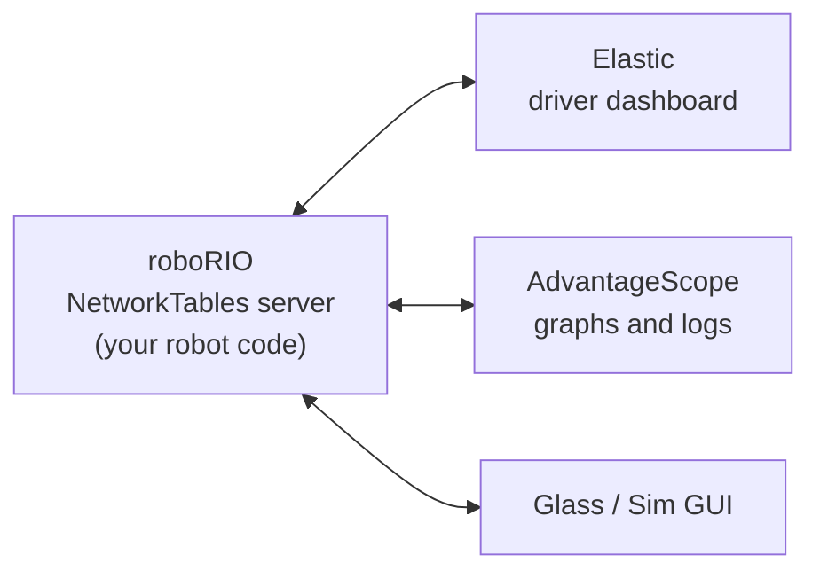

# 6.1 Dashboards: NetworkTables and Elastic

## Why it matters
Your robot code runs 50 times a second on a computer with no screen. To see what it's doing (sensor readings, targets, motor outputs, which command is running), you send values to a **dashboard** on the laptop. To tune it, you send numbers back the other way.

Both directions go through **NetworkTables**, WPILib's system for sharing data between the robot and the laptop. This course uses:

- **NetworkTables 4 publishers** in robot code, to send values
- **Elastic**, a drag-and-drop dashboard that comes with WPILib, to see and change them

!!! warning "Why this course doesn't use `SmartDashboard.putNumber`"
    Older code (and a lot of examples online) sends values with `SmartDashboard.putNumber(...)`. That still works in 2026, but it's on its way out:

    - The **SmartDashboard and Shuffleboard apps** are removed in WPILib 2027. WPILib's advice is to use **Elastic** as the driver dashboard and **AdvantageScope** for debugging.
    - In the 2027 previews, the **`SmartDashboard` class itself** is replaced by new **Telemetry** and **Tunables** APIs, and `SendableChooser` is replaced by **`Selectable`**.
    - **`SendableChooser`** only reaches the dashboard through `SmartDashboard.putData`, so this course uses `Selectable` instead.
    - **NetworkTables 4 stays.** The new 2027 APIs are built on top of it.

    So this course uses a small **2026 copy of the 2027 Telemetry and Tunables APIs**. The code you write now already looks like 2027 code.

## Read this
- [What is NetworkTables](https://docs.wpilib.org/en/stable/docs/software/networktables/networktables-intro.html)
- [Publishing and Subscribing to a Topic](https://docs.wpilib.org/en/stable/docs/software/networktables/publish-and-subscribe.html)
- [Elastic (WPILib docs)](https://docs.wpilib.org/en/stable/docs/software/dashboards/elastic.html) and the [Elastic documentation](https://frc-elastic.gitbook.io/docs)
- [Removed features in 2027](https://docs.wpilib.org/en/latest/docs/yearly-overview/removed-features.html)

## Walkthrough

### How NetworkTables works
The roboRIO runs a NetworkTables **server**. Dashboards and tools on the laptop connect to it as **clients**. Any of them can send values, and all of them see the same values.



Each value lives on a **topic**. A topic has a name that looks like a file path, and a fixed type:

| Topic | Type | Example value |
|---|---|---|
| `/Wheel/Position (rot)` | double | `3.42` |
| `/Wheel/At Target` | boolean | `true` |
| `/Elevator/kP` | double | `10.0` |
| `/Auto/selected` | string | `"Square"` |

The part before the last `/` is the **table**, like a folder. Group each subsystem's values in its own table, and put the units in the name so nobody has to guess.

Code doesn't write to a topic directly. It creates a **publisher** to send values, or a **subscriber** to read them:

| Object | Direction | Used for |
|---|---|---|
| **Publisher** (`DoublePublisher`, `BooleanPublisher`, ...) | Robot → dashboard | Showing sensor readings, targets, outputs |
| **Subscriber** (`DoubleSubscriber`, ...) | Dashboard → robot | Reading a value someone else sets |
| **Entry** (`DoubleEntry`, ...) | Both | A tunable number: the robot sets a starting value, and you change it from the dashboard |

### Publishing a value
```java
import edu.wpi.first.networktables.DoublePublisher;
import edu.wpi.first.networktables.NetworkTable;
import edu.wpi.first.networktables.NetworkTableInstance;

public class Arm extends SubsystemBase {
    // The "Arm" table, like a folder on the dashboard
    private final NetworkTable table = NetworkTableInstance.getDefault().getTable("Arm");

    // Create each publisher ONCE, and keep it in a field
    private final DoublePublisher anglePub = table.getDoubleTopic("Angle (deg)").publish();

    @Override
    public void periodic() {
        anglePub.set(getAngleDegrees());   // send the newest value, every loop
    }
}
```

| Line | What it does |
|---|---|
| `NetworkTableInstance.getDefault()` | The robot's NetworkTables. You'll almost never need any other. |
| `.getTable("Arm")` | The **Arm** table. Every topic in it starts with `/Arm/`. |
| `.getDoubleTopic("Angle (deg)")` | The topic `/Arm/Angle (deg)`, which holds a `double` |
| `.publish()` | Starts publishing. Keep the publisher in a field: publishing stops if it's closed. |
| `anglePub.set(...)` | Sends a new value. Call it every loop in `periodic()`. |

!!! warning "Make publishers once, set them every loop"
    Create publishers as fields (or in the constructor), not inside `periodic()`. Creating a new one 50 times a second wastes memory and time.

### Reading a value: tunable numbers
To change a number from the dashboard while the robot runs, use an **entry**: it publishes a starting value and also reads back whatever the dashboard writes.

```java
import edu.wpi.first.networktables.DoubleEntry;

private final DoubleEntry kP = table.getDoubleTopic("kP").getEntry(ArmConstants.kP);

public Arm() {
    kP.set(ArmConstants.kP);   // put the starting value on the dashboard
}

@Override
public void periodic() {
    pid.setP(kP.get());        // use whatever is on the dashboard right now
}
```

When the robot restarts, the value goes back to `ArmConstants.kP`. **Dashboard edits are not saved.** When you find a good number, copy it into `Constants.java`.

### The course's telemetry library: 2027's API, today
Writing a separate publisher field for every value gets long. WPILib 2027 fixes that with two new APIs, **Telemetry** (for sending values) and **Tunables** (for numbers and menus you change from the dashboard). They're built on NetworkTables 4.

This course uses a small **2026 copy** of those APIs, in a folder called [`telemetry`](https://github.com/Robojacks/frc-course/tree/main/library/telemetry). It has the **same class names, the same method names, and publishes to the same places** in NetworkTables as WPILib 2027. So the code you write now is already 2027 code: when the team moves to 2027, you delete the folder and change the imports.

You don't type it in. In [Lab 1.1](../testbed/lab1b-dashboard.md) you'll copy the folder into your project.

| Class | What it's for | Example |
|---|---|---|
| `Telemetry` | Where you start: get a table, or log a one-off value | `Telemetry.getTable("Arm")` |
| `TelemetryTable` | One folder of values, usually one per subsystem | `telemetry.log("Angle (deg)", angle)` |
| `Tunables` | Make a number you can change from the dashboard, or publish a menu | `Tunables.addDouble("Arm/kP", 0.05)` |
| `TunableDouble` | A tunable number | `kP.get()` |
| `Selectable` | A dropdown menu, like the auto chooser | `autoChooser.getSelected()` |

**Using it in a subsystem:**

```java
import frc.robot.telemetry.Telemetry;
import frc.robot.telemetry.TelemetryTable;
import frc.robot.telemetry.TunableDouble;
import frc.robot.telemetry.Tunables;

public class Arm extends SubsystemBase {
    // Everything this subsystem sends goes in /Telemetry/Arm
    private final TelemetryTable m_telemetry = Telemetry.getTable("Arm");

    // A gain you can change in Elastic, at /Tunables/Arm/kP. Starts at the value in Constants.
    private final TunableDouble m_kP = Tunables.addDouble("Arm/kP", ArmConstants.kP);

    @Override
    public void periodic() {
        m_telemetry.log("Angle (deg)", getAngleDegrees());
        m_telemetry.log("Target (deg)", m_targetDegrees);
        m_telemetry.log("Output (V)", m_lastVolts);
        m_telemetry.log("At Target", atTarget());

        m_pid.setP(m_kP.get());   // use whatever kP is on the dashboard right now
    }
}
```

| Line | What it does |
|---|---|
| `Telemetry.getTable("Arm")` | The **Arm** folder, inside `/Telemetry`. Keep it in a field. |
| `m_telemetry.log(name, value)` | Sends a value: a number, `true`/`false`, or text. Call it every loop. |
| `Tunables.addDouble("Arm/kP", ...)` | Makes a tunable number at `/Tunables/Arm/kP`. Call it once, in a field. |
| `m_kP.get()` | The number on the dashboard right now |

**What's inside `log`?** The same publishers you just learned, made once and kept in a `Map` (a lookup table from each name to its publisher):

```java
public void log(String name, double value) {
    // The first call for a name creates its publisher; every later call reuses it
    m_numbers.computeIfAbsent(name, n -> kNT.getDoubleTopic(topic(n)).publish()).set(value);
}
```

`computeIfAbsent` means "find the publisher for this name; if there isn't one yet, make it with this code and remember it." Read the [full source](https://github.com/Robojacks/frc-course/tree/main/library/telemetry): every line is commented.

**Structured values.** `log` also takes WPILib types like `Pose2d`, and sends them as **structs**, which AdvantageScope can draw on a field:

```java
m_telemetry.log("Pose", m_odometry.getPoseMeters());
```

A **list** of structs needs its serializer passed in, like the four module states of a swerve drive ([Lesson 21.1](../going-further/21b-swerve-maxswerve.md)):

```java
m_telemetry.log("Measured States", moduleStates, SwerveModuleState.struct);
```

**Tunable numbers reset.** A tunable goes back to its starting value every time the robot code starts. **Dashboard edits are not saved.** When you find a good number, copy it into `Constants.java`.

### A dropdown menu: `Selectable`
The drive team picks an autonomous routine from a dropdown on the dashboard before each match. Older code does this with `SendableChooser` and `SmartDashboard.putData`. In 2027 that becomes **`Selectable`**, and the course library has it now:

```java
private final Selectable<Command> m_autoChooser = new Selectable<>();

public RobotContainer() {
    m_autoChooser.addDefault("Do nothing", Commands.none());
    m_autoChooser.add("Drive forward", driveForwardAuto());
    m_autoChooser.add("Square", squareAuto());
    Tunables.publish("Auto", m_autoChooser);   // shows up as /Tunables/Auto
}

public Command getAutonomousCommand() {
    return m_autoChooser.getSelected();
}
```

A menu is just a few topics in one table. Elastic reads them and shows a **ComboBox Chooser**:

| Topic | Who writes it | What it holds |
|---|---|---|
| `.type` | Robot | `"String Chooser"`, which tells Elastic to show a dropdown |
| `options` | Robot | Every option's name, in order |
| `default` | Robot | The option used if nobody picks |
| `selected` | **Dashboard** | The option the drive team picked |
| `active` | Robot | The option the robot will really use, so the dashboard can confirm it |

`Selectable<Command>` is a **generic** class: the part in `< >` is the type of thing in the menu.

!!! tip "Add every option in the constructor"
    Add all the options in `RobotContainer`'s constructor, before the robot is enabled, then publish the menu.

### What to send
For any mechanism, send these four kinds of values. With them, you can usually tell in seconds whether a problem is the sensor, the code, or the hardware ([Lesson 9](09-debugging.md)):

| Value | Why |
|---|---|
| The sensor reading (position, velocity) | Is the sensor working and pointing the right way? |
| The target | Is the code asking for what you think? |
| The output (percent or volts) | Is the code actually commanding the motor? |
| State (at target, has piece, at limit) | Do your conditions flip when they should? |

### Elastic
**Elastic** is a dashboard made by Team 353, installed with WPILib. It's built for the driver station at competition, but it's just as good for testing.

**Open it:** in VS Code, press ++ctrl+shift+p++, run **WPILib: Start Tool**, and choose **Elastic**.

**Connect it:** click the **gear** (settings) and pick the IP address mode:

| Mode | Use it when |
|---|---|
| **Driver Station** | Connected to a real robot. Elastic gets the address from the Driver Station, so open the Driver Station first. |
| **localhost** | Running **simulation** on your own laptop |
| **Team Number** or **roboRIO mDNS** | Connecting without the Driver Station (these don't work in simulation) |

The bar at the bottom of Elastic shows **Network Tables: Disconnected** in red until it connects, then turns green and shows the robot's address. While it's disconnected, every widget is grayed out.

**Add widgets:** open Elastic's list of topics. Values you log are under **Telemetry**, in a folder for each subsystem (like **Telemetry → Wheel**); tunable numbers and menus are under **Tunables**. Drag a value onto the grid. Drag widgets to move them and drag their corners to resize. You can make several **tabs**, for example one for driving and one for each mechanism you're testing.

| Widget | Shows | Can change the value? |
|---|---|---|
| **Text Display** | A number, boolean, or text | Yes. Edit it to send a new value. In its settings, turn on the submit button if you want one. |
| **Graph** | A number over time | No |
| **Number Bar** | A number as a bar | No |
| **Number Slider** | A number on a slider | Yes, by dragging |
| **Boolean Box** | A color for true or false | No |
| **Toggle Switch** / **Toggle Button** | A boolean | Yes, by clicking |
| **ComboBox Chooser** | An autonomous chooser (`Selectable`) | Yes, by picking an option |

**Save your layout.** Elastic remembers the layout you build. To keep a copy for the team, export it from Elastic's file menu into your robot project and commit the file to Git.

!!! tip "Graph your target and your measurement together"
    Put the target and the sensor reading on **one Graph** widget. When you tune a controller in [Lesson 12](../controls/12-pid.md), the gap between the two lines is the error, and you can see overshoot and oscillation at a glance.

### What still uses `SmartDashboard.putData` in 2026
Some WPILib objects aren't single numbers. They're **Sendables**: the command scheduler, a `Field2d`, a `Mechanism2d`. In 2026, the way to put these on the dashboard is still `SmartDashboard.putData`. It sends them through NetworkTables 4 (under `/SmartDashboard/`), and Elastic shows them with special widgets.

```java
SmartDashboard.putData(CommandScheduler.getInstance());   // the running commands
SmartDashboard.putData("Arm/Mechanism", mech);            // a Mechanism2d drawing
```

This course uses `SmartDashboard` **only** for these. Plain values always go through `Telemetry`, tunable numbers through `Tunables`, and the auto chooser uses `Selectable`.

### Logging comes free
Once you call `DataLogManager.start()` in `Robot`'s constructor, everything you publish to NetworkTables is also **recorded** to a log file on the roboRIO. After a match, open the log in **AdvantageScope** and replay every value ([Lesson 9](09-debugging.md)).

### Moving to 2027
Because the course library copies WPILib 2027's API, moving to 2027 is short:

1. Delete the `telemetry` folder from the project.
2. Change each `import frc.robot.telemetry...` line to WPILib's import for the same class. VS Code's lightbulb can do it for you.
3. Build. The class names and method calls stay the same.

Telemetry and tunable numbers are published to the same paths in 2027 (`/Telemetry/...` and `/Tunables/...`), so most Elastic widgets keep working. In 2027 the auto chooser gets a new type of table, so you may need to drag it onto your layout again.

| 2026 (this course) | 2027 |
|---|---|
| `Telemetry.getTable("Wheel")`, `table.log(...)` | Same |
| `Tunables.addDouble("Wheel/kP", 1.0)`, `kP.get()` | Same |
| `new Selectable<>()`, `Tunables.publish("Auto", chooser)` | Same |
| `SmartDashboard.putData("Field", field)` once | `Telemetry.log("Field", field)` every loop |

The 2027 APIs were still in preview when this was written, so check WPILib's documentation for the final details: the [Telemetry design document](https://github.com/wpilibsuite/allwpilib/blob/main/telemetry/doc/telemetry.md) and the [Tunables design document](https://github.com/wpilibsuite/allwpilib/blob/main/tunables/doc/tunables.md).

## Try it
In simulation (no robot needed):

- [ ] Copy the [`telemetry` folder](https://github.com/Robojacks/frc-course/tree/main/library/telemetry) into a project. In `robotPeriodic()`, log `Timer.getFPGATimestamp()` with `Telemetry.log("Robot/Time (s)", ...)`.
- [ ] Run **WPILib: Simulate Robot Code**, open Elastic, set it to **localhost**, and find **Telemetry → Robot → Time (s)**. Show it as a Text Display, then as a Graph.
- [ ] Add a tunable with `Tunables.addDouble("Robot/Multiplier", 1.0)`, and log the time times the multiplier. Change the multiplier in Elastic and watch the logged value change.
- [ ] Restart the simulation. What happens to the multiplier you set?
- [ ] Build a tab with your values, save the layout, and export it.

## Check yourself
??? question "What's the difference between a publisher and a subscriber?"
    A publisher sends values from your code to NetworkTables. A subscriber reads values that something else (like the dashboard) put there.

??? question "Why create publishers once, in a field, instead of inside `periodic()`?"
    `periodic()` runs 50 times a second. Making a new publisher every time wastes memory and time; making it once and calling `set()` every loop is cheap.

??? question "You changed kP in Elastic and found a great value. Then the robot rebooted and it's gone. Why, and what should you do?"
    Tunables start at their default every time the code starts. Copy the value into `Constants.java` and deploy.

??? question "Elastic says \"Network Tables: Disconnected\" while you're running simulation. What should you check?"
    That the IP address mode is set to **localhost**, and that the simulation is actually running.

??? question "Why does this course use `Selectable` instead of `SendableChooser`?"
    `SendableChooser` only reaches the dashboard through `SmartDashboard.putData`, which is going away. `Selectable` is the 2027 replacement; the course library has a 2026 copy that sends the same menu over NetworkTables 4.

??? question "Where does `Telemetry.getTable(\"Wheel\").log(\"Position (rot)\", x)` show up in NetworkTables?"
    At `/Telemetry/Wheel/Position (rot)`. In Elastic, open **Telemetry**, then **Wheel**.

??? question "What do you have to change in your code when the team moves to WPILib 2027?"
    Delete the course's `telemetry` folder and change the imports to WPILib's. The class and method names stay the same.

??? question "In a `Selectable` menu, who writes `selected`, and who writes `active`?"
    The dashboard writes `selected` when the drive team picks. The robot writes `active`: the option it will really use.

??? question "What happens to the SmartDashboard and Shuffleboard apps in 2027?"
    They're removed. WPILib recommends Elastic for the driver dashboard and AdvantageScope for debugging.
