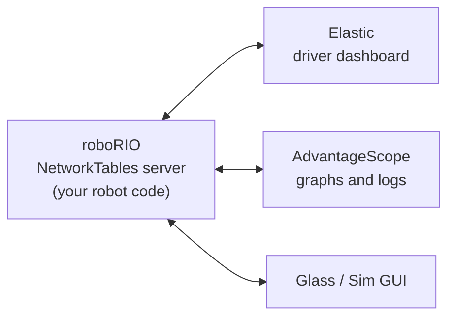

# 6.1 Dashboards: NetworkTables and Elastic

## Why it matters
Your robot code runs 50 times a second on a computer with no screen. To see what it's doing (sensor readings, targets, motor outputs, which command is running), you send values to a **dashboard** on the laptop. To tune it, you send numbers back the other way.

Both directions go through **NetworkTables**, WPILib's system for sharing data between the robot and the laptop. This course uses:

- **NetworkTables 4 publishers** in robot code, to send values
- **Elastic**, a drag-and-drop dashboard that comes with WPILib, to see and change them

!!! warning "Why this course doesn't use `SmartDashboard.putNumber`"
    Older code (and a lot of examples online) sends values with `SmartDashboard.putNumber(...)`. That still works in 2026, but it's on its way out:

    - The **SmartDashboard and Shuffleboard apps** are removed in WPILib 2027. WPILib's advice is to use **Elastic** as the driver dashboard and **AdvantageScope** for debugging.
    - In the 2027 previews, the **`SmartDashboard` class itself** is replaced by new **Telemetry** and **Tunables** APIs, and `SendableChooser` is replaced by **`Selectable`**.
    - **`SendableChooser`** only reaches the dashboard through `SmartDashboard.putData`, so this course uses its own NetworkTables chooser, `DashChooser`, instead.
    - **NetworkTables 4 stays.** The new 2027 APIs are built on top of it.

    So this course writes **2026** code with NetworkTables 4 directly, in a way that maps one-to-one onto the 2027 APIs. The end of this lesson shows exactly how.

## Read this
- [What is NetworkTables](https://docs.wpilib.org/en/stable/docs/software/networktables/networktables-intro.html)
- [Publishing and Subscribing to a Topic](https://docs.wpilib.org/en/stable/docs/software/networktables/publish-and-subscribe.html)
- [Elastic (WPILib docs)](https://docs.wpilib.org/en/stable/docs/software/dashboards/elastic.html) and the [Elastic documentation](https://frc-elastic.gitbook.io/docs)
- [Removed features in 2027](https://docs.wpilib.org/en/latest/docs/yearly-overview/removed-features.html)

## Walkthrough

### How NetworkTables works
The roboRIO runs a NetworkTables **server**. Dashboards and tools on the laptop connect to it as **clients**. Any of them can send values, and all of them see the same values.



Each value lives on a **topic**. A topic has a name that looks like a file path, and a fixed type:

| Topic | Type | Example value |
|---|---|---|
| `/Wheel/Position (rot)` | double | `3.42` |
| `/Wheel/At Target` | boolean | `true` |
| `/Elevator/kP` | double | `10.0` |
| `/Auto/selected` | string | `"Square"` |

The part before the last `/` is the **table**, like a folder. Group each subsystem's values in its own table, and put the units in the name so nobody has to guess.

Code doesn't write to a topic directly. It creates a **publisher** to send values, or a **subscriber** to read them:

| Object | Direction | Used for |
|---|---|---|
| **Publisher** (`DoublePublisher`, `BooleanPublisher`, ...) | Robot → dashboard | Showing sensor readings, targets, outputs |
| **Subscriber** (`DoubleSubscriber`, ...) | Dashboard → robot | Reading a value someone else sets |
| **Entry** (`DoubleEntry`, ...) | Both | A tunable number: the robot sets a starting value, and you change it from the dashboard |

### Publishing a value
```java
import edu.wpi.first.networktables.DoublePublisher;
import edu.wpi.first.networktables.NetworkTable;
import edu.wpi.first.networktables.NetworkTableInstance;

public class Arm extends SubsystemBase {
    // The "Arm" table, like a folder on the dashboard
    private final NetworkTable table = NetworkTableInstance.getDefault().getTable("Arm");

    // Create each publisher ONCE, and keep it in a field
    private final DoublePublisher anglePub = table.getDoubleTopic("Angle (deg)").publish();

    @Override
    public void periodic() {
        anglePub.set(getAngleDegrees());   // send the newest value, every loop
    }
}
```

| Line | What it does |
|---|---|
| `NetworkTableInstance.getDefault()` | The robot's NetworkTables. You'll almost never need any other. |
| `.getTable("Arm")` | The **Arm** table. Every topic in it starts with `/Arm/`. |
| `.getDoubleTopic("Angle (deg)")` | The topic `/Arm/Angle (deg)`, which holds a `double` |
| `.publish()` | Starts publishing. Keep the publisher in a field: publishing stops if it's closed. |
| `anglePub.set(...)` | Sends a new value. Call it every loop in `periodic()`. |

!!! warning "Make publishers once, set them every loop"
    Create publishers as fields (or in the constructor), not inside `periodic()`. Creating a new one 50 times a second wastes memory and time.

### Reading a value: tunable numbers
To change a number from the dashboard while the robot runs, use an **entry**: it publishes a starting value and also reads back whatever the dashboard writes.

```java
import edu.wpi.first.networktables.DoubleEntry;

private final DoubleEntry kP = table.getDoubleTopic("kP").getEntry(ArmConstants.kP);

public Arm() {
    kP.set(ArmConstants.kP);   // put the starting value on the dashboard
}

@Override
public void periodic() {
    pid.setP(kP.get());        // use whatever is on the dashboard right now
}
```

When the robot restarts, the value goes back to `ArmConstants.kP`. **Dashboard edits are not saved.** When you find a good number, copy it into `Constants.java`.

### A helper: `DashTable`
Writing a field for every single value gets long. The labs use a small helper class, `DashTable`, that makes and keeps the publishers for you. You'll add it to the TestBed project in [Lab 1.1](../testbed/lab1b-dashboard.md).

```java
package frc.robot;

import java.util.HashMap;
import java.util.Map;
import java.util.function.DoubleSupplier;

import edu.wpi.first.networktables.BooleanPublisher;
import edu.wpi.first.networktables.DoubleEntry;
import edu.wpi.first.networktables.DoublePublisher;
import edu.wpi.first.networktables.NetworkTable;
import edu.wpi.first.networktables.NetworkTableInstance;
import edu.wpi.first.networktables.StringPublisher;

/**
 * One folder ("table") of values on the dashboard, sent with NetworkTables 4.
 *
 * <p>Each subsystem makes its own DashTable, named after the subsystem. Every value it logs
 * shows up in Elastic inside that folder. For example:
 *
 * <pre>
 *   DashTable dash = new DashTable("Wheel");
 *   dash.log("Position (rot)", 3.4);   // shows up in Elastic as /Wheel/Position (rot)
 * </pre>
 *
 * <p>In WPILib 2027, this class is replaced by the built-in Telemetry and Tunables APIs:
 * {@code new DashTable("Wheel")} becomes {@code Telemetry.getTable("Wheel")}, and
 * {@code tunable(...)} becomes {@code Tunables.addDouble(...)}.
 */
public class DashTable {
  // The NetworkTables folder this DashTable writes into, like /Wheel
  private final NetworkTable m_table;

  // One publisher per value, remembered by name so it's only created once.
  // A Map is a lookup table: give it a key (the value's name), get back its publisher.
  private final Map<String, DoublePublisher> m_numbers = new HashMap<>();
  private final Map<String, BooleanPublisher> m_booleans = new HashMap<>();
  private final Map<String, StringPublisher> m_strings = new HashMap<>();

  // Tunable numbers use entries, which can both send a value AND read back changes from the dashboard
  private final Map<String, DoubleEntry> m_tunables = new HashMap<>();

  /**
   * Creates a folder of dashboard values.
   *
   * @param tableName the folder's name in Elastic, usually the subsystem's name (like "Wheel")
   */
  public DashTable(String tableName) {
    // getDefault() is the robot's one NetworkTables instance; getTable() picks the folder
    m_table = NetworkTableInstance.getDefault().getTable(tableName);
  }

  /**
   * Sends a number to the dashboard. Call it every loop (for example, in periodic()).
   *
   * @param key the value's name in Elastic. Put units in it, like "Height (m)".
   * @param value the number to show
   */
  public void log(String key, double value) {
    // computeIfAbsent: "find the publisher for this key; if there isn't one yet, make it
    // with this code and remember it." So the first call creates the publisher,
    // and every later call just reuses it and sends the new value.
    m_numbers.computeIfAbsent(key, k -> m_table.getDoubleTopic(k).publish()).set(value);
  }

  /**
   * Sends true or false to the dashboard. Show it as a Boolean Box in Elastic.
   *
   * @param key the value's name in Elastic, like "At Goal"
   * @param value true or false
   */
  public void log(String key, boolean value) {
    // Same pattern as the number version, with a BooleanPublisher
    m_booleans.computeIfAbsent(key, k -> m_table.getBooleanTopic(k).publish()).set(value);
  }

  /**
   * Sends text to the dashboard. Show it as a Text Display in Elastic.
   *
   * @param key the value's name in Elastic, like "Command"
   * @param value the text to show
   */
  public void log(String key, String value) {
    // Same pattern again, with a StringPublisher
    m_strings.computeIfAbsent(key, k -> m_table.getStringTopic(k).publish()).set(value);
  }

  /**
   * Makes a number you can change from the dashboard while the robot runs, like a PID gain.
   *
   * <p>Call this ONCE, when you create a field, and keep what it returns. Then call
   * {@code getAsDouble()} on it whenever you need the current value.
   *
   * <p>The number goes back to defaultValue every time the robot code starts, so dashboard
   * changes are NOT saved. When you find a good value, copy it into Constants.java.
   *
   * @param key the number's name in Elastic, like "kP"
   * @param defaultValue the starting value, usually from Constants
   * @return something you can ask for the current value at any time, with getAsDouble()
   */
  public DoubleSupplier tunable(String key, double defaultValue) {
    DoubleEntry entry = m_tunables.computeIfAbsent(key, k -> {
      // An entry is a publisher and a subscriber in one: it sends values and reads changes
      DoubleEntry newEntry = m_table.getDoubleTopic(k).getEntry(defaultValue);
      newEntry.set(defaultValue);   // put the starting value on the dashboard
      return newEntry;
    });
    // entry::get is a method reference: "call entry.get() whenever someone asks for the value"
    return entry::get;
  }
}
```

| Code | What it means |
|---|---|
| `Map<String, DoublePublisher>` | A lookup table from each name to its publisher |
| `computeIfAbsent(key, k -> ...)` | "Get the publisher for this name. If there isn't one yet, make it with this code and remember it." |
| Three `log` methods with the same name | **Overloading**: Java picks the right one by the type you pass in |
| `DoubleSupplier` and `entry::get` | `tunable` hands back something you can ask for the current value, any time, with `.getAsDouble()` |

Using it in a subsystem:

```java
private final DashTable m_dash = new DashTable("Arm");
private final DoubleSupplier m_kP = m_dash.tunable("kP", ArmConstants.kP);

@Override
public void periodic() {
    m_dash.log("Angle (deg)", getAngleDegrees());
    m_dash.log("Target (deg)", m_targetDegrees);
    m_dash.log("Output (V)", m_lastVolts);
    m_dash.log("At Target", atTarget());
    m_pid.setP(m_kP.getAsDouble());
}
```

### A dropdown menu: `DashChooser`
The drive team picks an autonomous routine from a dropdown on the dashboard before each match. Older code does this with `SendableChooser` and `SmartDashboard.putData`. This course uses a small class of its own, `DashChooser`, that sends the menu straight over NetworkTables 4. Its methods have the same names as WPILib 2027's `Selectable`, so moving to 2027 is a rename.

```java
package frc.robot;

import java.util.EnumSet;
import java.util.LinkedHashMap;
import java.util.Map;

import edu.wpi.first.networktables.NetworkTable;
import edu.wpi.first.networktables.NetworkTableEvent;
import edu.wpi.first.networktables.NetworkTableInstance;
import edu.wpi.first.networktables.StringArrayPublisher;
import edu.wpi.first.networktables.StringPublisher;
import edu.wpi.first.networktables.StringSubscriber;

/**
 * A dropdown menu on the dashboard, sent with NetworkTables 4.
 * Elastic shows it as a ComboBox Chooser. It works like WPILib 2027's Selectable.
 */
public class DashChooser<T> {
  private final Map<String, T> m_options = new LinkedHashMap<>();
  private String m_defaultName = "";

  private final StringPublisher m_type;
  private final StringArrayPublisher m_optionNames;
  private final StringPublisher m_default;
  private final StringPublisher m_active;
  private final StringSubscriber m_selected;

  public DashChooser(String tableName) {
    NetworkTableInstance nt = NetworkTableInstance.getDefault();
    NetworkTable table = nt.getTable(tableName);

    // ".type" tells Elastic which widget to show
    m_type = table.getStringTopic(".type").publish();
    m_type.set("String Chooser");

    m_optionNames = table.getStringArrayTopic("options").publish();
    m_default = table.getStringTopic("default").publish();
    m_active = table.getStringTopic("active").publish();

    // The dashboard writes the drive team's pick to "selected". The robot only reads it.
    m_selected = table.getStringTopic("selected").subscribe("");

    // Whenever the pick changes, report back which option the robot will really use
    nt.addListener(m_selected, EnumSet.of(NetworkTableEvent.Kind.kValueAll),
        event -> m_active.set(selectedName()));
  }

  /** Adds an option and makes it the default: the one used if nobody picks. */
  public void addDefault(String name, T value) {
    m_defaultName = name;
    m_default.set(name);
    add(name, value);
  }

  /** Adds an option to the menu. */
  public void add(String name, T value) {
    m_options.put(name, value);
    m_optionNames.set(m_options.keySet().toArray(new String[0]));
    m_active.set(selectedName());
  }

  /** The value for the option picked on the dashboard, or the default if nothing valid is picked. */
  public T getSelected() {
    return m_options.get(selectedName());
  }

  private String selectedName() {
    String name = m_selected.get();
    return m_options.containsKey(name) ? name : m_defaultName;
  }
}
```

A menu is just a few topics in one table. Elastic reads them and shows a dropdown:

| Topic | Who writes it | What it holds |
|---|---|---|
| `.type` | Robot | `"String Chooser"`, which tells Elastic to show a **ComboBox Chooser** |
| `options` | Robot | Every option's name, in order |
| `default` | Robot | The option used if nobody picks |
| `selected` | **Dashboard** | The option the drive team picked |
| `active` | Robot | The option the robot will really use, so the dashboard can confirm it |

| Code | What it means |
|---|---|
| `DashChooser<T>` | A **generic** class: `T` is the type of thing in the menu. `DashChooser<Command>` holds commands. |
| `LinkedHashMap` | A map that remembers the order you added things, so the menu lists options in that order |
| `nt.addListener(...)` | Runs the code at the end whenever `selected` changes, without waiting for the robot loop |
| `m_options.containsKey(name) ? name : m_defaultName` | If the dashboard's pick isn't a real option (or nothing is picked yet), use the default |

Using it in `RobotContainer`:

```java
private final DashChooser<Command> autoChooser = new DashChooser<>("Auto");

public RobotContainer() {
    autoChooser.addDefault("Do nothing", Commands.none());
    autoChooser.add("Drive forward", driveForwardAuto());
    autoChooser.add("Square", squareAuto());
}

public Command getAutonomousCommand() {
    return autoChooser.getSelected();
}
```

In Elastic, find the **Auto** table and drag it onto your tab. It appears as a **ComboBox Chooser**.

!!! tip "Add every option in the constructor"
    Add all the options in `RobotContainer`'s constructor, before the robot is enabled, and don't add more later.

### What to send
For any mechanism, send these four kinds of values. With them, you can usually tell in seconds whether a problem is the sensor, the code, or the hardware ([Lesson 9](09-debugging.md)):

| Value | Why |
|---|---|
| The sensor reading (position, velocity) | Is the sensor working and pointing the right way? |
| The target | Is the code asking for what you think? |
| The output (percent or volts) | Is the code actually commanding the motor? |
| State (at target, has piece, at limit) | Do your conditions flip when they should? |

### Elastic
**Elastic** is a dashboard made by Team 353, installed with WPILib. It's built for the driver station at competition, but it's just as good for testing.

**Open it:** in VS Code, press ++ctrl+shift+p++, run **WPILib: Start Tool**, and choose **Elastic**.

**Connect it:** click the **gear** (settings) and pick the IP address mode:

| Mode | Use it when |
|---|---|
| **Driver Station** | Connected to a real robot. Elastic gets the address from the Driver Station, so open the Driver Station first. |
| **localhost** | Running **simulation** on your own laptop |
| **Team Number** or **roboRIO mDNS** | Connecting without the Driver Station (these don't work in simulation) |

The bar at the bottom of Elastic shows **Network Tables: Disconnected** in red until it connects, then turns green and shows the robot's address. While it's disconnected, every widget is grayed out.

**Add widgets:** open Elastic's list of topics, find your table (like **Wheel**), and drag a value onto the grid. Drag widgets to move them and drag their corners to resize. You can make several **tabs**, for example one for driving and one for each mechanism you're testing.

| Widget | Shows | Can change the value? |
|---|---|---|
| **Text Display** | A number, boolean, or text | Yes. Edit it to send a new value. In its settings, turn on the submit button if you want one. |
| **Graph** | A number over time | No |
| **Number Bar** | A number as a bar | No |
| **Number Slider** | A number on a slider | Yes, by dragging |
| **Boolean Box** | A color for true or false | No |
| **Toggle Switch** / **Toggle Button** | A boolean | Yes, by clicking |
| **ComboBox Chooser** | An autonomous chooser (`DashChooser`) | Yes, by picking an option |

**Save your layout.** Elastic remembers the layout you build. To keep a copy for the team, export it from Elastic's file menu into your robot project and commit the file to Git.

!!! tip "Graph your target and your measurement together"
    Put the target and the sensor reading on **one Graph** widget. When you tune a controller in [Lesson 12](../controls/12-pid.md), the gap between the two lines is the error, and you can see overshoot and oscillation at a glance.

### What still uses `SmartDashboard.putData` in 2026
Some WPILib objects aren't single numbers. They're **Sendables**: the command scheduler, a `Field2d`, a `Mechanism2d`. In 2026, the way to put these on the dashboard is still `SmartDashboard.putData`. It sends them through NetworkTables 4 (under `/SmartDashboard/`), and Elastic shows them with special widgets.

```java
SmartDashboard.putData(CommandScheduler.getInstance());   // the running commands
SmartDashboard.putData("Arm/Mechanism", mech);            // a Mechanism2d drawing
```

This course uses `SmartDashboard` **only** for these. Plain numbers and booleans always go through `DashTable`, and the auto chooser uses `DashChooser`.

### Logging comes free
Once you call `DataLogManager.start()` in `Robot`'s constructor, everything you publish to NetworkTables is also **recorded** to a log file on the roboRIO. After a match, open the log in **AdvantageScope** and replay every value ([Lesson 9](09-debugging.md)).

### Moving to 2027
When the team moves to WPILib 2027, the changes are mostly renames. The 2027 APIs are still in preview, so the details may change before release:

| 2026 (this course) | 2027 preview |
|---|---|
| `new DashTable("Wheel")` | `Telemetry.getTable("Wheel")` |
| `m_dash.log("Position (rot)", x)` | `table.log("Position (rot)", x)` |
| `m_dash.tunable("kP", 1.0)` and `.getAsDouble()` | `Tunables.addDouble("Wheel/kP", 1.0)` and `.get()` |
| `new DashChooser<Command>("Auto")` | `new Selectable<Command>()`, then `Tunables.publish("Auto", chooser)` |
| `chooser.addDefault(...)`, `chooser.add(...)`, `chooser.getSelected()` | The same three methods on `Selectable` |
| `SmartDashboard.putData("Field", field)` once | `Telemetry.log("Field", field)` every loop |

In 2027, telemetry is published under `/Telemetry/` and tunables under `/Tunables/` by default, so you'll re-drag your Elastic widgets onto the new topics.

## Try it
In simulation (no robot needed):

- [ ] Add `DashTable` to a project. In `robotPeriodic()`, log `Timer.getFPGATimestamp()` as `"Robot/Time (s)"`.
- [ ] Run **WPILib: Simulate Robot Code**, open Elastic, set it to **localhost**, and find **Robot/Time (s)**. Show it as a Text Display, then as a Graph.
- [ ] Add a tunable `"Robot/Multiplier"` starting at 1.0, and log the time times the multiplier. Change the multiplier in Elastic and watch the logged value change.
- [ ] Restart the simulation. What happens to the multiplier you set?
- [ ] Build a tab with your values, save the layout, and export it.

## Check yourself
??? question "What's the difference between a publisher and a subscriber?"
    A publisher sends values from your code to NetworkTables. A subscriber reads values that something else (like the dashboard) put there.

??? question "Why create publishers once, in a field, instead of inside `periodic()`?"
    `periodic()` runs 50 times a second. Making a new publisher every time wastes memory and time; making it once and calling `set()` every loop is cheap.

??? question "You changed kP in Elastic and found a great value. Then the robot rebooted and it's gone. Why, and what should you do?"
    Tunables start at their default every time the code starts. Copy the value into `Constants.java` and deploy.

??? question "Elastic says \"Network Tables: Disconnected\" while you're running simulation. What should you check?"
    That the IP address mode is set to **localhost**, and that the simulation is actually running.

??? question "Why does this course use `DashChooser` instead of `SendableChooser`?"
    `SendableChooser` only reaches the dashboard through `SmartDashboard.putData`, which is going away. `DashChooser` sends the same menu over NetworkTables 4 directly, and its methods match 2027's `Selectable`.

??? question "In a `DashChooser`, who writes `selected`, and who writes `active`?"
    The dashboard writes `selected` when the drive team picks. The robot writes `active`: the option it will really use.

??? question "What happens to the SmartDashboard and Shuffleboard apps in 2027?"
    They're removed. WPILib recommends Elastic for the driver dashboard and AdvantageScope for debugging.
