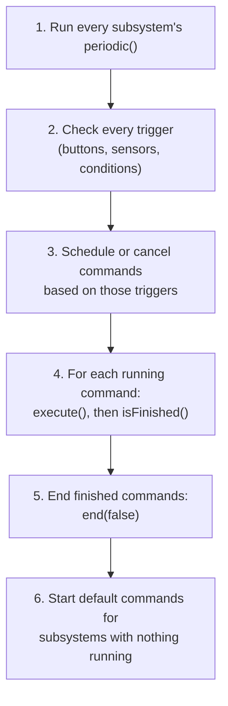
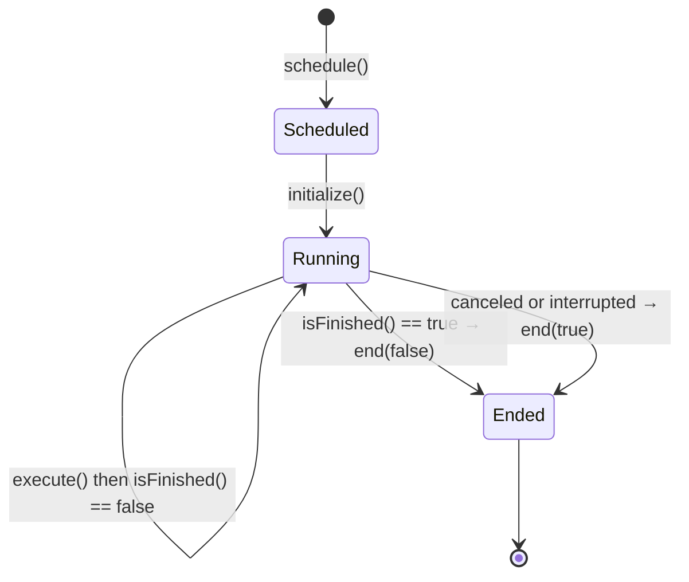

# 7.1 How the Command Scheduler Works

## Why it matters
In [Lesson 7](07-command-based.md) you bound a button to a command and it "just worked." That's the **command scheduler** doing its job. Most confusing command-based bugs come from not knowing what the scheduler does:

- a command that never stops
- a command that stops the moment it starts
- a button that does nothing
- two mechanisms fighting each other

Once you can picture what the scheduler does every 20 ms, you can predict exactly what your robot will do, and debugging gets much easier.

## Read this
- [The Command Scheduler](https://docs.wpilib.org/en/stable/docs/software/commandbased/command-scheduler.html)
- [Commands](https://docs.wpilib.org/en/stable/docs/software/commandbased/commands.html), especially the command lifecycle
- [Binding Commands to Triggers](https://docs.wpilib.org/en/stable/docs/software/commandbased/binding-commands-to-triggers.html)
- [Command Compositions](https://docs.wpilib.org/en/stable/docs/software/commandbased/command-compositions.html)

## Walkthrough

### The scheduler is one object, run once per loop
There is exactly **one** scheduler in your robot program: `CommandScheduler.getInstance()`. It doesn't run on its own. The Command Robot template calls it from `Robot.java`:

```java
@Override
public void robotPeriodic() {
    CommandScheduler.getInstance().run();
}
```

Remember the 20 ms loop from [Lesson 6](06-robot-program.md). Every time `robotPeriodic()` runs, the scheduler gets **one turn**. Everything it does happens inside that turn, on one thread, one step at a time. Nothing happens "in the background."

!!! warning "If you delete that line, nothing works"
    No commands run, no buttons respond, and no subsystem `periodic()` methods are called. The robot code still builds and deploys without errors, which makes this hard to spot.

### What happens in one `run()`
Every 20 ms, the scheduler does these steps, in this order:



Here's the same sequence as drawn in the WPILib docs:


<p class="credit">One run of the scheduler. From the WPILib docs source, <a href="https://github.com/wpilibsuite/frc-docs/blob/stable/source/docs/software/commandbased/diagrams/scheduler-run-sequence.drawio.svg">scheduler-run-sequence.drawio.svg</a> (CC BY 4.0).</p>

1. **Subsystem `periodic()` methods run.** Every registered subsystem gets its `periodic()` called, whether or not a command is using it. This is the place for telemetry and reading sensors.
2. **Triggers are checked.** Every button binding and other trigger you set up in `configureBindings()` is checked: is the A button pressed right now? Was it pressed last loop?
3. **Commands are scheduled or canceled.** If a trigger changed (button just pressed, just released), the scheduler starts or cancels the bound command.
4. **Running commands run.** For each scheduled command, it calls `execute()`, then asks `isFinished()`.
5. **Finished commands end.** Any command that returned `true` from `isFinished()` gets `end(false)` called and is removed.
6. **Default commands start.** Any subsystem that now has **no** command using it gets its default command scheduled.

Then `run()` returns, the loop finishes, and 20 ms later it all happens again.

### The life of a command
Every command has four methods. The scheduler, not you, decides when each one is called.

| Method | When the scheduler calls it | Typical use |
|---|---|---|
| `initialize()` | **Once**, when the command is scheduled | Reset a timer, reset a PID controller, set a target |
| `execute()` | **Every loop** while it's running | Set motor outputs, read sensors |
| `isFinished()` | **Every loop**, right after `execute()` | Return `true` when the job is done |
| `end(boolean interrupted)` | **Once**, when it stops | Stop motors. `interrupted` is `true` if it was canceled instead of finishing |



Here's a command written out longhand so you can see all four:

```java
public class SpinUpShooter extends Command {
    private final Shooter shooter;
    private final double targetRpm;

    public SpinUpShooter(Shooter shooter, double targetRpm) {
        this.shooter = shooter;
        this.targetRpm = targetRpm;
        addRequirements(shooter);   // "I need the shooter" (see below)
    }

    @Override
    public void initialize() {
        shooter.setTarget(targetRpm);          // runs once
    }

    @Override
    public void execute() {
        shooter.runControlLoop();              // runs every 20 ms
    }

    @Override
    public boolean isFinished() {
        return shooter.isAtSpeed();            // checked every 20 ms
    }

    @Override
    public void end(boolean interrupted) {
        if (interrupted) {
            shooter.stop();                    // only stop if we were canceled
        }
    }
}
```

The shortcut factories from Lesson 7 build these same four methods for you:

| Factory | `initialize()` | `execute()` | `isFinished()` | `end()` |
|---|---|---|---|---|
| `runOnce(a)` | `a` | nothing | `true` right away | nothing |
| `run(a)` | nothing | `a` | never finishes | nothing |
| `startEnd(a, b)` | `a` | nothing | never finishes | `b` |
| `runEnd(a, b)` | nothing | `a` | never finishes | `b` |

Most of these never finish on their own. They run until a button release, a timeout, or another command interrupts them. Add `.until(condition)` or `.withTimeout(seconds)` when you want one to stop by itself.

### Requirements: one command per subsystem
A **requirement** is a command saying "I'm using this subsystem." The scheduler enforces a simple rule:

> **Only one running command may require a given subsystem at a time.**

This is what stops two commands from setting the same motor to different speeds in the same loop. Factories made from a subsystem (`intake.run(...)`) require that subsystem automatically. A longhand command calls `addRequirements(...)` in its constructor.

When you schedule a command whose requirements are already in use, the scheduler has to pick one:

- **By default, the new command wins.** The old command is interrupted: its `end(true)` runs, then the new one starts.
- **A command can refuse to be interrupted.** If the running command was built with `.withInterruptBehavior(InterruptionBehavior.kCancelIncoming)`, the **new** command is ignored instead.

Here's how the scheduler decides, as a flowchart:


<p class="credit">What happens when a command is scheduled. From the WPILib docs source, <a href="https://github.com/wpilibsuite/frc-docs/blob/stable/source/docs/software/commandbased/diagrams/scheduler.drawio.svg">scheduler.drawio.svg</a> (CC BY 4.0).</p>

!!! wpilib "From the WPILib docs: What schedule() checks"
    When a command is scheduled, the scheduler:

    1. Checks that the command isn't part of a composition.
    2. Does nothing if the scheduler is disabled, the command is already running, or the robot is disabled and the command isn't allowed to run while disabled.
    3. If the command's requirements are in use:
        * If all the conflicting commands can be interrupted, cancels them.
        * If not, doesn't schedule the new command.
    4. Calls the command's `initialize()`.

    Users **must** call `CommandScheduler.getInstance().run()` from `robotPeriodic()`. If this isn't done, the scheduler never runs, and the command framework won't work. The template already includes this call.

    *Adapted from [The Command Scheduler](https://docs.wpilib.org/en/stable/docs/software/commandbased/command-scheduler.html), CC BY 4.0.*

!!! danger "Forgetting a requirement"
    If a command uses a motor but doesn't require its subsystem, the scheduler can't protect it. Two commands will both run and fight over the motor every loop, and the mechanism twitches or does whichever one ran last. Using the subsystem's own factories avoids this.

### Default commands
A **default command** runs whenever nothing else requires its subsystem. The drivetrain's joystick command from [Lesson 10](../project/10-teleop.md) is the classic example.

- When another command takes the subsystem, the default command is **interrupted**.
- When that command ends, the scheduler **restarts** the default command in step 6 of the same loop.
- A default command must require its own subsystem, and it shouldn't finish on its own. If it finishes, the scheduler just starts it again the next loop.

### How triggers turn button presses into commands
Triggers are checked every loop (step 2). The scheduler remembers whether each one was true **last** loop, so it can tell a press from a hold:

| Binding | Starts the command | Cancels the command |
|---|---|---|
| `onTrue(cmd)` | When the button goes from released to pressed | Never. It runs until it finishes. |
| `whileTrue(cmd)` | When the button is pressed | When the button is released |
| `onFalse(cmd)` | When the button is released | Never |
| `toggleOnTrue(cmd)` | First press | Second press |

Triggers aren't only buttons. Any `BooleanSupplier` can be a trigger:

```java
new Trigger(intake::hasGamePiece)
    .onTrue(leds.flashGreen().withTimeout(1.0));
```

### Walk through it loop by loop
Here's exactly what happens when a driver holds A, which is bound with `driver.a().whileTrue(intake.runIntake())`, while the intake has a default command that holds the rollers still.

| Loop | Driver | What the scheduler does |
|---|---|---|
| 1 | Not pressing A | Intake default command runs its `execute()` |
| 2 | **Presses A** | Trigger sees a new press. `runIntake()` requires the intake, so the default command is interrupted: `end(true)`. `runIntake()` is scheduled: `initialize()` sets rollers to 0.75 |
| 3 to 40 | Holding A | `runIntake()` keeps running. Its `isFinished()` is always false |
| 41 | **Releases A** | Trigger sees the release and cancels `runIntake()`: `end(true)` sets rollers to 0. The intake is free, so the default command starts again |
| 42 | Not pressing A | Default command runs |

The driver held the button for about 40 loops × 20 ms = 0.8 seconds.

### Compositions and the scheduler
When you combine commands, such as `a.andThen(b)`, the scheduler sees **one** command: the composition. It requires every subsystem that `a` or `b` needs, for its whole run. That has two consequences that surprise people:

1. **A sequence holds every subsystem, the whole time.** In `drive.andThen(shoot)`, the shooter is reserved even while the robot is still driving, so the shooter's default command won't run.
2. **A command inside a composition belongs to it.** You can't schedule it separately or put the same command object in two compositions. Build a fresh one each time, which is one reason factory methods that return a new command are the standard pattern.

### Disabled mode
When the robot is disabled, the scheduler still runs every loop, but it **cancels** running commands, and it won't start new ones unless they're marked `.ignoringDisable(true)`. Use that for things that are safe when disabled, like LEDs or resetting a sensor.

### Seeing the scheduler work
**On the dashboard.** Add this to `RobotContainer`, then open Elastic and find **Scheduler** in the **SmartDashboard** table:
```java
SmartDashboard.putData(CommandScheduler.getInstance());
```
It lists every running command, live. The scheduler is a **Sendable**, so in 2026 it still goes on the dashboard with `SmartDashboard.putData` ([Lesson 6.1](06b-dashboards.md#what-still-uses-smartdashboardputdata-in-2026)). You can also put a subsystem on the dashboard (`SmartDashboard.putData(intake)`) to see which command currently owns it.

**In the console.** The scheduler can call your code whenever a command starts, gets interrupted, or finishes:
```java
CommandScheduler.getInstance().onCommandInitialize(
    cmd -> System.out.println("START  " + cmd.getName()));
CommandScheduler.getInstance().onCommandInterrupt(
    cmd -> System.out.println("CANCEL " + cmd.getName()));
CommandScheduler.getInstance().onCommandFinish(
    cmd -> System.out.println("DONE   " + cmd.getName()));
```

Give commands readable names with `.withName("Intake")`.

**Loop overruns.** If the scheduler's turn takes longer than 20 ms, you'll see a *loop overrun* warning that lists how long each step took: each subsystem's `periodic()`, and each command's `execute()`. The slow one is your culprit, usually blocking code (Lesson 6) or slow logging.

### Common scheduler bugs

| Symptom | Likely cause | Fix |
|---|---|---|
| Nothing responds at all | `CommandScheduler.getInstance().run()` missing from `robotPeriodic()` | Put it back |
| Command ends the instant it starts | `isFinished()` is already `true` (sensor already "at target," or `runOnce` used by mistake) | Check the condition. Use `run()` for something that should keep going. |
| Command never ends | `run()`/`startEnd()` with no `until`, timeout, or `whileTrue` binding | Add an end condition |
| Mechanism twitches between two speeds | Two commands use the motor and one doesn't require the subsystem | Add the requirement, or use the subsystem's factories |
| Default command doesn't come back | Another command (often a sequence) still requires the subsystem | Check what's running on the dashboard |
| Error about a command already in a composition | Same command object used twice | Call the factory again to make a new command |
| Command restarts constantly | Scheduling it every loop from `periodic()` | Bind it to a trigger instead |

## Try it
- [ ] Add the three `onCommand...` print hooks and `SmartDashboard.putData(CommandScheduler.getInstance())`
- [ ] In simulation, press and hold your intake button. Match what prints to the loop-by-loop table above.
- [ ] Give the intake a default command that sets the motor to 0. Watch it get interrupted and come back.
- [ ] Change the intake binding from `whileTrue` to `onTrue`. What happens now when you release the button, and why?
- [ ] Write the `SpinUpShooter` command longhand, then rewrite it with `runOnce`, `run`, and `.until()`. Both should behave the same.
- [ ] Break it on purpose: make a command that sets the intake motor **without** requiring the intake, bind it to B, and press A and B together. Explain what you see.

## Check yourself
??? question "In what order does the scheduler do its work each loop?"
    Subsystem `periodic()` methods, then triggers, then scheduling or canceling commands, then `execute()` and `isFinished()` for each running command, then ending finished commands, then starting default commands.

??? question "What's the difference between `end(true)` and `end(false)`?"
    `end(false)` means the command finished on its own because `isFinished()` returned true. `end(true)` means it was interrupted: canceled, its button released, or another command took its subsystem.

??? question "A command is running on the arm. You schedule a different command that also requires the arm. What happens?"
    By default the running command is interrupted (`end(true)`) and the new one starts. If the running command was set to `kCancelIncoming`, the new command is ignored instead.

??? question "Why does `drive.andThen(shoot)` stop the shooter's default command, even while driving?"
    A composition requires every subsystem any of its parts needs, for its whole run. The shooter is reserved from the first loop of the sequence.

??? question "Your intake binding uses `onTrue(intake.runIntake())`. The driver taps A. When does the intake stop?"
    Never on its own. `runIntake()` doesn't finish and `onTrue` doesn't cancel on release, so it runs until something else requires the intake or the robot is disabled.
