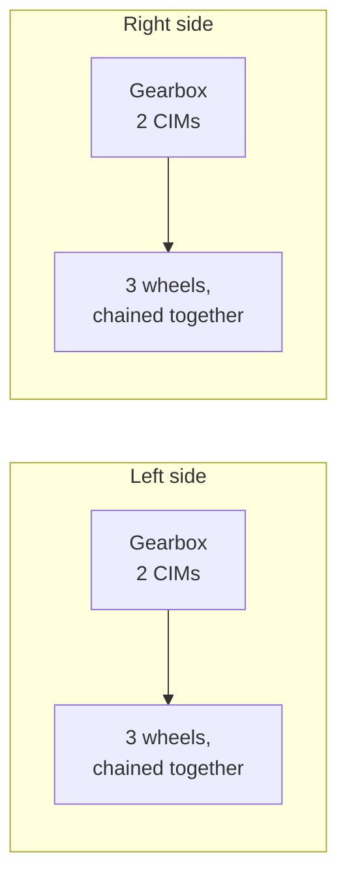

# Lab 2: Drive a West Coast Drive

## Why it matters
In Lab 1 you spun one motor. Now you'll drive a whole robot.

The drivetrain is the most important mechanism on any robot: if it can't drive well, nothing else matters. In this lab you'll program the team's **West Coast Drive (WCD)** so a driver can move it around with an Xbox controller. Along the way you'll learn three ideas every drivetrain uses:

- **Leaders and followers:** several motors acting as one
- **Inversion:** why one side of the robot has to run "backward"
- **Skid steer driving:** each joystick runs one side of the robot, just like the two levers on a skid steer loader

**Before you start:** finish [Lab 1.1](lab1b-dashboard.md). [Lesson 10](../project/10-teleop.md) explains the drive code in more depth; read it before or after.

## Read this
- [Using the WPILib Drive Classes](https://docs.wpilib.org/en/stable/docs/software/hardware-apis/motors/wpi-drive-classes.html)
- [Joysticks](https://docs.wpilib.org/en/stable/docs/software/basic-programming/joystick.html)

## Walkthrough

### What's a West Coast Drive?
A WCD steers like a **skid steer loader**: the left wheels all move together, the right wheels all move together, and there's no steering. To turn, one side drives faster than the other, and the wheels **skid** sideways across the floor. That's where the name *skid steer* comes from.



- Each side has one **gearbox** with two **CIM** motors. Both CIMs turn the same gear, so they must always push in the same direction.
- The middle wheels sit slightly lower ("dropped center"), so the robot rocks onto fewer wheels and turns more easily.

### The hardware

| Part | Details |
|---|---|
| Motors | 4 **CIM** motors, 2 per side. CIMs are **brushed** motors. |
| Motor controllers | 4 SPARK MAXes, one per CIM, on CAN |
| CAN IDs | Left leader **1**, left follower **2**, right leader **3**, right follower **4** (check yours, Step 1) |
| Breakers | 40 A, one per motor |
| Controller | An Xbox controller on the Driver Station laptop |


<p class="credit">The RoboJacks West Coast Drive chassis, before the elevator goes on. Front is at the top of the photo.</p>

Find each of these on the real chassis before you write any code:

| In the photo | What it is |
|---|---|
| Gray box near the top | The **roboRIO**, where your code runs |
| Four black motors in the middle | The **drive motors**, two on each side, each pair driving one gearbox |
| Chains along the left and right edges | Connect each gearbox to that side's three wheels, so all three turn together |
| Black and red board at the bottom | The **Power Distribution Hub**, with one breaker per motor |
| White box labeled **4674-6** | The **radio**: the Driver Station connects to the robot through it |
| Breaker with a red button, bottom right | The **main breaker**: press the red button to turn off all power |
| White box labeled **SPARK MAX** | A **SPARK MAX** motor controller |

Trace the wires from one motor to its SPARK MAX, and from the SPARK MAX to its breaker on the Power Distribution Hub. Knowing which controller drives which motor makes Step 1 much easier.

!!! danger "CIMs are brushed motors"
    Every SPARK MAX in this lab must be set up as `MotorType.kBrushed`. The wrong motor type can damage the motor and the controller. This is the opposite of Lab 1's NEO, so read that line twice.

### New project
The WCD is its own robot with its own roboRIO, so it gets its own project. Repeat [Lab 0](lab0-first-project.md), Parts 2 to 4, but name the project **WestCoastDrive**. Remember to install **REVLib**.

Then copy the **`telemetry`** folder from your **TestBed** project ([Lab 1.1](lab1b-dashboard.md)) into the new project's `frc/robot` folder, next to `Robot.java`. (It's also [on GitHub](https://github.com/Robojacks/frc-course/tree/main/library/telemetry).) Every subsystem uses it to send values to Elastic.

### Step 1: Check the SPARK MAXes
1. Connect each SPARK MAX to your laptop over USB-C and open the **REV Hardware Client**.
2. Write down each one's **CAN ID** and which motor it drives (left front, left back, and so on). Put tape labels on the controllers.
3. Pick one controller on each side as the **leader**. The other is its **follower**.
4. Check that no two SPARK MAXes share an ID. A duplicate makes motors twitch or not respond ([Lesson 4](../hardware/04-electronics.md)).

### Step 2: Constants
Open `Constants.java` and add a class for the drivetrain. Use the CAN IDs you wrote down.

```java
public final class Constants {
  public static class OperatorConstants {
    public static final int kControllerPort = 0;
    public static final double kDeadband = 0.08;   // ignore tiny stick movements
  }

  public static class kDriveConstants {
    public static final int LeftLeaderCanId = 1;
    public static final int LeftFollowerCanId = 2;
    public static final int RightLeaderCanId = 3;
    public static final int RightFollowerCanId = 4;

    public static final int CurrentLimit = 40;     // amps, matches the 40 A breakers
    public static final double MaxOutput = 0.5;    // top speed, 0 to 1. Start slow!
  }
}
```

`MaxOutput` caps the robot at 50% speed. Raise it only after the robot drives correctly.

### Step 3: Leaders and followers
Each side has two motors in one gearbox. Instead of sending every command to both, you send commands to the **leader**, and tell the **follower** to copy it.

| | Leader | Follower |
|---|---|---|
| Your code tells it | The speed to run | Just "follow the leader" |
| What it does | Runs at that speed | Matches the leader's output automatically |

Following happens on the SPARK MAXes themselves, so the code only ever talks to two motors: left leader and right leader.

### Step 4: Why one side is inverted
The left and right gearboxes face **opposite directions**. If you send "forward" to both sides, the left wheels roll forward and the right wheels roll backward, and the robot spins in place.

The fix is to **invert** one side's leader, so "forward" means forward on both. We'll invert the right side. If your robot drives backward or spins when you push forward, you'll invert the other side instead (Step 8).

### Step 5: The drive subsystem
Create `subsystems/DriveSubsystem.java` (right-click `subsystems` → **Create a new class/command** → **Subsystem (New)**). Replace its contents:

```java
package frc.robot.subsystems;

import java.util.function.DoubleSupplier;

import com.revrobotics.PersistMode;
import com.revrobotics.ResetMode;
import com.revrobotics.spark.SparkLowLevel.MotorType;
import com.revrobotics.spark.SparkMax;
import com.revrobotics.spark.config.SparkBaseConfig.IdleMode;
import com.revrobotics.spark.config.SparkMaxConfig;

import edu.wpi.first.wpilibj.RobotController;
import edu.wpi.first.wpilibj.drive.DifferentialDrive;
import edu.wpi.first.wpilibj2.command.Command;
import edu.wpi.first.wpilibj2.command.SubsystemBase;

import frc.robot.Constants.kDriveConstants;
import frc.robot.telemetry.Telemetry;
import frc.robot.telemetry.TelemetryTable;

public class DriveSubsystem extends SubsystemBase {
  // Four SPARK MAXes, all BRUSHED, because CIMs are brushed motors.
  private final SparkMax m_leftLeader =
      new SparkMax(kDriveConstants.LeftLeaderCanId, MotorType.kBrushed);
  private final SparkMax m_leftFollower =
      new SparkMax(kDriveConstants.LeftFollowerCanId, MotorType.kBrushed);
  private final SparkMax m_rightLeader =
      new SparkMax(kDriveConstants.RightLeaderCanId, MotorType.kBrushed);
  private final SparkMax m_rightFollower =
      new SparkMax(kDriveConstants.RightFollowerCanId, MotorType.kBrushed);

  // DifferentialDrive is WPILib's class for any drivetrain with a left side and a right side.
  // We only hand it the two leaders. The followers copy them.
  private final DifferentialDrive m_drive =
      new DifferentialDrive(m_leftLeader::set, m_rightLeader::set);

  // Everything this subsystem sends shows up under "Drive" in Elastic
  private final TelemetryTable m_telemetry = Telemetry.getTable("Drive");

  public DriveSubsystem() {
    // Left leader: normal direction
    SparkMaxConfig leftLeaderConfig = baseConfig();

    // Left follower: copy the left leader
    SparkMaxConfig leftFollowerConfig = baseConfig();
    leftFollowerConfig.follow(kDriveConstants.LeftLeaderCanId);

    // Right leader: inverted, because the right gearbox faces the other way
    SparkMaxConfig rightLeaderConfig = baseConfig();
    rightLeaderConfig.inverted(true);

    // Right follower: copy the right leader
    SparkMaxConfig rightFollowerConfig = baseConfig();
    rightFollowerConfig.follow(kDriveConstants.RightLeaderCanId);

    m_leftLeader.configure(leftLeaderConfig, ResetMode.kResetSafeParameters, PersistMode.kPersistParameters);
    m_leftFollower.configure(leftFollowerConfig, ResetMode.kResetSafeParameters, PersistMode.kPersistParameters);
    m_rightLeader.configure(rightLeaderConfig, ResetMode.kResetSafeParameters, PersistMode.kPersistParameters);
    m_rightFollower.configure(rightFollowerConfig, ResetMode.kResetSafeParameters, PersistMode.kPersistParameters);

    // Cap the top speed while we're learning. Raise this in Constants later.
    m_drive.setMaxOutput(kDriveConstants.MaxOutput);
  }

  /** Settings every drive motor shares. */
  private static SparkMaxConfig baseConfig() {
    SparkMaxConfig config = new SparkMaxConfig();
    config.smartCurrentLimit(kDriveConstants.CurrentLimit);  // protects motors and breakers
    config.idleMode(IdleMode.kBrake);                        // stop quickly when sticks are released
    return config;
  }

  /**
   * Differential drive with two sticks: one value for the left side, one for the right.
   * Suppliers are read every loop, so the robot follows the sticks as they move.
   */
  public Command differentialDriveCommand(DoubleSupplier leftSpeed, DoubleSupplier rightSpeed) {
    return run(() -> m_drive.tankDrive(leftSpeed.getAsDouble(), rightSpeed.getAsDouble()))
        .withName("Differential Drive");
  }

  @Override
  public void periodic() {
    m_telemetry.log("Left Output", m_leftLeader.getAppliedOutput());
    m_telemetry.log("Right Output", m_rightLeader.getAppliedOutput());
    m_telemetry.log("Left Leader Current (A)", m_leftLeader.getOutputCurrent());
    m_telemetry.log("Left Follower Current (A)", m_leftFollower.getOutputCurrent());
    m_telemetry.log("Right Leader Current (A)", m_rightLeader.getOutputCurrent());
    m_telemetry.log("Right Follower Current (A)", m_rightFollower.getOutputCurrent());
    m_telemetry.log("Battery (V)", RobotController.getBatteryVoltage());
  }
}
```

Things to notice:

| Code | What it means |
|---|---|
| `MotorType.kBrushed` | CIMs are brushed. In Lab 1, the NEO was `kBrushless`. |
| `follow(LeftLeaderCanId)` | "Copy whatever the left leader does." |
| `inverted(true)` on the right leader | Flips the right side so forward means forward. The right follower copies the leader, so it flips too. |
| `new DifferentialDrive(m_leftLeader::set, m_rightLeader::set)` | Gives WPILib's drive class a way to set each side. It only needs the leaders. |
| `m_drive.tankDrive(left, right)` | Sends one speed to the left side and one to the right. Each value goes from -1 (full backward) to 1 (full forward). |
| `setMaxOutput(0.5)` | Caps every output at 50% while you're learning |

### Step 6: Skid steer controls
If you've ever run a skid steer loader, you already know how to drive this robot. A skid steer has two levers: the left lever runs the left wheels and the right lever runs the right wheels. Push both forward to go straight, push one further to turn, and push them opposite ways to spin in place.

The Xbox controller's two sticks are the two levers. In code, WPILib calls this kind of drivetrain a **differential drive**, and this control style **tank drive**.

| Stick | Controls |
|---|---|
| **Left stick**, up and down | Left side wheels |
| **Right stick**, up and down | Right side wheels |

| To do this | Push the sticks (like skid steer levers) |
|---|---|
| Drive straight forward | Both forward, the same amount |
| Turn gently right | Left stick a little more than the right |
| Spin in place to the right (a skid steer's "counter-rotate") | Left stick forward, right stick back |
| Stop | Let go of both |

`m_drive.tankDrive(left, right)` sends those two values straight to the two sides. It also **squares** them by default, which gives finer control at low speed: half stick gives about a quarter of full speed ([Lesson 10](../project/10-teleop.md)).

!!! warning "Rename the template's controller first"
    The WPILib template names the controller `m_driverController`, and its port `kDriverControllerPort`. This course calls them **`m_controller`** and **`kControllerPort`**. In VS Code, click on `m_driverController`, press ++f2++ (**Rename Symbol**), and type `m_controller`. Do the same for `kDriverControllerPort` → `kControllerPort`. ++f2++ renames every use at once, so nothing breaks.

Open `RobotContainer.java`. Add the imports and create the subsystem:

```java
import edu.wpi.first.math.MathUtil;
import frc.robot.subsystems.DriveSubsystem;
```

```java
private final DriveSubsystem m_driveSubsystem = new DriveSubsystem();
```

Then set the drive's **default command** in `configureBindings()`:

```java
private void configureBindings() {
  // Left stick drives the left side, right stick drives the right side,
  // whenever no other command is using the drivetrain
  m_driveSubsystem.setDefaultCommand(
      m_driveSubsystem.differentialDriveCommand(
          () -> -MathUtil.applyDeadband(m_controller.getLeftY(), OperatorConstants.kDeadband),
          () -> -MathUtil.applyDeadband(m_controller.getRightY(), OperatorConstants.kDeadband)));
}
```

| Piece | Why |
|---|---|
| `setDefaultCommand` | The drive command runs all the time, unless another command takes over the drivetrain |
| `() -> ...` | A lambda: read the stick **every loop**, not just once ([Lesson 3](../foundations/03-java.md)) |
| `getLeftY()` and `getRightY()` | The up-and-down axis of each stick |
| The minus signs | Xbox sticks report pushing **forward as negative**. WPILib wants forward to be positive. |
| `applyDeadband` | A stick resting in the middle rarely reads exactly 0. Without a deadband, the robot creeps. |

Delete or comment out the template's example subsystem and its auto in `getAutonomousCommand()` if you like; for now, make it return `null` so autonomous does nothing:

```java
public Command getAutonomousCommand() {
  return null;   // no autonomous yet
}
```

### Step 7: First drive, on blocks
!!! danger "Wheels off the ground first"
    The first time new drive code runs, **put the robot on blocks** so all six wheels are off the ground. A drivetrain with a wrong sign can lurch or spin the moment it's enabled.

    Everyone stands clear. One person drives, one person watches the wheels, and the driver keeps a finger near ++enter++ (disable).

1. **Build** and **Deploy**.
2. Plug in the Xbox controller and check it's in slot **0** on the Driver Station USB tab.
3. Say **"Enabling!"** and enable **TeleOperated**.
4. Gently push **one stick at a time**, then both together.

Check every row:

| You do | Should happen | If not |
|---|---|---|
| Nothing (sticks centered) | All wheels still | Raise `kDeadband` a little |
| Left stick forward | **Only the left** three wheels roll forward | See Step 8 |
| Right stick forward | **Only the right** three wheels roll forward | See Step 8 |
| Both sticks forward | **All six wheels** roll forward | See Step 8 |
| Both sticks back | All six wheels roll backward | See Step 8 |
| Left forward, right back | Left wheels forward, right wheels backward | See Step 8 |
| Let go | Everything stops | Check the default command is set |

!!! danger "Listen to the gearboxes"
    If a gearbox **grinds, buzzes, or hums without the wheels turning**, or a breaker trips right away, **disable immediately**. It usually means a leader and follower are pushing against each other in the same gearbox. Check that the follower is set to `follow` the correct leader's CAN ID, and look at the dashboard: a follower drawing current while its side barely moves is the giveaway.

### Step 8: Fixing directions
Change **one thing at a time**, deploy, and test again on blocks.

| What you see | Fix |
|---|---|
| One side rolls **backward** when its stick goes forward | That side's direction is flipped. If it's the right side, remove `inverted(true)` from the right leader. If it's the left, add `inverted(true)` to the left leader. |
| **Both** sides roll backward when both sticks go forward | Move `inverted(true)` from the right leader to the left leader, or check both minus signs |
| The **left stick moves the right wheels** | The left and right CAN IDs are swapped in `Constants`. Swap them back. |
| One side doesn't move at all | That side's leader CAN ID is wrong, or its breaker is tripped |
| A gearbox grinds or a breaker trips | Leader and follower are fighting. Check the `follow` CAN IDs. |

### Step 9: Drive on the floor
Once every row in Step 7 passes on blocks:

1. Put the robot on the floor in a big open space, with nobody in front of it.
2. Keep `MaxOutput` at 0.5.
3. Drive slowly: forward, backward, gentle turns, then a figure eight.
4. Watch Elastic while you drive (put the currents and battery voltage on **Graph** widgets). Look at the **current** on each side when you start moving and when you turn in place.

Spinning in place usually pulls the most current, because the wheels have to skid sideways across the carpet, the same reason a skid steer tears up a lawn when it turns. Watch the **battery voltage** drop while you do it. That's where brownouts come from ([Lesson 4](../hardware/04-electronics.md)).

### Step 10: Commit
```bash
git add .
git commit -m "Lab 2: differential drive on the WCD"
```

!!! example "Finished code"
    Stuck, or missed a lab? [**lab02-west-coast-drive**](https://github.com/Robojacks/frc-course/tree/main/examples/lab02-west-coast-drive) on GitHub is the complete project as it looks at the end of this lab. It's a full WPILib 2026 project you can open in VS Code, build, and deploy. Try to finish the lab yourself first.

## Try it
- [ ] Get every row in the Step 7 table to pass on blocks
- [ ] Drive a figure eight on the floor at 50% max output
- [ ] Add **slow mode**: while the right bumper is held, multiply both stick values by 0.4. (Hint: `m_controller.rightBumper().getAsBoolean()` inside the lambdas.)
- [ ] Drive a straight line across the room. Is it hard to push both sticks exactly the same? What could the code do to help?
- [ ] Change `IdleMode.kBrake` to `IdleMode.kCoast` for all motors. How does stopping feel different? Which would a driver want?
- [ ] Raise `MaxOutput` to 0.75 and watch the battery voltage while turning in place
- [ ] Challenge: some WCDs have **3 CIMs per side**. What would you add to support a third motor on each side?

## Check yourself
??? question "Why are the CIMs set to `kBrushed` when Lab 1's motor was `kBrushless`?"
    CIMs are brushed motors and NEOs are brushless. The SPARK MAX drives them completely differently, and the setting must match the motor.

??? question "What does a follower do, and why do we use them?"
    It copies its leader's output. Both motors in a gearbox must always push together, so the code only commands the leader and the follower matches it automatically.

??? question "Why is one side of the drivetrain inverted?"
    The two gearboxes face opposite directions. Without inverting one side, "forward" on both would spin the robot in place.

??? question "How does a skid steer (or this robot) turn without steering wheels?"
    It runs the left and right sides at different speeds, and the wheels skid sideways. The faster side swings around the slower one. Running them in opposite directions spins the robot in place.

??? question "What does `tankDrive(left, right)` do with the two stick values?"
    It sends the left value to the left side and the right value to the right side, after squaring them for finer control at low speed.

??? question "Why do we negate `getLeftY()` and `getRightY()`?"
    Xbox controllers report pushing a stick forward as a **negative** number, and WPILib expects forward to be positive.

??? question "Why do the stick values go in lambdas (`() -> ...`)?"
    So they're read every loop. A plain number would be read once at startup, and the robot would never respond to the sticks again.

??? question "A gearbox buzzes and gets hot, but the wheels barely turn. What's wrong, and what do you do?"
    Disable immediately. The two motors in that gearbox are pushing against each other, usually because a follower is following the wrong leader or is set to the opposite direction.

??? question "Why put the robot on blocks for the first test?"
    If a direction or sign is wrong, the robot could lurch or spin into someone. On blocks, you can see every wheel's direction safely.
