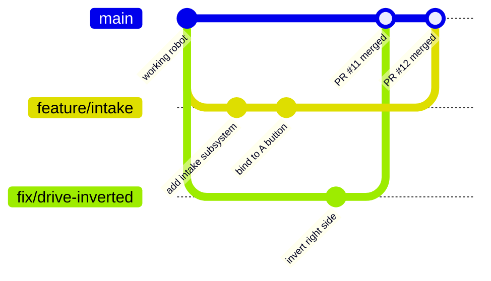

# 15. Branches, PRs & Code Review

## Why it matters
During build season, many programmers write code at once on one robot project. Without a process:

- someone's half-finished arm code breaks the drivetrain the night before competition
- two people rewrite the same file and one person's work disappears
- nobody remembers which version of the code was on the robot when auto worked

**Branches** let everyone work separately without breaking the shared code. **Pull requests** let the team review a change before it joins the main code. Together they keep `main` always working, which is the one rule that matters most.

## Read this
- [About pull requests (GitHub Docs)](https://docs.github.com/en/pull-requests/collaborating-with-pull-requests/proposing-changes-to-your-work-with-pull-requests/about-pull-requests)
- [About branches (GitHub Docs)](https://docs.github.com/en/pull-requests/collaborating-with-pull-requests/proposing-changes-to-your-work-with-pull-requests/about-branches)
- [Git Version Control Introduction (WPILib)](https://docs.wpilib.org/en/stable/docs/software/basic-programming/git-getting-started.html)

## Walkthrough

### The rule: `main` always deploys
At any moment, anyone should be able to pull `main`, deploy it, and get a working robot. So:

- Nobody commits directly to `main`.
- All work happens on a **branch**.
- A branch joins `main` through a **pull request (PR)**, after someone reviews it.



Two people worked at the same time on separate branches, and each change joined `main` only after review.

### What a branch is
A branch is a separate line of commits. When you create one, it starts as a copy of `main`. Your commits go on your branch only, so `main` and everyone else's branches are untouched until you merge.

| Command | What it does |
|---|---|
| `git branch` | List branches. `*` marks the one you're on. |
| `git switch -c feature/arm-pid` | Create a new branch and switch to it |
| `git switch main` | Switch back to `main` |
| `git push -u origin feature/arm-pid` | Upload the branch to GitHub (first time) |
| `git branch -d feature/arm-pid` | Delete a branch after it's merged |

!!! warning "Commit before you switch"
    Switching branches with uncommitted changes either carries them along or refuses to switch. Commit (or `git stash`) first.

### Branch naming
Names should say what the branch is for at a glance:

| Prefix | Use for | Example |
|---|---|---|
| `feature/` | New functionality | `feature/arm-pid` |
| `fix/` | Bug fixes | `fix/intake-inverted` |
| `tune/` | Gain and constant changes | `tune/shooter-ff` |
| `comp/` | Changes made at an event | `comp/week2-auto-tweak` |

### The full workflow
**1. Start from the latest `main`:**
```bash
git switch main
git pull
git switch -c feature/arm-pid
```

**2. Work and commit as you go.** Small commits with clear messages ([Lesson 1](../foundations/01-git.md)).

**3. Keep up with `main`** if your branch lives more than a day or two, so conflicts stay small:
```bash
git switch main
git pull
git switch feature/arm-pid
git merge main
```

**4. Push your branch:**
```bash
git push -u origin feature/arm-pid
```

**5. Open a pull request.** On GitHub, click **Compare & pull request**. Fill in the description and request a reviewer.

**6. Respond to review.** Push more commits to the same branch; the PR updates automatically.

**7. Merge** once it's approved and CI passes ([Lesson 16](16-unit-testing.md)). Then delete the branch.

### Writing a good PR
A reviewer should understand your PR in a minute. Include:

- **What** changed and **why**, in a few sentences
- **How you tested it**: in simulation, on the real robot, or not yet
- **Anything risky**: "this changes every drive constant," "needs retuning on the real robot"

```markdown
## What
Adds PID position control to the arm, with goTo() and hold() commands.

## Why
The arm sagged at the scoring angle with open-loop control.

## Testing
- Tuned in ArmSimulation: settles in under 1 s, no overshoot
- NOT yet tested on the real robot. Gains will need adjustment.
```

Keep PRs **small**. One feature per PR is easy to review and easy to undo. A PR that changes 40 files gets a rubber-stamp review, which defeats the purpose.

### Reviewing someone else's PR
Code review isn't about catching people. It's how the team learns from each other and catches bugs before they reach the robot.

**What to look for:**

- Does it build? Does CI pass?
- Does it do what the description says?
- Are units clear in names? Are magic numbers in `Constants`?
- Do commands require the subsystems they use?
- What happens if a sensor disconnects? Is there a timeout on anything that could run forever?
- Is anything blocking the loop ([Lesson 6](../robot-code/06-robot-program.md))?

**How to comment:**

| ❌ Not helpful | ✅ Helpful |
|---|---|
| "This is wrong." | "This uses degrees, but `ArmFeedforward` expects radians. Should this be `Math.toRadians(angle)`?" |
| "Fix the names." | "Could `getVal()` be `getAngleDegrees()`, so the unit is clear?" |
| "Why?" | "What happens here if the encoder is unplugged?" |

Ask questions, explain your reasoning, and say what's good too. **Approve** when it's ready, or **Request changes** with a clear list of what's needed.

### Tracking work with issues
Use **GitHub Issues** as the team's to-do list:

- One issue per task: "Add slow mode to drivetrain," "Arm overshoots at 90°"
- Assign an owner, so everyone knows who's on it
- Link the PR to its issue by writing `Closes #14` in the PR description. The issue closes automatically when the PR merges.

A **GitHub Project board** with columns like *To do / In progress / In review / Done* gives the whole team a view of build-season progress.

### At competition
Competitions are fast and stressful, but the process still matters, maybe more:

- Make a `comp/` branch for each event. Small fixes go there, reviewed by a second programmer even if the review is 30 seconds long.
- **Tag** the exact code that ran in each match day: `git tag week2-day1` then `git push --tags`. If something breaks, you can always get back to what worked.
- Merge the competition branch back into `main` after the event, so fixes aren't lost.

## Try it
- [ ] Create a branch, make two commits, and push it
- [ ] Open a PR with a description that covers what, why, and how you tested it
- [ ] Review a teammate's PR and leave at least one helpful comment, written as a question
- [ ] Respond to review on your own PR by pushing another commit
- [ ] Merge after approval, then delete the branch
- [ ] Open an issue, then write `Closes #N` in a PR and watch it close on merge

## Check yourself
??? question "Why not commit directly to `main`?"
    `main` must always build and deploy. Unreviewed changes there can break the robot for everyone.

??? question "Your branch has existed for a week and `main` has moved on. What should you do before opening a PR?"
    Merge the latest `main` into your branch and fix any conflicts there, so the PR merges cleanly.

??? question "What makes a PR easy to review?"
    It's small, focused on one change, and explains what changed, why, and how it was tested.

??? question "What's a helpful way to point out a possible bug in review?"
    Explain what you noticed and ask a specific question, like "What happens here if the encoder is unplugged?"

??? question "Why tag the code at competition?"
    So you can always get back to the exact version that ran in a match, even after more changes.
